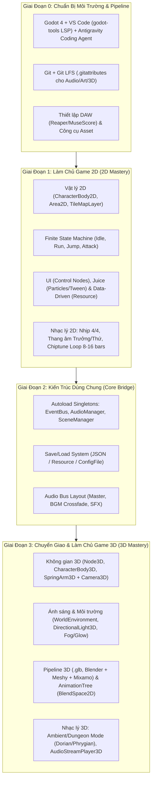

# 🎮 Tổng Quan Dự Án: Học & Phát Triển Game 2D & 3D (Godot 4.x)

> [!TIP] Điều Hướng Hồ Sơ Dự Án (Folder-First Map)
> - 🧭 **Hướng Dẫn & Quy Chuẩn**: [[README]] | [[GEMINI]]
> - 🛠️ **01. Môi Trường & Quy Trình**: [[01. Thiết lập Godot 4, VS Code, LSP & Git LFS]] | [[02. Quy trình Non-Code — Nhạc lý (DAW), SFX & Đồ họa 2D-3D]]
> - 🕹️ **02. Giai Đoạn 1 — Game 2D**: [[01. Vật lý 2D, Điều khiển Nhân vật & State Machine]] | [[02. Giao diện (UI), Hiệu ứng (Juice) & Thiết kế Hướng Dữ Liệu (Data-Driven)]]
> - 🧱 **03. Giai Đoạn 2 — Kiến Trúc Dùng Chung**: [[01. Autoload (Singletons), EventBus, AudioManager & SceneTransition]] | [[02. Hệ thống Save-Load, Quản lý Resource & Đa ngôn ngữ]]
> - 🌐 **04. Giai Đoạn 3 — Game 3D**: [[01. Không gian 3D, Node3D, Camera3D, Ánh sáng & Môi trường]] | [[02. Nhập Mô Hình 3D (.glb), Rigging, AnimationTree & Âm Thanh Không Gian 3D]]
> - 🧪 **05. Kiểm Thử & QA**: [[Hệ thống kiểm thử & Checklist hoàn thành từng mốc]]

---

## 🎯 Mục Tiêu Cốt Lõi & Hệ Sinh Thái Công Cụ

Dự án này được thiết kế để đưa bạn từ nền tảng **Làm chủ Game 2D** $\rightarrow$ **Xây dựng Kiến trúc Cốt lõi Tái sử dụng (Core Bridge)** $\rightarrow$ **Chinh phục Game 3D trên Godot 4.x**, kết hợp toàn diện giữa lập trình cùng AI và tự sáng tạo nghệ thuật (Nhạc lý/OST, SFX, Đồ họa 2D & 3D).

| Hạng Mục | Công Cụ Chính Thức | Vai Trò Trong Quy Trình |
| :--- | :--- | :--- |
| **Game Engine** | **Godot Engine 4.x** (GDScript) | Dựng Scene Tree, Vật lý 2D/3D, AnimationTree, Lighting, Audio Bus, Xuất bản game |
| **Xem Code & AI Agent** | **VS Code** + **Antigravity Coding Agent** | Dùng **Antigravity Coding Agent** để viết code GDScript, đặt log truy vết, giải thích toán/vật lý, refactor; dùng **VS Code** để xem code & debug |
| **VS Code Extensions** | `godot-tools` (geequlim), `Error Lens`, `GitLens`, `Markdown All in One` | Kết nối Language Server (LSP cổng `6005`) trên VS Code, Debug trực tiếp, soi lỗi tức thì |
| **Quản Lý Mã Nguồn** | **Git** + **Git LFS** + **GitLens / GitHub Desktop** | Quản lý code sạch, lưu trữ file đồ họa/âm thanh/3D nặng (`.png`, `.ogg`, `.glb`, `.blend`) |
| **Âm Nhạc (OST/BGM)** | **Reaper / LMMS / MuseScore** | Thực hành nhạc lý từ căn bản đến nâng cao: tự soạn vòng hòa âm, giai điệu & nhạc Loop |
| **SFX & Voice** | **Chiptone / jsfxr** + **ElevenLabs SFX** | Tạo tiếng động va chạm, nhảy, chém, UI click và âm thanh môi trường chân thực |
| **Đồ Họa 2D** | **Kenney.nl** + **PixelLab / Recraft AI** + **Aseprite / Krita** | Prototyping nhanh, tạo Sprite/UI bằng AI và chỉnh sửa hậu kỳ, đóng gói SpriteSheet |
| **Đồ Họa 3D** | **Blender** + **Meshy / Tripo3D** + **Mixamo / Cascadeur** | Dựng môi trường, tạo prop tĩnh bằng AI, gắn xương (Rigging) và làm hoạt ảnh 3D |

---

## 🏷️ Quy Ước 4 Nhãn Phân Vai Công Việc (Task Labels)

Mọi đầu việc (Checklists) trong toàn bộ các tệp chuyên đề đều được gắn **1 trong 4 nhãn bắt buộc** sau để bạn biết ngay việc đó cần mở công cụ nào lên làm:

- **`[Code cùng AI]`**: Giao việc cho **Antigravity Coding Agent** viết GDScript, thiết kế State Machine, viết Custom Resource, xử lý toán học/vector, đặt log debug và mở **VS Code** để xem/kiểm tra code.
- **`[Thao tác trên Godot]`**: Mở **Godot 4 Editor**, lắp ráp Node, kéo thả Scene, vẽ TileMap/GridMap, chỉnh thông số Inspector, nối dây Signal hoặc dựng cây AnimationTree.
- **`[Tự soạn nhạc]`**: Mở **MuseScore / Reaper / LMMS**, áp dụng kiến thức nhạc lý đang học để viết hợp âm, giai điệu (Melody), phối khí đơn giản và xuất file `.ogg` Seamless Loop.
- **`[Tạo Asset]`**: Mở **PixelLab / Recraft / Aseprite** (cho 2D), **Blender / Meshy / Mixamo** (cho 3D), hoặc **Chiptone / ElevenLabs** (cho SFX) để chuẩn bị tài nguyên đưa vào game.

---

## 🗺️ Sơ Đồ Lộ Trình Tổng Thể (Master Roadmap)

---

## 📋 Bảng Theo Dõi Tiến Độ Các Hạng Mục Lớn

| Giai Đoạn | Tệp Tài Liệu Chi Tiết | Sản Phẩm Đầu Ra (Deliverables) | Trạng Thái |
| :--- | :--- | :--- | :---: |
| **00. Môi Trường & Pipeline** | [[01. Thiết lập Godot 4, VS Code, LSP & Git LFS]] [[02. Quy trình Non-Code — Nhạc lý (DAW), SFX & Đồ họa 2D-3D]] | • VS Code kết nối LSP Godot 4 thành công • Repo Git LFS hoạt động chuẩn • Dự án mẫu DAW & bảng màu Aseprite | ⬜ Chưa bắt đầu |
| **01. Làm Chủ Game 2D** | [[01. Vật lý 2D, Điều khiển Nhân vật & State Machine]] [[02. Giao diện (UI), Hiệu ứng (Juice) & Thiết kế Hướng Dữ Liệu (Data-Driven)]] | • Prototype 2D Platformer / Top-down Action hoàn chỉnh • 02 bản BGM 2D (Menu & Stage Loop) • Bộ Sprite nhân vật & UI tự tinh chỉnh | ⬜ Chưa bắt đầu |
| **02. Kiến Trúc Dùng Chung** | [[01. Autoload (Singletons), EventBus, AudioManager & SceneTransition]] [[02. Hệ thống Save-Load, Quản lý Resource & Đa ngôn ngữ]] | • Bộ khung Core Template tái sử dụng cho mọi game 2D/3D • Hệ thống lưu game & cài đặt âm thanh mượt mà | ⬜ Chưa bắt đầu |
| **03. Làm Chủ Game 3D** | [[01. Không gian 3D, Node3D, Camera3D, Ánh sáng & Môi trường]] [[02. Nhập Mô Hình 3D (.glb), Rigging, AnimationTree & Âm Thanh Không Gian 3D]] | • Prototype 3D Third-Person Adventure / Arena • Nhân vật 3D chạy mượt với `AnimationTree` • Bản nhạc Ambient 3D & âm thanh không gian 3D | ⬜ Chưa bắt đầu |
| **04. Kiểm Thử & Đánh Giá** | [[Hệ thống kiểm thử & Checklist hoàn thành từng mốc]] | • Vượt qua toàn bộ Test Cases từng giai đoạn | ⬜ Chưa bắt đầu |
