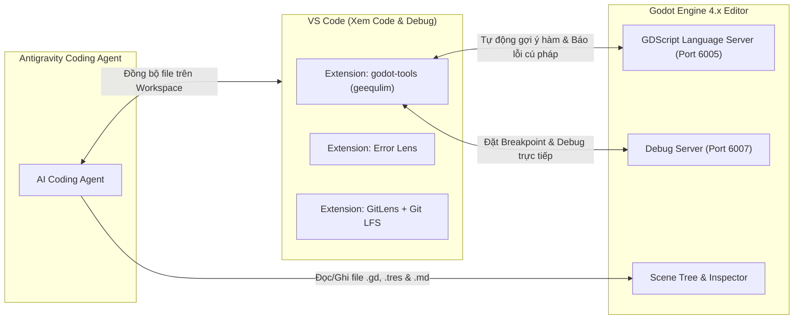

# 🛠️ Thiết Lập Godot 4.x, VS Code, Antigravity Coding Agent, LSP & Git LFS

> [!TIP] Điều Hướng Hồ Sơ
> - 🧭 **Về Trang Tổng Quan**: [[00. Tổng quan - Học & Phát Triển Game 2D & 3D (Godot 4)]]
> - 📂 **Cùng Chuyên Mục**: [[02. Quy trình Non-Code — Nhạc lý (DAW), SFX & Đồ họa 2D-3D]]
> - ⏭️ **Bước Tiếp Theo**: [[01. Vật lý 2D, Điều khiển Nhân vật & State Machine]]

---

## 🔌 Sơ Đồ Kết Nối Giữa Godot 4 Editor, VS Code & Antigravity Coding Agent

Khi làm việc với GDScript, bạn dùng **Godot 4 Editor** để dựng cảnh (Scene/Node), dùng **VS Code** để xem/kiểm tra code & debug trực quan, và dùng **Antigravity Coding Agent** để tự động viết code, thiết kế kiến trúc và quản lý tài liệu. VS Code và Godot giao tiếp thời gian thực qua giao thức **LSP (Language Server Protocol)** và **DAP (Debug Adapter Protocol)**:



---

## ⚙️ Cấu Hình Chi Tiết Từng Công Cụ

### Cấu Hình Extensions Bắt Buộc Trên VS Code
> [!tip] **Cài nhanh qua Terminal (Linux / Windows):**
> ```bash
> code --install-extension geequlim.godot-tools
> code --install-extension usernamehw.errorlens
> code --install-extension eamodio.gitlens
> code --install-extension yzhang.markdown-all-in-one
> ```

- **`godot-tools` (tác giả: geequlim):**
  - Mở Settings của VS Code (`Ctrl + ,`) $\rightarrow$ tìm `Godot Tools`.
  - Tại mục `Godot_tools > Editor_path: Godot4`: Trỏ đường dẫn tới file thực thi Godot 4 trên máy của bạn (ví dụ `/usr/local/bin/godot4` trên Linux hoặc `Godot_v4.x-stable_win64.exe` trên Windows).
  - Tại mục `Godot_tools > Gdscript_lsp: Server_port`: Đặt là `6005` (khớp với mặc định của Godot 4.x).
- **`Error Lens`:** Hiển thị ngay lỗi thiếu dấu hai chấm `:`, sai kiểu dữ liệu (Static Typing) của GDScript ngay trên dòng code khi bạn xem trong VS Code.
- **`GitLens`:** Giúp bạn xem lịch sử từng dòng code GDScript ai sửa (bạn hay Antigravity Coding Agent sửa) và đối chiếu các commit trực quan.
- **`Markdown All in One`:** Hỗ trợ xem và chỉnh sửa các file tài liệu `.md` mượt mà.

### Cấu Hình Bên Trong Godot 4 Editor (Mở Code Bằng VS Code)
- Vào menu **Editor $\rightarrow$ Editor Settings $\rightarrow$ Text Editor $\rightarrow$ External**:
  - Bật **Use External Editor**: `On` (khi nhấp đúp vào script trong Godot sẽ mở thẳng sang **VS Code**).
  - **Exec Path**: Điền `/usr/bin/code` (trên Linux) hoặc đường dẫn `Code.exe` (trên Windows).
  - **Exec Flags**: Điền `{project} --goto {file}:{line}:{col}` để VS Code mở đúng dự án và nhảy tới đúng dòng code.
- Vào **Editor $\rightarrow$ Editor Settings $\rightarrow$ Network $\rightarrow$ Language Server**:
  - Đảm bảo **Remote Port** là `6005` và bật **Enable Smart Resolve**.

---

## 📦 Cấu Hình Git + Git LFS Cho Dự Án Game (Chống Phình Dung Lượng Repo)

Game chứa rất nhiều file nhị phân nặng (ảnh `.png`, nhạc `.ogg`/`.wav`, mô hình 3D `.glb`/`.blend`). Nếu chỉ dùng Git thường, repo sẽ bị phình to và chậm. **Git LFS (Large File Storage)** là bắt buộc:

### Mẫu Tệp `.gitignore` Chuẩn Cho Godot 4
```gitignore
# Godot 4+ specific ignores
.godot/
.nomedia

# Exported builds
build/
exports/
*.exe
*.pck

# OS / Editor temporary files
.DS_Store
Thumbs.db
*.tmp
*~
```

### Mẫu Tệp `.gitattributes` Chuẩn Cho Git LFS (Đồ Họa, Âm Thanh, 3D)
```gitattributes
# Đồ họa 2D & Nguồn thiết kế
*.png filter=lfs diff=lfs merge=lfs -text
*.jpg filter=lfs diff=lfs merge=lfs -text
*.webp filter=lfs diff=lfs merge=lfs -text
*.aseprite filter=lfs diff=lfs merge=lfs -text
*.kra filter=lfs diff=lfs merge=lfs -text
*.psd filter=lfs diff=lfs merge=lfs -text

# Âm nhạc (OST/BGM) & Hiệu ứng âm thanh (SFX)
*.ogg filter=lfs diff=lfs merge=lfs -text
*.wav filter=lfs diff=lfs merge=lfs -text
*.mp3 filter=lfs diff=lfs merge=lfs -text

# Đồ họa 3D & Mô hình
*.glb filter=lfs diff=lfs merge=lfs -text
*.gltf filter=lfs diff=lfs merge=lfs -text
*.fbx filter=lfs diff=lfs merge=lfs -text
*.blend filter=lfs diff=lfs merge=lfs -text
```

---

## ✅ Checklist Đầu Việc Thực Hiện (Actionable Tasks)

- [x] **`[Thao tác trên Godot]`** Tải bản **Godot 4.x Standard (GDScript)** mới nhất (`v4.7.2-stable` tại `~/.local/bin/godot4`), khởi tạo thư mục dự án gốc `Godot_Project/` kèm cấu trúc thư mục chuẩn: `res://assets/`, `res://scenes/`, `res://scripts/`, `res://resources/`. ✅
- [x] **`[Code cùng AI]`** Cài đặt đủ 4 extensions trên **VS Code**: `godot-tools` (geequlim), `Error Lens`, `GitLens`, `Markdown All in One`; cấu hình Godot mở External Editor bằng VS Code (`/usr/bin/code`) và kết nối cổng LSP `6005`. ✅
- [x] **`[Code cùng AI]`** Nhờ **Antigravity Coding Agent** khởi tạo `git init`, cài đặt `git lfs install` (`v3.8.1`), tạo tệp `.gitignore` và `.gitattributes` chuẩn cho Godot 4 + Git LFS. ✅
- [x] **`[Code cùng AI]`** Cấu hình **VS Code (`GitLens`)** quản lý trực quan các thay đổi của cả file code lẫn file hình ảnh/âm thanh trong Repository. ✅
- [x] **`[Code cùng AI]`** Nhờ **Antigravity Coding Agent** viết file `scripts/autoload/logger.gd` (Autoload `GameLogger`) chuẩn hóa các hàm ghi log (`info`, `debug`, `warn`, `error`) để áp dụng xuyên suốt dự án theo đúng quy chuẩn `GEMINI.md`. ✅
