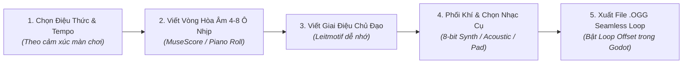
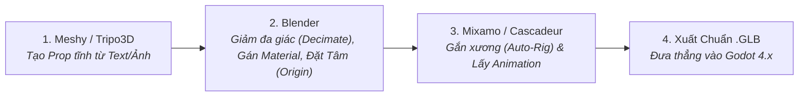

# 🎨 Quy Trình Non-Code: Tự Soạn Nhạc (Nhạc Lý), SFX & Sản Xuất Đồ Họa 2D/3D

> [!TIP] Điều Hướng Hồ Sơ
> - 🧭 **Về Trang Tổng Quan**: [[00. Tổng quan - Học & Phát Triển Game 2D & 3D (Godot 4)]]
> - 📂 **Cùng Chuyên Mục**: [[01. Thiết lập Godot 4, VS Code, LSP & Git LFS]]
> - ⏭️ **Bước Tiếp Theo**: [[01. Vật lý 2D, Điều khiển Nhân vật & State Machine]]

---

## 🎵 Quy Trình 1: Tự Soạn Nhạc Game (OST/BGM) Gắn Liền Với Học Nhạc Lý

Vì bạn đang học nhạc lý và muốn tự sáng tác nhạc cho game bằng DAW (**Reaper / LMMS / MuseScore**), dưới đây là lộ trình kết hợp giữa **kiến thức nhạc lý** và **nhu cầu âm nhạc thực tế của từng màn chơi**:

### Bảng Tra Cứu Nhạc Lý Ứng Dụng Vào Tình Huống Game

| Tình Huống Trong Game | Nhịp & Tốc Độ (Tempo) | Thang Âm / Điệu Thức (Scale/Mode) | Vòng Hòa Âm Gợi Ý (Chord Progression) | Cảm Xúc Mang Lại |
| :--- | :--- | :--- | :--- | :--- |
| **Màn Hình Chính (Title / Town 2D)** | 4/4 — `90 - 110 BPM` | **Đô Trưởng (C Major)** hoặc **Lydian Mode** (bậc IV tăng `#4`) | `I - V - vi - IV` *(C - G - Am - F)* hoặc `I - II - vii° - I` | Tươi sáng, chào đón, khơi gợi sự tò mò khám phá |
| **Màn Chơi Hành Động 2D (Stage Loop)** | 4/4 — `130 - 150 BPM` | **La Thứ Tự Nhiên (A Minor)** hoặc **Dorian Mode** | `i - VI - III - VII` *(Am - F - C - G)* hoặc `i - IV - i - VII` | Năng động, dồn dập, thôi thúc người chơi tiến lên |
| **Đấu Trùm (Boss Fight)** | 4/4 hoặc 3/4 — `150 - 170 BPM` | **Thứ Hòa Thanh (Harmonic Minor)** hoặc **Phrygian Mode** (bậc `b2`) | `i - bII - i - V7` *(Am - Bb - Am - E7)* | Kịch tính, nguy hiểm, căng thẳng cao độ |
| **Không Gian 3D Bí Ẩn / Khám Phá** | 4/4 hoặc 6/8 — `70 - 85 BPM` | **Ngũ Cung (Pentatonic)** hoặc **Mixolydian / Dorian** | Hợp âm treo `sus2`, `sus4`, `maj7` ngân dài (Pad + Reverb lớn) | Rộng lớn, sâu lắng, không làm người chơi bị mệt tai khi đi lâu |

> [!important] **Mẹo Kỹ Thuật Khi Xuất Nhạc Cho Godot 4:**
> - Luôn xuất định dạng **`.ogg` (Ogg Vorbis)** cho nhạc nền BGM (dung lượng nhẹ, hỗ trợ đánh dấu điểm Loop cực chuẩn) và **`.wav`** cho hiệu ứng SFX ngắn (không trễ giải mã).
> - Khi cắt file nhạc Loop trong Reaper/LMMS: Để phần đuôi vang (Reverb tail) của ô nhịp cuối vòng ngược lại đè lên ô nhịp đầu tiên (Zero-crossing seamless loop) để khi lặp lại trong Godot không bị tiếng "khựng/tách".

---

## 🔊 Quy Trình 2: Sản Xuất Hiệu Ứng Âm Thanh (SFX) & Voice

- **SFX Hành Động Nhanh (Chiptone / jsfxr):**
  - Dùng cho tiếng nhảy (`Jump`), nhặt xu (`Pickup`), bắn đạn (`Shoot`), trúng đòn (`Hit`), bấm nút (`UI Click`).
  - Xuất file `.wav` (16-bit, 44.1kHz, Mono).
- **SFX Môi Trường & Chân Thực (ElevenLabs SFX):**
  - Dùng câu lệnh mô tả tiếng Anh chi tiết (ví dụ: *"Heavy iron sword swinging through air with metallic whoosh, crisp game sound effect"* hoặc *"Footsteps on stone dungeon floor, single step, dry"*).
  - Cắt bỏ khoảng lặng đầu file (Trim silence) bằng Reaper để khi bấm nút trong game là âm thanh phát ra ngay lập tức (0ms delay).

---

## 🖼️ Quy Trình 3: Sản Xuất Đồ Họa 2D (Kenney + AI + Aseprite/Krita)

1. **Bước 1 — Prototyping với Asset Mẫu (`Kenney.nl`):**
   - Trong lúc mới code cơ chế di chuyển và va chạm, dùng ngay bộ sprite trắng đen hoặc bộ mẫu của **Kenney.nl** để không bị kẹt tiến độ code.
2. **Bước 2 — Tạo Nghệ Thuật Riêng Bằng AI (`PixelLab` / `Recraft`):**
   - Dùng **PixelLab** để tạo nhân vật Pixel Art đồng nhất góc nhìn (Side-scroller hoặc Top-down 4 hướng) và tạo khung hoạt ảnh cơ bản.
   - Dùng **Recraft AI** để tạo bộ khung giao diện người dùng (UI Vector, Icon kỹ năng, Thanh máu, Nút bấm).
3. **Bước 3 — Hậu Kỳ & Đóng Gói (`Aseprite` / `Krita`):**
   - Đưa vào **Aseprite** để làm sạch viền (Clean-up), đồng bộ bảng màu (Color Palette), căn chỉnh tâm chân nhân vật (Pivot) và xuất ra **SpriteSheet (`.png` ngang)**.
   - Trong Godot 4: Đặt `Texture Filter` của Node 2D là **`Nearest`** để giữ độ sắc nét tuyệt đối cho Pixel Art!

---

## 🧊 Quy Trình 4: Sản Xuất Đồ Họa 3D (Blender + Meshy/Tripo3D + Mixamo/Cascadeur)

- **Quy tắc sống còn khi xuất `.glb` từ Blender sang Godot 4:**
  - Luôn đặt vật thể tại tọa độ gốc `(0, 0, 0)` và nhấn `Ctrl + A $\rightarrow$ All Transforms` (đưa Scale về `1, 1, 1`, Rotation về `0, 0, 0`).
  - Hướng mặt trước của nhân vật trong Blender phải nhìn về trục **`-Y` (Front View)** để khớp với trục **`-Z` (Forward)** của Godot 4.

---

## ✅ Checklist Đầu Việc Thiết Lập Quy Trình Non-Code

- [x] **`[Tự soạn nhạc]`** Cài đặt DAW (**Reaper v7.27 Linux Native** tại `~/.local/opt/REAPER/reaper`), sẵn sàng soạn nhạc và cắt loop `.ogg`/`.wav`. ✅
- [ ] **`[Tự soạn nhạc]`** Thực hành bài tập nhạc lý số 1: Viết một câu nhạc hiệu chiến thắng (Victory Fanfare) dài 4 ô nhịp ở giọng Đô Trưởng (`C - F - G - C`) và xuất ra `.ogg`.
- [ ] **`[Tạo Asset]`** Tải 1 bộ gói tài nguyên 2D & 3D cơ bản từ `Kenney.nl` làm bộ khung Prototyping (`res://assets/prototype/`).
- [ ] **`[Tạo Asset]`** Cài đặt **Aseprite / Krita** (cho 2D) và **Blender 4.x** (cho 3D), thử nghiệm xuất 1 khối hộp `.glb` từ Blender sang Godot 4 đúng tỷ lệ `1m = 1 unit`.
