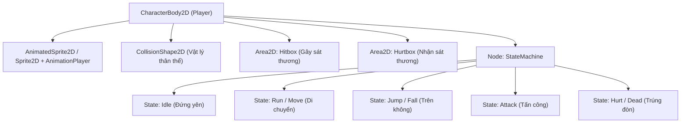

# 🕹️ Giai Đoạn 1.1: Làm Chủ Vật Lý 2D, Điều Khiển Nhân Vật & State Machine

> [!TIP] Điều Hướng Hồ Sơ
> - 🧭 **Về Trang Tổng Quan**: [[00. Tổng quan - Học & Phát Triển Game 2D & 3D (Godot 4)]]
> - ⏮️ **Bước Trước**: [[02. Quy trình Non-Code — Nhạc lý (DAW), SFX & Đồ họa 2D-3D]]
> - 📂 **Cùng Chuyên Mục**: [[02. Giao diện (UI), Hiệu ứng (Juice) & Thiết kế Hướng Dữ Liệu (Data-Driven)]]

---

## 🏗️ Kiến Trúc Nhân Vật 2D & Máy Trạng Thái (Finite State Machine - FSM)

Sai lầm phổ biến nhất của người mới học làm game là viết toàn bộ logic di chuyển, nhảy, đánh nhau, trúng đòn vào một hàm `_physics_process(delta)` duy nhất với hàng chục câu lệnh `if/else` chồng chéo. Giải pháp chuẩn công nghiệp là tách thành **Node-based State Machine**:

### Nguyên Tắc Vật Lý & Va Chạm 2D Trọng Tâm Trên Godot 4
- **Phân biệt 3 loại thân vật lý:**
  - `StaticBody2D` / `TileMapLayer`: Mặt đất, tường tĩnh không di chuyển.
  - `CharacterBody2D`: Nhân vật chính & Quái vật điều khiển bằng code thông qua biến `velocity` và hàm `move_and_slide()`.
  - `Area2D`: Vùng cảm biến phát hiện va chạm chồng lấp (dùng làm đồng xu, bẫy, vùng chém `Hitbox` và vùng nhận đòn `Hurtbox`).
- **Quản lý Collision Layer & Collision Mask (Quy tắc Vàng):**
  - `Collision Layer`: *"Tôi đang đứng ở tầng nào?"* (Ví dụ: Layer 1 = World, Layer 2 = Player, Layer 3 = Enemy, Layer 4 = Collectibles).
  - `Collision Mask`: *"Tôi quan tâm và va chạm với tầng nào?"*

---

## 📋 Checklist Đầu Việc Chi Tiết (Phân Tách Theo 4 Vai Trò)

### 1. Chuẩn Bị Tài Nguyên Hình Ảnh & Âm Thanh Cơ Bản Cho Nhân Vật
- [ ] **`[Tạo Asset]`** Tải gói asset 2D mẫu từ `Kenney.nl` hoặc dùng **PixelLab** tạo 1 SpriteSheet nhân vật gồm 4 hành động cơ bản: `Idle` (4 frames), `Run` (6 frames), `Jump` (2 frames), `Attack` (4 frames).
- [ ] **`[Tạo Asset]`** Mở **Aseprite**, kiểm tra căn chỉnh tâm nhân vật ở giữa hai bàn chân, xuất file `player_spritesheet.png` vào `res://assets/sprites/player/`.
- [ ] **`[Tạo Asset]`** Mở **Chiptone / jsfxr**, tạo 4 file hiệu ứng âm thanh `.wav` ngắn gọn: `sfx_jump.wav` (tiếng nhảy cao dần), `sfx_land.wav` (tiếng tiếp đất trầm), `sfx_slash.wav` (tiếng vung kiếm), `sfx_hit.wav` (tiếng trúng đòn).
- [ ] **`[Tự soạn nhạc]`** **Thực hành Nhạc lý Mốc 1 (Nhịp điệu & Bassline):** Mở **MuseScore / Reaper**, viết một đoạn nhạc nền ngắn 8 ô nhịp (Tempo `128 BPM`, nhịp `4/4`, giọng La Thứ `Am - F - C - G`), tập trung vào tiếng trống (Kick vào phách 1-3, Snare vào phách 2-4) và Bass đi theo nốt gốc (Root note) của hợp âm để làm nhạc nền khi luyện tập điều khiển nhân vật.

### 2. Dựng Scene Nhân Vật, Bản Đồ TileMapLayer & Cấu Hình Vật Lý
- [ ] **`[Thao tác trên Godot]`** Vào **Project Settings $\rightarrow$ Rendering $\rightarrow$ Textures**, chỉnh `Default Texture Filter` thành **`Nearest`** (để ảnh Pixel Art không bị mờ).
- [ ] **`[Thao tác trên Godot]`** Vào **Project Settings $\rightarrow$ Layer Names $\rightarrow$ 2D Physics**, đặt tên rõ ràng cho 5 Layer đầu tiên: `1: World`, `2: Player`, `3: Enemy`, `4: PlayerHitbox`, `5: EnemyHurtbox`.
- [ ] **`[Thao tác trên Godot]`** Vào **Project Settings $\rightarrow$ Input Map**, khai báo các phím thao tác: `move_left` (A / Left), `move_right` (D / Right), `move_up` (W / Up), `move_down` (S / Down), `jump` (Space), `attack` (J / Chuột trái).
- [ ] **`[Thao tác trên Godot]`** Tạo Scene `level_01.tscn`, thêm node **`TileMapLayer`** (chuẩn mới của Godot 4.3+), nạp TileSet mặt đất, vẽ lớp va chạm vật lý (Physics Layer) cho gạch và dựng một màn chơi thử nghiệm có bậc nhảy.
- [ ] **`[Thao tác trên Godot]`** Tạo Scene `player.tscn` (`CharacterBody2D`), gắn `Sprite2D`, `AnimationPlayer`, `CollisionShape2D` (hình Capsule), cùng 2 node `Area2D` (`Hitbox` và `Hurtbox`).

### 3. Lập Trình Điều Khiển Mượt (Game Feel) & State Machine
- [ ] **`[Code cùng AI]`** Viết lớp cơ sở `state.gd` (`class_name State extends Node`) với các hàm ảo: `enter()`, `exit()`, `update(delta: float)`, `physics_update(delta: float)` và `state_machine.gd` quản lý việc chuyển đổi trạng thái kèm log truy vết mỗi khi nhân vật đổi trạng thái (`Logger.debug("Player State: Idle -> Run")`).
- [ ] **`[Code cùng AI]`** Viết các script trạng thái con: `player_idle_state.gd`, `player_run_state.gd`, `player_jump_state.gd`, `player_attack_state.gd`.
- [ ] **`[Code cùng AI]`** Tích hợp 3 kỹ thuật làm mượt cảm giác điều khiển (Platformer Game Feel):
  - **Acceleration & Friction (Gia tốc & Ma sát):** Dùng `move_toward()` để nhân vật tăng tốc và dừng lại mượt mà thay vì khựng cứng.
  - **Coyote Time (Thời gian ân huệ):** Cho phép người chơi vẫn bấm nhảy được trong `0.12 giây` sau khi vừa bước hụt khỏi mép vực.
  - **Jump Buffer (Bộ đệm nhảy):** Ghi nhận phím nhảy trước khi chạm đất `0.1 giây` để nhân vật bật nhảy ngay lập tức khi vừa chạm sàn.
- [ ] **`[Code cùng AI]`** Viết logic `Hitbox` và `Hurtbox`: Khi trạng thái `Attack` bật vùng `CollisionShape2D` của `Hitbox` và chạm vào `Hurtbox` của quái vật, trừ máu quái và phát âm thanh `sfx_slash.wav`.

---

## 🧪 Luồng Nghiệp Vụ (Flow) & Tiêu Chí Kiểm Thử (Test Cases)

- **Flow xử lý:** `Người chơi nhấn phím (Input Map)` $\rightarrow$ `State hiện tại bắt sự kiện trong physics_update()` $\rightarrow$ `Tính toán Velocity + Trọng lực` $\rightarrow$ `Gọi move_and_slide()` $\rightarrow$ `Chuyển State nếu đủ điều kiện` $\rightarrow$ `Kích hoạt Animation & SFX tương ứng`.
- **Test Case 1 (Happy Path):** Nhân vật chạy trái/phải đổi hướng mặt (`flip_h`) đúng, nhảy lên và rơi xuống đúng trọng lực, chém kiếm phát ra âm thanh và quay về `Idle` sau khi hết hoạt ảnh chém.
- **Test Case 2 (Edge Case):** Bấm nút nhảy liên tục khi đang ở trên không hoặc bấm chém liên tục $\rightarrow$ State Machine không bị kẹt trạng thái và không cho phép nhảy vô hạn trên không.
