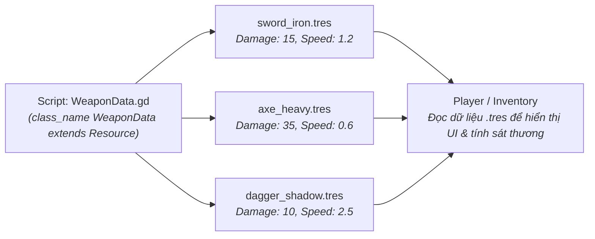

# ✨ Giai Đoạn 1.2: Giao Diện (UI), Hiệu Ứng (Game Juice) & Thiết Kế Hướng Dữ Liệu (Data-Driven)

> [!TIP] Điều Hướng Hồ Sơ
> - 🧭 **Về Trang Tổng Quan**: [[00. Tổng quan - Học & Phát Triển Game 2D & 3D (Godot 4)]]
> - 📂 **Cùng Chuyên Mục**: [[01. Vật lý 2D, Điều khiển Nhân vật & State Machine]]
> - ⏭️ **Bước Tiếp Theo**: [[01. Autoload (Singletons), EventBus, AudioManager & SceneTransition]]

---

## 📊 Thiết Kế Hướng Dữ Liệu Với Custom Resource (Data-Driven Design)

Thay vì viết cứng (hardcode) chỉ số máu, sát thương, tốc độ của từng loại quái vật hay từng món vũ khí vào trong code, Godot 4 cung cấp **`Resource` (`.tres`)** cực mạnh:

- Bạn chỉ cần viết 1 file script `weapon_data.gd` khai báo các biến `@export var weapon_name: String`, `@export var damage: int`, `@export var icon: Texture2D`.
- Sau đó trong Godot Inspector, bạn có thể tạo hàng chục món vũ khí khác nhau bằng thao tác chuột (`New Resource -> WeaponData`) mà không cần sửa thêm một dòng code nào!

---

## 📋 Checklist Đầu Việc Chi Tiết (Phân Tách Theo 4 Vai Trò)

### 1. Sáng Tác Nhạc Chủ Đề (Menu & Battle) & Tạo Tài Nguyên UI / VFX
- [ ] **`[Tự soạn nhạc]`** **Thực hành Nhạc lý Mốc 2 (Giai điệu & Cấu trúc A-B Loop):**
  - Mở **MuseScore / Reaper**, sáng tác bản nhạc **Main Menu / Safe Zone** dài 16 ô nhịp (8 ô phần A êm dịu + 8 ô phần B cao trào nhẹ rồi dẫn về hợp âm bậc V để quay lại phần A mượt mà).
  - Áp dụng kỹ thuật **Arpeggio (Rải hợp âm)** cho nhạc cụ nền (Harp / Piano / Synth Pad) và viết giai điệu bằng thang âm Ngũ cung Trưởng (Major Pentatonic: `Đô - Rê - Mi - Sol - La`) để đảm bảo không bao giờ bị phô hay chói tai.
- [ ] **`[Tạo Asset]`** Dùng **Recraft AI** hoặc gói UI từ `Kenney.nl` kết hợp **Aseprite / Krita** để thiết kế:
  - Khung thanh máu (Health Bar Border & Fill), Khung ô chứa đồ (Inventory Slot 9-slice), Nút bấm (`Normal`, `Hover`, `Pressed`) và Font chữ Pixel/Vector.
- [ ] **`[Tạo Asset]`** Dùng **ElevenLabs SFX** và **Chiptone** tạo bộ âm thanh giao diện: `ui_hover.wav`, `ui_click.wav`, `item_pickup.wav`, `enemy_die.wav`.

### 2. Dựng Hệ Thống Giao Diện (Control Nodes) & Hiệu Ứng Hạt Trên Godot 4
- [ ] **`[Thao tác trên Godot]`** Tạo Scene `hud.tscn` đặt gốc là `CanvasLayer` (để UI luôn bám theo màn hình dù Camera2D di chuyển):
  - Sử dụng `MarginContainer` $\rightarrow$ `HBoxContainer` $\rightarrow$ `TextureProgressBar` (Thanh máu nhân vật) và `Label` (Điểm số / Số vàng).
- [ ] **`[Thao tác trên Godot]`** Tạo Scene `pause_menu.tscn` và `main_menu.tscn` dùng `VBoxContainer` căn giữa màn hình (`Anchor Preset: Center`), thiết lập `Theme` dùng chung cho toàn bộ nút bấm.
- [ ] **`[Thao tác trên Godot]`** Chỉnh `Process Mode` của node gốc `PauseMenu` thành **`When Paused`** để khi gọi `get_tree().paused = true`, màn chơi dừng lại nhưng người chơi vẫn bấm được nút trong menu tạm dừng.
- [ ] **`[Thao tác trên Godot]`** Thêm node `GPUParticles2D` tạo hiệu ứng bụi tung lên khi nhân vật nhảy/tiếp đất và hiệu ứng tia lửa văng ra khi chém trúng quái.

### 3. Lập Trình Custom Resource, Tweening & Hiệu Ứng "Game Juice"
- [ ] **`[Code cùng AI]`** Viết script `character_stats.gd` (`class_name CharacterStats extends Resource`) và `item_data.gd` (`class_name ItemData extends Resource`) chứa các thuộc tính `@export`, phát tín hiệu `health_changed(current_hp, max_hp)` và `died`.
- [ ] **`[Code cùng AI]`** Viết hiệu ứng làm mượt thanh máu bằng **`Tween`**: Khi máu giảm, thanh máu chính tụt ngay nhưng thanh nền màu trắng/vàng phía dưới tụt từ từ trong `0.4 giây` (`create_tween().tween_property(...)`).
- [ ] **`[Code cùng AI]`** Viết 3 hiệu ứng "Game Juice" tăng cảm giác sướng tay khi chiến đấu:
  - **Hit Flash:** Khi quái bị chém trúng, đổi màu Sprite sang trắng sáng trong `0.08 giây` bằng Shader hoặc `modulate`.
  - **Hit Stop (Freeze Frame):** Tạm ngưng thời gian (`Engine.time_scale = 0.05`) trong `0.05 giây` khi tung đòn chí mạng.
  - **Camera Shake:** Rung nhẹ `Camera2D` theo hàm nhiễu (`FastNoiseLite` hoặc giảm dần biên độ `offset`) khi nhân vật đánh trúng hoặc nhận sát thương.

---

## 🧪 Luồng Nghiệp Vụ (Flow) & Tiêu Chí Kiểm Thử (Test Cases)

- **Flow xử lý:** `Hitbox chạm Hurtbox` $\rightarrow$ `Trừ máu trong CharacterStats Resource` $\rightarrow$ `Resource phát Signal health_changed` $\rightarrow$ `HUD bắt Signal và chạy Tween tụt thanh máu` + `Kích hoạt Hit Flash, Camera Shake & SFX`.
- **Test Case 1 (Happy Path):** Khi nhân vật nhận sát thương hoặc nhặt vật phẩm, giao diện HUD cập nhật chính xác tức thì mà code của `Player` không cần biết sự tồn tại của node `HUD` (Decoupled).
- **Test Case 2 (Edge Case):** Phóng to/thu nhỏ cửa sổ game ở nhiều tỷ lệ màn hình khác nhau (`1280x720`, `1920x1080`) $\rightarrow$ Các nút bấm và thanh máu trong `Container` tự động co giãn đúng vị trí, không bị lệch khỏi màn hình.
