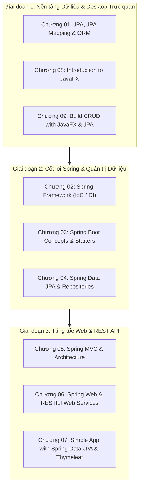

# 🎓 Kế Hoạch Chuẩn Bị & Giảng Dạy Môn HSF302 (Spring Boot & JavaFX)

> [!abstract] **Thông Tin Khóa Học (Theo Bộ Slide Chuẩn)**
> - **Mã môn:** **HSF302** (JPA and Spring Framework)
> - **Nền tảng kỹ thuật:** JDK 21 | Spring Boot 3.x | Scene Builder 23 | IntelliJ IDEA
> - **Thư mục Slide gốc:** `D:\Obsidian_Save\Just_Something4Anti\Slides`
> - **Cơ cấu đánh giá:** 2 Progress Tests (10%) | 2 Assignments (10%) | Practical Exam (PE - 25%) | Group Project (GP - 25%) | Final Exam (FE - 30%)
> - **Vault học liệu riêng:** `D:\Obsidian_Save\Mindy\HSF` (Đã khởi tạo Git & cấu hình Obsidian)
> - **Trọng tâm sư phạm:** Dùng JavaFX làm bàn đạp trực quan $\rightarrow$ Tăng tốc chuyển giao sang Spring Boot REST API.

---

## 🧭 Cấu Trúc 10 Chương Trong Slide & Phân Bổ Giảng Dạy

---

## ✅ Danh Sách Việc Cần Làm (Action Checklist)

### 🛠️ Giai đoạn 1: Chuẩn bị Môi trường & Bộ Code Mẫu Khởi Động (Starter Kits)
- [x] **Khởi tạo Vault HSF & Kế hoạch triển khai:** Đã lập Vault `D:\Obsidian_Save\Mindy\HSF`, cấu hình Git, `GEMINI.md`, `implementation_plan.md` và lộ trình 10 chương. ✅
- [ ] **Kiểm tra công cụ chuẩn:** Cài đặt JDK 21, IntelliJ IDEA Ultimate/Community, Scene Builder 23.
- [ ] **Tạo dự án mẫu 1 (JavaFX + JPA):**
  - Cấu hình Maven với JavaFX 21 + Hibernate/JPA + H2/MySQL.
  - Thiết kế sẵn khung ứng dụng CRUD Quản lý sinh viên (Student Management) theo mô hình Repository Pattern.
- [ ] **Tạo dự án mẫu 2 (Spring Boot 3 REST API):**
  - Cấu hình `spring-boot-starter-web`, `spring-boot-starter-data-jpa`, `springdoc-openapi` (Swagger UI).
  - Khung chuẩn phân tầng: Controller $\rightarrow$ Service $\rightarrow$ Repository $\rightarrow$ DTO $\rightarrow$ Global Exception Handling.

### 📚 Giai đoạn 2: Soạn Giáo Án Chi Tiết Theo Từng Cụm Chương
- [ ] **Cụm 1: Nền tảng Desktop Trực quan (Chương 01, 08, 09)**
  - [ ] Soạn tóm tắt lý thuyết: ORM là gì, Entities, Annotations (`@Entity`, `@Id`, `@Column`), Stage, Scene, FXML.
  - [ ] Kịch bản demo: Từng bước dựng UI bằng Scene Builder, kết nối Controller `@FXML` và lưu dữ liệu bằng JPA.
  - [ ] Bài Lab 1: Hoàn thiện chức năng Thêm - Sửa - Xóa - Tìm kiếm sinh viên trên giao diện JavaFX.
- [ ] **Cụm 2: Cốt lõi Spring & Tự động hóa (Chương 02, 03, 04)**
  - [ ] Soạn bài giảng IoC (Inversion of Control) và DI (Dependency Injection): Giải thích `@Component`, `@Autowired`, `@Service`.
  - [ ] Spring Boot 3: Auto-configuration, `application.properties`, Spring Initializr.
  - [ ] Spring Data JPA: Kế thừa `JpaRepository`, Custom Queries (`findBy...`), JPQL.
  - [ ] Bài Lab 2: Chuyển đổi tầng Data Access từ JPA thuần sang Spring Data JPA.
- [ ] **Cụm 3: Tăng tốc Spring MVC & REST API (Chương 05, 06, 07)**
  - [ ] Spring MVC: Cơ chế DispatcherServlet, Model, View, Controller.
  - [ ] Chuyển dịch sang RESTful API: `@RestController`, `@GetMapping`, `@PostMapping`, `@PutMapping`, `@DeleteMapping`, `ResponseEntity`.
  - [ ] DTO & Validation: `@Valid`, `@NotBlank`, `@Size`, xử lý lỗi tập trung `@RestControllerAdvice`.
  - [ ] Hướng dẫn test API bằng Postman & Swagger UI.
  - [ ] Bài Lab 3: Xây dựng hệ thống REST API Quản lý Sản phẩm / Đơn hàng chuẩn RESTful.

### 🎯 Giai đoạn 3: Chuẩn Bị Bộ Đề Đánh Giá & Thi Cử (Exam & Assignment Packs)
- [ ] **02 Progress Tests (PT1 & PT2):**
  - [ ] PT1: Trắc nghiệm & Thực hành nhỏ về JPA + JavaFX + Spring Core (IoC/DI).
  - [ ] PT2: Trắc nghiệm & Thực hành về Spring Data JPA + REST Controller.
- [ ] **02 Assignments (AS1 & AS2):**
  - [ ] AS1: Ứng dụng Desktop JavaFX kết nối Database quản lý nghiệp vụ mini.
  - [ ] AS2: Backend RESTful API hoàn chỉnh với đầy đủ CRUD, Validation và Exception Handling.
- [ ] **01 Đề thi thử Practical Exam (PE - Chiếm 25% điểm):**
  - [ ] Bộ đề thi thực hành giới hạn thời gian (90 - 120 phút): Cho sẵn Database script $\rightarrow$ Sinh viên tạo Entity, Repository, Service và REST Controller hoặc JavaFX form.
  - [ ] Hướng dẫn giải chi tiết (Solution Key) và Barem chấm điểm (Rubric).
- [ ] **Hướng dẫn Đồ án nhóm (Group Project - Chiếm 25% điểm):**
  - [ ] Danh sách đề tài gợi ý (E-Commerce, Booking System, Library Management...).
  - [ ] Tiêu chuẩn kiến trúc và checklist nộp bài.

---

## 📌 Lịch Dạy & Theo Dõi Tiến Độ Lớp Học

| Buổi | Nội dung giảng dạy | Chương tương ứng | Trạng thái chuẩn bị |
| :---: | :--- | :--- | :---: |
| **01** | Giới thiệu HSF302, Cài đặt JDK 21, IntelliJ, Scene Builder | Chương 00, 08 | ⬜ Chưa làm |
| **02** | JavaFX Cơ bản, FXML, Layouts, Controls, Event Handling | Chương 08 | ⬜ Chưa làm |
| **03** | JPA Cơ bản, ORM, Mapping Entity, Quan hệ bảng | Chương 01 | ⬜ Chưa làm |
| **04** | Xây dựng CRUD Desktop với JavaFX + JPA (Student Management) | Chương 09 | ⬜ Chưa làm |
| **05** | Spring Core, Kiến trúc IoC Container, Dependency Injection | Chương 02 | ⬜ Chưa làm |
| **06** | Spring Boot 3 Concepts, Auto-configuration, Starters | Chương 03 | ⬜ Chưa làm |
| **07** | Spring Data JPA, JpaRepository, JPQL Query Methods | Chương 04 | ⬜ Chưa làm |
| **08** | Spring MVC, DispatcherServlet, Model-View-Controller | Chương 05 | ⬜ Chưa làm |
| **09** | Tăng tốc RESTful API: `@RestController`, Request/Response JSON | Chương 06 | ⬜ Chưa làm |
| **10** | DTO Pattern, Validation dữ liệu, Global Exception Handling | Chương 06 | ⬜ Chưa làm |
| **11** | Tích hợp Swagger / OpenAPI, Test API toàn diện với Postman | Chương 06 | ⬜ Chưa làm |
| **12** | Demo hoàn chỉnh Thymeleaf / Web App & Ôn tập thi PE | Chương 07 | ⬜ Chưa làm |

---
*Điều hướng: [[00. Tổng quan - Dashboard]] | [[02. Việc hôm nay (Today)]]*
