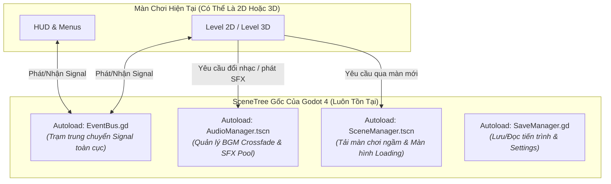

# 🧱 Giai Đoạn 2.1: Kiến Trúc Dùng Chung — Autoload, EventBus, AudioManager & Chuyển Cảnh

> [!TIP] Điều Hướng Hồ Sơ
> - 🧭 **Về Trang Tổng Quan**: [[00. Tổng quan - Học & Phát Triển Game 2D & 3D (Godot 4)]]
> - ⏮️ **Bước Trước**: [[02. Giao diện (UI), Hiệu ứng (Juice) & Thiết kế Hướng Dữ Liệu (Data-Driven)]]
> - 📂 **Cùng Chuyên Mục**: [[02. Hệ thống Save-Load, Quản lý Resource & Đa ngôn ngữ]]

---

## 🏛️ Tại Sao Cần Tầng Kiến Trúc Dùng Chung (Core Bridge) Trước Khi Lên 3D?

Dù bạn làm Game 2D hay Game 3D, **80% hệ thống quản trị bên dưới là giống hệt nhau**: Quản lý chuyển màn chơi, phát nhạc nền không bị ngắt quãng khi đổi cảnh, bảng điều chỉnh âm lượng, sự kiện toàn cục và lưu trữ dữ liệu. Xây dựng tốt tầng này giúp bạn mang nguyên bộ khung từ dự án 2D sang dự án 3D chỉ trong 5 phút!

---

## 📋 Checklist Đầu Việc Chi Tiết (Phân Tách Theo 4 Vai Trò)

### 1. Sáng Tác Nhạc Chuyển Tiếp (Adaptive/Layered Music) & Thiết Lập Audio Bus
- [ ] **`[Tự soạn nhạc]`** **Thực hành Nhạc lý Mốc 3 (Nhạc Đa Lớp - Adaptive Music / Crossfade):**
  - Mở **Reaper / LMMS**, sáng tác 1 bài nhạc có **cùng Tempo (ví dụ `120 BPM`) và cùng Giọng (ví dụ `Rê Thứ - D Minor`)** nhưng phối thành **2 phiên bản (2 Stems/Layers)**:
    1. *Bản Khám Phá (Exploration Layer):* Chỉ có tiếng Guitar/Piano nhẹ nhàng và tiếng Pad mỏng.
    2. *Bản Chiến Đấu (Combat Layer):* Giữ nguyên vòng hòa âm đó nhưng thêm dàn Trống dồn dập, Bass mạnh và Lead Synth/Strings.
  - Khi nhân vật bước vào vùng có quái, `AudioManager` chỉ cần tăng âm lượng bản Chiến Đấu lên (`Fade In`) và giảm bản Khám Phá xuống (`Fade Out`) $\rightarrow$ Nhạc chuyển trạng thái mượt như các tựa game AAA!
- [ ] **`[Thao tác trên Godot]`** Mở tab **Audio** ở dưới đáy Godot Editor, thiết lập **3 Audio Buses** chuẩn:
  - `Master`: Cổng âm thanh tổng.
  - `BGM` (trỏ về Master): Gắn thêm hiệu ứng `AudioEffectLowPassFilter` (để khi người chơi bấm Pause game, bật filter này lên làm tiếng nhạc nền trầm ấm xuống như nghe dưới nước cực kỳ nghệ thuật).
  - `SFX` (trỏ về Master): Gắn `AudioEffectLimiter` để khi nhiều tiếng nổ phát cùng lúc không bị rè loa (Clipping).
  - Lưu cấu hình thành `res://resources/default_bus_layout.tres`.

### 2. Dựng Scene Autoload Cho AudioManager & SceneManager
- [ ] **`[Thao tác trên Godot]`** Tạo Scene `audio_manager.tscn` gồm 2 node `AudioStreamPlayer` cho nhạc nền (`BGMPlayerA`, `BGMPlayerB` để đảo nhau Crossfade) và 1 node chứa danh sách 8-12 `AudioStreamPlayer` cho hiệu ứng âm thanh (`SFXPool` để phát nhiều tiếng động cùng lúc không đè lên nhau).
- [ ] **`[Thao tác trên Godot]`** Tạo Scene `scene_manager.tscn` chứa `CanvasLayer` (tầng `Layer = 100` cao nhất) $\rightarrow$ `ColorRect` đen toàn màn hình hoặc hiệu ứng rèm kéo + `ProgressBar` hiển thị phần trăm tải màn chơi.
- [ ] **`[Thao tác trên Godot]`** Vào **Project Settings $\rightarrow$ Globals $\rightarrow$ Autoload**, đăng ký `EventBus`, `AudioManager`, `SceneManager`.

### 3. Lập Trình EventBus, AudioManager & Tải Cảnh Bất Đồng Bộ (Threaded Loading)
- [ ] **`[Code cùng AI]`** Viết `event_bus.gd` khai báo các tín hiệu toàn cục (Global Signals) giúp các node xa nhau giao tiếp mà không bị phụ thuộc cứng (`get_parent().get_node(...)`):
  - Ví dụ: `signal player_health_updated(current: int, max_hp: int)`, `signal enemy_defeated(score_value: int)`, `signal combat_state_changed(in_combat: bool)`.
- [ ] **`[Code cùng AI]`** Viết `audio_manager.gd`:
  - Hàm `play_bgm(stream: AudioStream, fade_duration: float = 1.0)` sử dụng `Tween` để giảm dần âm lượng bài cũ và tăng dần âm lượng bài mới.
  - Hàm `play_sfx(stream: AudioStream, pitch_randomness: float = 0.1)` tự động thay đổi nhẹ cao độ (`pitch_scale` ngẫu nhiên từ `0.9` đến `1.1`) mỗi lần phát để tiếng bước chân hay tiếng chém kiếm nghe tự nhiên, không bị nhàm chán như máy khâu!
- [ ] **`[Code cùng AI]`** Viết `scene_manager.gd` sử dụng `ResourceLoader.load_threaded_request(path)` để tải các màn chơi nặng (đặc biệt quan trọng khi lên 3D) ở luồng ngầm mà không làm đứng hình (Freeze) trò chơi, kèm ghi log đầy đủ.

---

## 🧪 Luồng Nghiệp Vụ (Flow) & Tiêu Chí Kiểm Thử (Test Cases)

- **Flow xử lý:** `Nhân vật chạm cổng qua màn` $\rightarrow$ `Gọi SceneManager.change_scene("res://scenes/level_02.tscn")` $\rightarrow$ `Màn hình tối dần (Fade Out)` $\rightarrow$ `Tải màn mới ngầm` $\rightarrow$ `AudioManager chuyển nhạc sang bài mới bằng Crossfade` $\rightarrow$ `Màn hình sáng lên (Fade In)`.
- **Test Case 1 (Happy Path):** Đổi qua lại giữa Main Menu và Màn chơi 1 $\rightarrow$ Nhạc nền chuyển êm ái không bị cắt cụt đột ngột, không bị phát chồng 2 bài nhạc cùng lúc.
- **Test Case 2 (Edge Case):** Phát liên tục 15 tiếng chém kiếm trong 1 giây $\rightarrow$ `SFXPool` tự động lấy kênh rảnh để phát kèm biến thiên nhẹ cao độ (`pitch_scale`), không làm mất tiếng hoặc văng lỗi.
