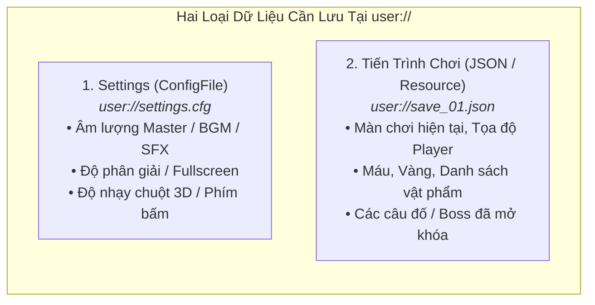

# 💾 Giai Đoạn 2.2: Hệ Thống Save/Load, Quản Lý Cài Đặt (Settings) & Tái Sử Dụng Resource

> [!TIP] Điều Hướng Hồ Sơ
> - 🧭 **Về Trang Tổng Quan**: [[00. Tổng quan - Học & Phát Triển Game 2D & 3D (Godot 4)]]
> - 📂 **Cùng Chuyên Mục**: [[01. Autoload (Singletons), EventBus, AudioManager & SceneTransition]]
> - ⏭️ **Bước Tiếp Theo**: [[01. Không gian 3D, Node3D, Camera3D, Ánh sáng & Môi trường]]

---

## 🗂️ Phân Biệt Đường Dẫn `res://` và `user://` Trong Godot 4

Một kiến thức bắt buộc phải nắm rõ trước khi đóng gói (Export) bất kỳ tựa game 2D hay 3D nào:
- **`res://` (Resource Path — Chỉ Đọc khi đã xuất bản):** Chứa toàn bộ code, cảnh, hình ảnh, âm thanh gốc của game. Khi xuất thành file `.exe`/`.pck`, thư mục `res://` bị khóa cứng (Read-only), bạn **không thể ghi file save vào `res://`**.
- **`user://` (User Data Path — Đọc & Ghi tự do):** Thư mục riêng trên máy người chơi (trên Windows nằm tại `%APPDATA%\Godot\app_userdata\[Tên_Game]\`). Mọi file Save Game và Cài đặt (`settings.cfg`, `save_slot_1.json`) **bắt buộc phải lưu tại `user://`**.

---

## 📋 Checklist Đầu Việc Chi Tiết (Phân Tách Theo 4 Vai Trò)

### 1. Thiết Kế Giao Diện Cài Đặt (Settings Menu) & Âm Thanh Xác Nhận Lưu Game
- [ ] **`[Tạo Asset]`** Dùng **Chiptone / ElevenLabs SFX** tạo hiệu ứng âm thanh đặc trưng khi người chơi chạm vào Điểm Lưu Game (Checkpoint / Bonfire): `sfx_checkpoint_save.wav` (âm thanh ngân vang ấm áp báo hiệu đã lưu an toàn).
- [ ] **`[Tự soạn nhạc]`** **Thực hành Nhạc lý Mốc 4 (Hợp âm Bảy - Seventh Chords cho Điểm Nghỉ Ngơi / Save Room):**
  - Mở **MuseScore / Reaper**, viết một bản nhạc ngắn 8 ô nhịp theo phong cách *Save Room* (như Resident Evil hoặc Hollow Knight) sử dụng các hợp âm **`Maj7` và `m7`** (ví dụ: `Fmaj7 - Em7 - Dm7 - Cmaj7` ở Tempo chậm `72 BPM`).
  - Màu sắc lơ lửng, êm dịu của hợp âm 7 giúp người chơi cảm thấy hoàn toàn thư giãn và an toàn ngay khi bước vào phòng lưu game!
- [ ] **`[Thao tác trên Godot]`** Tạo Scene `settings_menu.tscn` gồm:
  - 3 thanh trượt `HSlider` (`min_value = 0.0`, `max_value = 1.0`, `step = 0.05`) điều chỉnh âm lượng `Master`, `BGM`, `SFX`.
  - Nút tích `CheckButton` bật/tắt Toàn màn hình (`Fullscreen`) và `OptionButton` chọn độ phân giải.

### 2. Lập Trình Hệ Thống Lưu Cài Đặt (`ConfigFile`) & Lưu Tiến Trình (`SaveManager`)
- [ ] **`[Code cùng AI]`** Viết Autoload `settings_manager.gd` sử dụng lớp `ConfigFile` có sẵn của Godot 4 để lưu và nạp file `user://settings.cfg`:
  - Chuyển đổi giá trị tuyến tính của thanh trượt (`0.0 -> 1.0`) sang đơn vị Decibel chuẩn của AudioBus bằng hàm `linear_to_db()` và `AudioServer.set_bus_volume_db()`.
  - Lưu trạng thái cửa sổ bằng `DisplayServer.window_set_mode()`.
- [ ] **`[Code cùng AI]`** Thiết kế nhóm Node cần lưu bằng **Godot Groups (`Persist` Group)**:
  - Mọi đối tượng trong màn chơi cần lưu trạng thái (Player, Rương báu đã mở, Quái vật) được gắn vào Group `"persist"` và cài đặt hàm `save_data() -> Dictionary` cùng hàm `load_data(data: Dictionary)`.
- [ ] **`[Code cùng AI]`** Viết Autoload `save_manager.gd` thực hiện tuần tự hóa (Serialization) toàn bộ dữ liệu sang định dạng **JSON** (`FileAccess.open("user://save_slot_1.json", FileAccess.WRITE)`):
  - Đặt log truy vết rõ ràng (`Logger.info("Game saved successfully to user://save_slot_1.json")`) và xử lý ngoại lệ (`try/parse error`) nếu file save bị hỏng hoặc người chơi chỉnh sửa file bên ngoài.

---

## 🧪 Luồng Nghiệp Vụ (Flow) & Tiêu Chí Kiểm Thử (Test Cases)

- **Flow xử lý:** `Người chơi kéo thanh âm lượng BGM xuống 50% và bấm Lưu` $\rightarrow$ `SettingsManager chuyển 0.5 sang dB và cập nhật AudioServer` $\rightarrow$ `Ghi xuống user://settings.cfg` $\rightarrow$ `Tắt hẳn game mở lại` $\rightarrow$ `SettingsManager._ready() tự động nạp lại đúng mức âm lượng 50%`.
- **Test Case 1 (Happy Path):** Chơi ở màn 2D, nhặt 5 đồng xu, chạm cột Checkpoint, tắt game mở lại bấm *Continue* $\rightarrow$ Nhân vật xuất hiện đúng tại vị trí cột Checkpoint với đúng 5 đồng xu.
- **Test Case 2 (Error Handling):** Cố tình xóa hoặc viết ký tự rác vào file `user://save_slot_1.json` $\rightarrow$ Game không bị crash khi mở lên, `SaveManager` ghi log `WARN`, tự động tạo file mặc định mới và thông báo lịch sự trên UI.
