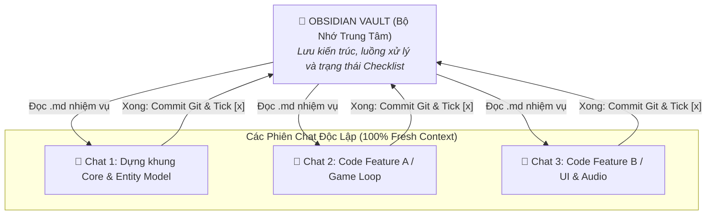

# 🔬 Nghiên Cứu: Quy Chuẩn GEMINI.md & Quản Trị Git Cho Các Dự Án Mới

> [!abstract] **Mục đích nghiên cứu**
> Ghi chú này tổng hợp và đóng gói bộ quy chuẩn về **AI Agent (Antigravity)**, **Git cục bộ** và **Tài liệu hóa bằng Markdown** để bạn có thể mang đi áp dụng, tái sử dụng cho **bất kỳ dự án phần mềm / source code nào khác trong tương lai**.

---

## 🎯 1. Tại Sao Phải Có `GEMINI.md` Cho Dự Án Mới?

Khi bạn làm việc với AI Agent trong một thư mục code mới:
* Nếu không có quy chuẩn, AI có thể tự ý sửa file, tạo cấu trúc lộn xộn hoặc không lưu lại nhật ký công việc.
* Khi có tệp **`GEMINI.md`** ở thư mục gốc: AI Agent khi bước vào dự án sẽ tự động đọc file này trước tiên và tuân thủ:
  1. **Đóng vai trò Project / Task Manager:** Tự động phân rã yêu cầu của bạn thành các đầu việc nhỏ, quản lý checklist tiến độ rõ ràng.
  2. **Luôn lập kế hoạch trước khi code:** Với tác vụ lớn, AI phải tạo `implementation_plan.md` cho bạn duyệt trước khi đụng vào code.
  3. **Báo cáo kết quả:** Sau khi làm xong, AI tự tổng hợp những gì đã làm vào `walkthrough.md` hoặc note tiến độ.

👉 *File khuôn mẫu hoàn chỉnh đã được lưu sẵn tại: [[GEMINI|GEMINI.md (Mẫu chuẩn)]]*

---

## 🛠️ 2. Tại Sao Project Chưa Đẩy Git Vẫn Phải Khởi Tạo Git Cục Bộ (`git init`)?

* **Lý do cốt lõi: Khả năng Rollback (Khôi phục) An toàn Tuyệt đối.**
  * Trong quá trình code cùng AI hoặc tự thử nghiệm ý tưởng mới, sẽ có lúc code bị lỗi, bug phát sinh ngoài ý muốn hoặc bạn muốn đổi hướng tiếp cận.
  * Nếu không có Git, bạn sẽ phải Ctrl+Z mò mẫm hoặc mất code.
  * Khi có **Git cục bộ (`git init`)**:
    - Mỗi khi hoàn thành một chức năng nhỏ hoặc trước khi bảo AI refactor code lớn $\rightarrow$ tạo ngay 1 commit:
      ```bash
      git add .
      git commit -m "feat: xong chức năng đăng nhập"
      ```
    - Nếu AI làm lỗi hoặc không ưng ý, bạn chỉ cần gõ 1 lệnh là quay về phiên bản sạch trước đó ngay lập tức:
      ```bash
      git restore .
      # hoặc git reset --hard HEAD
      ```
  * **Không phụ thuộc vào GitHub/GitLab:** Bạn hoàn toàn kiểm soát được lịch sử phiên bản ngay trên ổ cứng máy tính cá nhân.

---

## 📝 Quy Chuẩn Tài Liệu Hóa Bằng Markdown (.md) Cho Project Mới

Mỗi dự án phần mềm mới nên vận hành xoay quanh các file `.md`:
- **`README.md`**: Tổng quan dự án, hướng dẫn cài đặt môi trường, cách chạy và test code.
- **`implementation_plan.md`**: Bản kế hoạch các bước triển khai chi tiết trước khi code.
- **`walkthrough.md`**: Báo cáo tổng kết những gì đã hoàn thành, kết quả test và bước tiếp theo.
- **`GEMINI.md`**: Bản hướng dẫn vận hành chuẩn hóa cho AI Agent.
- **Liên Kết Chéo & Truy Vết Luồng Nghiệp Vụ (Flow Traceability):**
  - Các file tài liệu trong Obsidian hoặc repo phải **liên kết chéo với nhau** (`[[WikiLinks]]` hoặc `[Link](file://...)`) nếu có quan hệ nghiệp vụ logic.
  - Khi mô tả một flow: Phải chỉ rõ **từ đâu tới đâu** (ví dụ: `UI` $\rightarrow$ `Controller` $\rightarrow$ `Service` $\rightarrow$ `Repository` $\rightarrow$ `DB`), mô tả xử lý từng chặng và **gắn kèm danh sách Test Case** (Happy path, Edge case, Lỗi).
- **Quy Chuẩn Định Dạng Obsidian Vault (Obsidian Best Practices):**
  - **Không đánh số thứ tự đầu dòng (No Numbered Headings / Lists):** Tiêu đề (`##`, `###`) và danh sách không đánh số thứ tự cứng (`1.`, `2.`, `1.1.`) để tránh rối mắt, giữ outline và giao diện đọc luôn thoáng đãng.
  - **Cấu hình Vault chuẩn:** File `.obsidian/app.json` luôn đặt `"showLineNumber": false` để tránh bật cột số dòng editor làm rối mắt khi xem tài liệu.
  - **Tối ưu hiển thị trực quan:** Sử dụng sơ đồ Mermaid, callouts GitHub-style (`> [!tip]`, `> [!important]`), bảng biểu trực quan.
- **File Đính Chính / Làm Rõ Khi Chưa Chắc Chắn (`clarifications_needed.md`):**
  - Nếu có quá nhiều câu hỏi, điểm mơ hồ hoặc kiến trúc chưa thống nhất: AI Agent chủ động **tạo 1 file Markdown riêng** tổng hợp toàn bộ câu hỏi và các phương án so sánh để User review và đính chính một lần trước khi bắt tay vào code.

---

## 💻 Quy Chuẩn Code & Logging Dễ Truy Vết (Debuggability)

- **Ghi Log đúng chỗ và đúng cấp độ (`INFO`, `DEBUG`, `WARN`, `ERROR`):**
  - `INFO`: Điểm bắt đầu luồng nghiệp vụ, sự kiện hệ thống quan trọng.
  - `DEBUG`: Dữ liệu chi tiết, giá trị tham số trung gian khi xử lý thuật toán.
  - `WARN`: Dữ liệu bất thường, tài nguyên suy giảm hoặc thử lại kết nối (retry).
  - `ERROR`: Bắt buộc trong khối ngoại lệ (`try-catch`), phải log rõ thông điệp lỗi kèm context ID và stack trace.
- **Mục tiêu tối thượng:** Mọi cú pháp code khi vận hành đều có thể truy vết được luồng xử lý (traceability) từ đầu tới cuối, giúp việc điều tra và gỡ lỗi (debugging) tức thì khi có sự cố.

---

## 🔄 Chiến Lược Tách Chat Theo Tính Năng & Bảo Toàn Ngữ Cảnh (Context Hygiene)

### Tại sao 1 phiên chat duy nhất chắc chắn sẽ "quên code"?
- **Hiện tượng tràn Context Window (Context Saturation & Lost in the Middle):** Khi một cuộc trò chuyện kéo dài qua nhiều lượt trao đổi, lịch sử chat phình to ngốn hàng chục nghìn token. AI bắt đầu quên các file đã đọc ở đầu chat, nhầm lẫn giữa code cũ với code mới hoặc tưởng tượng ra các biến/hàm không có thật.
- **Nghịch lý "Chat càng dài, code càng dễ sinh bug":** Càng nhiều context rác (lịch sử debug, lỗi cú pháp cũ đã fix), AI càng dễ mất tập trung và giảm độ chính xác.

### Giải pháp: Obsidian làm "Bộ não trung tâm" — Chat làm "Công nhân chuyên biệt" (Ephemeral Worker)



### Quy trình 4 bước khi làm việc theo mô hình Tách Chat
- **Bước 1 (Chuẩn bị trên Obsidian):**
  - Mở file kế hoạch (`implementation_plan.md` hoặc note nghiệp vụ trong Obsidian).
  - Xác định rõ: Tên tính năng cần làm, luồng xử lý từ đâu tới đâu, các file code liên quan và các test case cần đạt.
- **Bước 2 (Khởi động Chat mới):**
  - Mở một phiên chat mới hoàn toàn (vẫn add 2 workspace: Code & Obsidian).
  - Chat mới sở hữu 100% dung lượng ngữ cảnh sạch, không bị vướng bận lịch sử trao đổi cũ.
  - Gửi prompt chỉ định: *"Phiên chat này chỉ tập trung làm đúng Tính năng X theo tài liệu [Ten_File.md] bên Obsidian."*
- **Bước 3 (Thực thi & Kiểm thử):**
  - AI đọc file `.md` để hiểu bối cảnh, đọc các file code liên quan, viết code sạch, đặt log chuẩn và chạy test xác minh.
- **Bước 4 (Đóng gói & Bàn giao):**
  - AI chạy `git commit -m "feat: hoàn thành tính năng X"`.
  - AI mở file `.md` trong Obsidian đánh dấu `[x]` vào checklist của tính năng đó.
  - Bạn có thể đóng chat này lại. Tính năng tiếp theo lại mở chat mới với tâm thế hoàn toàn tươi mới!

### Mẫu Prompt ngắn khi mở Chat mới cho 1 Tính năng con (Sub-feature Prompt)
```markdown
Chào bạn, trong phiên chat này chúng ta chỉ tập trung làm DUY NHẤT một tính năng: [TÊN TÍNH NĂNG / FLOW].
Tôi đã gắn 2 thư mục làm việc (Code Workspace và Obsidian Workspace).

Nhiệm vụ của bạn:
1. Đọc tệp tài liệu: [[TÊN_FILE_KE_HOACH.md]] bên thư mục Obsidian để nắm rõ yêu cầu nghiệp vụ, luồng xử lý và tiêu chí kiểm thử của tính năng này.
2. Kiểm tra các file mã nguồn liên quan bên thư mục Code và lập kế hoạch thực hiện ngắn gọn.
3. Tiến hành viết code, đặt log đúng chỗ (INFO, DEBUG, ERROR), chạy test xác minh.
4. Sau khi xong: Tạo commit Git theo chuẩn Conventional Commits và cập nhật trạng thái checklist [x] vào tệp .md bên Obsidian.
```

---

## 📋 Checklist Các Bước Khi Bắt Đầu Dự Án Mới Trong Tương Lai

- [ ] **Bước 1:** Mở terminal tại thư mục gốc của project mới $\rightarrow$ Chạy lệnh khởi tạo Git cục bộ:
  ```bash
  git init
  ```
- [ ] **Bước 2:** Copy tệp [[GEMINI|GEMINI.md]] từ thư mục này bỏ vào thư mục gốc của project mới.
- [ ] **Bước 3:** Tạo tệp `.gitignore` phù hợp (bỏ qua `node_modules/`, `target/`, `.idea/`, file tạm...).
- [ ] **Bước 4:** Tạo commit đầu tiên để đánh dấu mốc dự án khởi động:
  ```bash
  git add .
  git commit -m "feat: initial commit with GEMINI.md guidelines"
  ```

---

## 🚀 Prompt Mẫu Khởi Động Dự Án Mới (Master Kick-off Prompt)

> [!tip] **Hướng dẫn sử dụng:**
> Khi mở một phiên chat mới cho một dự án mới (ví dụ: làm Game, Web, App) và đã add 2 thư mục (Thư mục Code & Thư mục Obsidian), hãy copy toàn bộ đoạn prompt bên dưới và gửi vào ô chat:

```markdown
Chào bạn, chúng ta sẽ bắt đầu làm việc trên dự án này.
Tôi đã cấu hình cho bạn 2 không gian làm việc (Workspaces):
1. Thư mục Dự Án (Project / Code Workspace): Nơi chứa mã nguồn, assets, scenes, file cấu hình engine/build.
2. Thư mục Obsidian (Documentation / Vault Workspace): Nơi lưu trữ tài liệu, kế hoạch, nhật ký tiến độ và To-Do List.

### NGUYÊN TẮC VẬN HÀNH BẮT BUỘC (TUÂN THEO GEMINI.md):
Bạn là AI Agent cấp cao (Senior Engineer kiêm Project / Task Manager). Bạn bắt buộc phải tuân thủ nghiêm ngặt các quy chuẩn sau:
- Vai trò Project & Task Manager: Tự động phân rã yêu cầu thành các đầu việc nhỏ ([ ] -> [/] -> [x]). Giữ to-do list luôn tinh gọn: hiển thị rõ việc ĐANG LÀM và việc CẦN LÀM TIẾP, không để trôi task.
- Git cục bộ & Rollback an toàn: Kiểm tra ngay thư mục dự án xem đã có Git cục bộ chưa. Nếu chưa có, hãy khởi tạo (git init) và commit thường xuyên theo Conventional Commits (feat:, fix:, docs:, refactor:, test:, chore:) sau mỗi mốc tính năng để đảm bảo có thể rollback bất kỳ lúc nào.
- Phân tách trách nhiệm 2 thư mục:
  + Mọi mã nguồn, asset, file cấu hình kỹ thuật viết và thao tác trong Thư mục Dự Án.
  + Mọi tài liệu hóa (README.md, implementation_plan.md, walkthrough.md, to-do notes) viết và cập nhật bên Thư mục Obsidian.
- Liên kết chéo & Truy vết luồng nghiệp vụ (Flow Traceability): Các file tài liệu trong Obsidian phải được liên kết chéo ([[WikiLinks]]). Khi mô tả một flow (Game loop, Player State Machine, Data flow), phải chỉ rõ từ đâu tới đâu kèm các Test Case kiểm thử tương ứng.
- Quy chuẩn Ghi Log (Debuggability): Mọi cú pháp code phải có log đúng chỗ, đúng cấp độ (INFO, DEBUG, WARN, ERROR) tại các điểm then chốt (bắt đầu hàm, trước/sau gọi ngoại vi, rẽ nhánh điều kiện, trong khối try-catch) để dễ dàng truy vết và debug.
- Quy chuẩn Obsidian Vault: Không đánh số thứ tự đầu dòng cứng (## 1., 1.1.), tối ưu hiển thị trực quan (Mermaid diagram, Callouts, bảng biểu).
- Cơ chế đính chính khi chưa chắc chắn: Nếu có nhiều hướng tiếp cận kiến trúc hoặc yêu cầu chưa rõ, hãy gom vào file clarifications_needed.md để tôi đính chính/xác nhận một lần thay vì đoán mò.

---

### NHIỆM VỤ ĐẦU TIÊN CỦA BẠN (TURN 1):
Ngay bây giờ, hãy thực hiện các bước khảo sát sơ bộ sau và báo cáo lại cho tôi:
1. Quét toàn diện thư mục Dự Án (Project Folder):
   - Nhận diện loại công nghệ / Game Engine / Framework đang sử dụng (ví dụ: Godot, Unity, Pygame, Raylib, Web...).
   - Liệt kê cây thư mục chính, các file cấu hình quan trọng, các scenes, scripts, assets hiện có.
   - Đánh giá hiện trạng: Project đã có những gì chạy được? Những thành phần cốt lõi nào đang còn thiếu?
2. Kiểm tra trạng thái Git:
   - Kiểm tra xem project đã có git init và .gitignore phù hợp chưa.
3. Khởi tạo Kế Hoạch & To-Do List ban đầu trong Thư mục Obsidian:
   - Tạo file tổng quan dự án (hoặc cập nhật Dashboard / implementation_plan.md trong thư mục Obsidian).
   - Thiết lập danh sách các đầu việc cần làm ban đầu (Backlog & Next Steps).
4. Báo cáo tổng kết hiện trạng & Đề xuất hành động tiếp theo:
   - Trình bày ngắn gọn, trực quan bức tranh toàn cảnh của project cho tôi.
   - Nêu rõ: "Hiện trạng project đang có gì" và "Bước tiếp theo đề xuất chúng ta nên bắt tay vào làm việc gì".
```

---
*Điều hướng: [[00. Tổng quan - Dashboard]] | [[03. Dự án & Mục tiêu]]*
