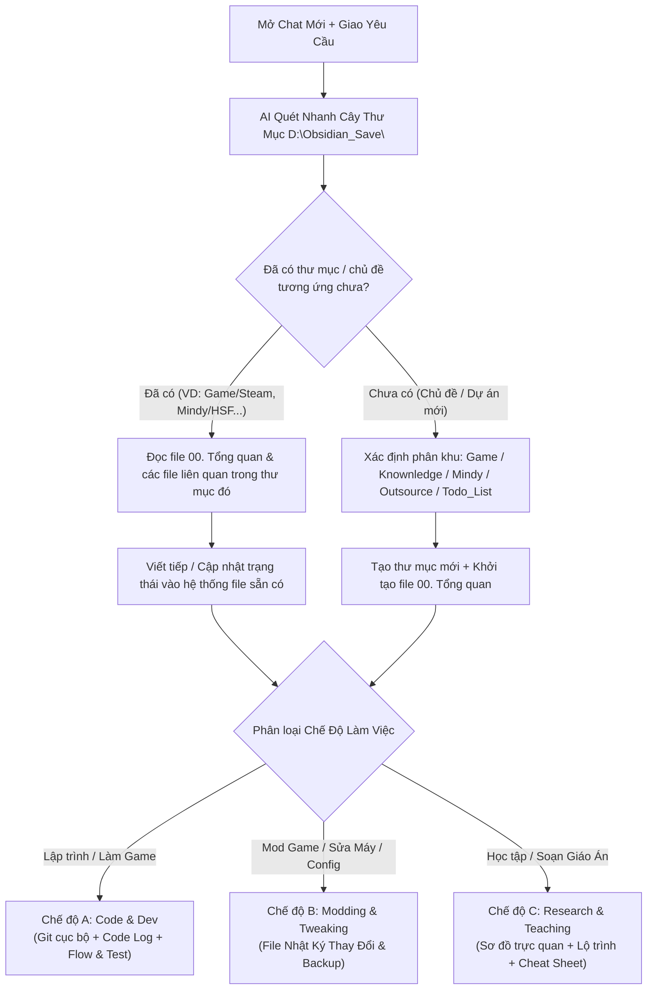

# 🧭 Báo Cáo Phân Tích & Đề Xuất: Quy Chuẩn Root Obsidian (Universal Router & Multi-Mode Blueprint)

> [!abstract] **Mục Đích Tài Liệu**
> Tài liệu này cập nhật lại toàn bộ tư duy thiết kế cho tệp quy chuẩn đặt tại gốc `D:\Obsidian_Save\`. Thay vì chỉ bó hẹp trong các dự án lập trình, tệp ở root sẽ đóng vai trò là **Bộ Định Tuyến Tổng Quát (Universal Router & Constitution)** — tự động nhận diện lĩnh vực, quyết định viết tiếp hay tạo mới, và tự chuyển đổi chế độ làm việc (Code / Mod Game & Cấu hình / Nghiên cứu & Giảng dạy).

---

## 🎯 Tôi Đã Nắm Được Những Gì Từ Yêu Cầu Của Bạn?

Bản chất mong muốn của bạn đối với tệp đặt tại gốc `D:\Obsidian_Save\` gồm **4 nguyên lý cốt lõi**:

- **Tính Tổng Quát Tuyệt Đối (Universal & Domain-Agnostic):**
  - Không phải phiên chat nào cũng là viết code dự án phần mềm. Bạn dùng AI cho rất nhiều mục đích: **Mod game** (Steam, cấu hình `.ini`, danh sách mod, patch), **Tinh chỉnh hệ thống/mạng** (VPN, Registry, Windows), **Nghiên cứu công nghệ** (AI, CCNA, Godot), **Soạn giáo án dạy học** (HSF, CSD, PRJ), và **Làm dự án phần mềm/game**.
  - Do đó, tệp ở root `D:\Obsidian_Save\` phải là một **"Hiến pháp chung"** bao quát được tất cả các tình huống này.
- **Cơ Chế Định Tuyến Thông Minh: "Có Rồi Thì Viết Tiếp — Chưa Có Mới Tạo Mới" (Smart Folder Routing):**
  - Khi một chat mới bắt đầu, việc đầu tiên AI phải làm là **quét cấu trúc thư mục trong `D:\Obsidian_Save\`**:
    - Nếu chủ đề bạn hỏi **đã thuộc một lĩnh vực/dự án có sẵn** (ví dụ: hỏi về một tựa game trong `Game\Steam\`, hoặc hỏi tiếp về môn học trong `Mindy\`) $\rightarrow$ AI phải tự động tìm đến đúng thư mục đó, đọc các file `.md` hiện có để nắm lịch sử và **cập nhật/viết nối tiếp vào đó**.
    - Nếu chủ đề hoàn toàn mới, **chưa từng có thư mục nào chứa** $\rightarrow$ AI mới đề xuất tạo thư mục/tệp mới tại phân khu phù hợp.
- **Luôn Phải Có Nhật Ký Thay Đổi Cho Cả Việc Phi Lập Trình (Change & Modification Log):**
  - Với dự án code thì có Git và code log. Nhưng với các việc như **Mod Game, sửa file config, can thiệp hệ thống**, bạn vẫn bắt buộc cần **1 file `.md` đóng vai trò Sổ Tay Thay Đổi (Modification & Rollback Log)**.
  - File này giúp bạn nhớ chính xác: *Đã cài mod gì, sửa thông số nào ở file nào, đường dẫn gốc ở đâu, bản backup để đâu, và nếu game update hay bị crash thì gỡ ra/khôi phục lại như thế nào.*
- **Tách Chat Chống Quên Ngữ Cảnh (Session Splitting):**
  - Mỗi phiên chat chỉ giải quyết một đầu việc/tính năng hoặc một vấn đề cụ thể, sau đó ghi kết quả lại vào Obsidian để các chat tương lai đọc lại là hiểu ngay mà không bị tràn bộ nhớ.

---

## 🏗️ Đề Xuất Kiến Trúc Cho Tệp Root `D:\Obsidian_Save\`

### Cơ Chế 1: Lưu Đồ Định Tuyến Tự Động Khi Mở Chat Mới (Auto-Discovery & Routing)

---

### Cơ Chế 2: Ba Chế Độ Thích Ứng Linh Hoạt (Adaptive Modes)

Thay vì ép mọi thứ vào khuôn mẫu code, AI sẽ tự động nhận diện yêu cầu của bạn thuộc nhóm nào trong 3 nhóm sau:

| Chế Độ | Khi Nào Kích Hoạt? | Quy Chuẩn Bắt Buộc AI Phải Làm |
| :--- | :--- | :--- |
| **1. Chế độ Code & Dev** *(Làm phần mềm, làm game từ đầu)* | Khi có thư mục source code riêng | • Bắt buộc `git init` cục bộ tại thư mục code để rollback. • Code phải có log truy vết (`INFO`, `DEBUG`, `WARN`, `ERROR`). • Tài liệu hóa luồng đi (`Flow`) từ đâu tới đâu kèm `Test Cases`. |
| **2. Chế độ Modding & Tweaking** *(Mod game, chỉnh file `.ini`/config, sửa lỗi PC/mạng)* | Khi can thiệp vào game có sẵn, cài mod, chỉnh cấu hình máy | • **Bắt buộc duy trì file Nhật Ký Thay Đổi (`Changelog / Mod List`):**   1. *Vị trí tác động:* Đường dẫn cài game / thư mục chứa config / Registry.   2. *Giá trị gốc / Backup:* Lưu lại thông số mặc định trước khi sửa.   3. *Danh sách Mod / Thay đổi:* Đã cài gì, thứ tự load, sửa dòng nào.   4. *Cách khôi phục (Rollback):* Các bước trả về nguyên trạng nếu lỗi. |
| **3. Chế độ Research & Teaching** *(Nghiên cứu kiến thức, soạn giáo trình dạy học)* | Khi tìm hiểu công nghệ mới hoặc chuẩn bị bài giảng | • Trực quan hóa bằng sơ đồ Mermaid, bảng biểu, ví dụ ẩn dụ đời thực. • Chia nhỏ thành các chuyên đề có liên kết chéo `[[WikiLinks]]`. • Tạo sẵn Master Prompt hoặc Cheat Sheet khi cần. |

---

### Cơ Chế 3: Chuẩn Hóa Tên File `.md` Dùng Chung Cho Mọi Lĩnh Vực

Để dù là dự án Code, Mod Game hay Nghiên cứu thì các chat sau nhìn vào tên file đều hiểu ngay nhiệm vụ của từng file:

| Nhóm Vai Trò | Quy Ước Đặt Tên Chuẩn | Ý Nghĩa & Áp Dụng Chung Cho Mọi Lĩnh Vực |
| :--- | :--- | :--- |
| **Trạm Điều Phối** *(Luôn có ở mỗi dự án/chủ đề)* | `00. Tổng quan - [Tên Chủ Đề].md` *(hoặc `00. Dashboard.md`)* | **File đầu tiên AI phải đọc** khi vào một thư mục. Chứa mục lục liên kết tất cả các file con và danh sách việc đang làm (`[ ]`, `[/]`, `[x]`). |
| **Kế Hoạch & Phương Án** *(Trước khi làm)* | `Kế hoạch - [Tên Việc].md` *(hoặc `implementation_plan.md`)* | Ghi lại dự định sẽ làm gì, cài những mod nào, hoặc kiến trúc code ra sao trước khi thực hiện. |
| **Nhật Ký Thay Đổi & Kết Quả** *(Trong & Sau khi làm)* | `Nhật ký thay đổi - [Tên].md` *(hoặc `walkthrough.md` / `changelog.md`)* | • **Với Mod Game / Hệ thống:** Ghi rõ đường dẫn file đã sửa, thông số cũ $\rightarrow$ mới, danh sách mod đã cài và cách gỡ. • **Với Code:** Ghi lại kết quả test và những gì đã hoàn thành. |
| **Luồng & Chi Tiết Chuyên Môn** *(Tài liệu thành phần)* | `Chi tiết - [Tên Mảng].md` *(hoặc `Flow - [Tên Luồng].md`)* | Tách nhỏ từng tính năng, từng nhóm mod (VD: `Chi tiết - Mod Đồ Họa & UI.md`) hoặc từng luồng nghiệp vụ để không làm 1 file bị quá dài. |
| **Câu Hỏi Cần Xác Nhận** *(Khi chưa chắc chắn)* | `Cần làm rõ - [Tên].md` *(hoặc `clarifications_needed.md`)* | Khi có nhiều cách làm hoặc sợ xung đột (ví dụ: 2 bản mod đụng nhau, hoặc 2 hướng kiến trúc), AI ghi ra đây để hỏi bạn trước. |
| **Lưu Trữ Cũ** *(Khi đã xong)* | Thư mục `Lưu Trữ/` *(hoặc `Archive/`)* | Chứa các ghi chú cũ không còn dùng tới để AI ở các chat sau không bị đọc nhầm. |

---

### Cơ Chế 4: Về MCP & Thiết Lập Bổ Trợ

- **Đối với quản lý file `.md` và tìm kiếm trong `D:\Obsidian_Save\`:**
  - Không cần cài thêm MCP ngoài. Chỉ cần khi mở chat mới, bạn **add thư mục gốc `D:\Obsidian_Save`** (hoặc thư mục phân khu tương ứng) vào Workspace của chat. Công cụ đọc thư mục và tìm kiếm nội tại của Antigravity sẽ quét toàn bộ cây thư mục chỉ trong 1 giây.
- **Điểm duy nhất cần chuẩn bị thêm:**
  - Đặt tệp quy chuẩn ngay tại gốc: **`D:\Obsidian_Save\GEMINI.md`**!
  - **Tại sao nên đặt tên là `D:\Obsidian_Save\GEMINI.md`?** Vì theo cơ chế tự động của hệ thống Antigravity, bất cứ khi nào bạn gắn `D:\Obsidian_Save` làm Workspace (hoặc thư mục cha), Antigravity sẽ **tự động phát hiện và nạp `GEMINI.md` vào bộ nhớ quy tắc bắt buộc (User Rules)** ngay từ giây đầu tiên mà bạn thậm chí không cần phải copy-paste dài dòng!

---

## 🔗 Liên Kết Điều Hướng
* [[00. Tổng quan - Dashboard]] | [[05. Nghiên Cứu - Quy Chuẩn GEMINI.md & Quản Lý Git Cho Dự Án Khác]]
