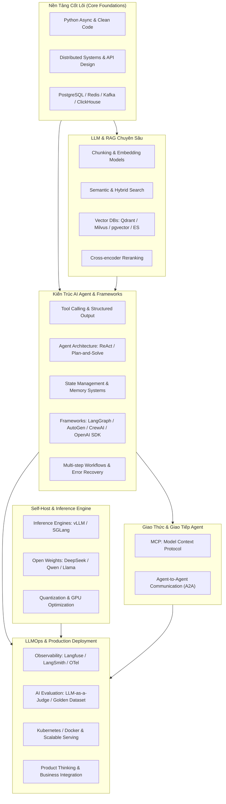

# 🧠 Lộ Trình Nghiên Cứu Chuyên Sâu — AI Engineer & Agentic Systems

> [!abstract] **Mục Tiêu & Bối Cảnh Nghiên Cứu**
> Tài liệu này tổng hợp toàn bộ lộ trình nghiên cứu, chuẩn hóa kiến thức và kế hoạch thực hành dựa trên bộ yêu cầu tuyển dụng **Senior AI Engineer / AI Agent Engineer**.
> Hệ thống tài liệu được chia tách thành các module chuyên sâu, liên kết chéo (`[[WikiLinks]]`) và bám sát cả 2 nhóm: **Yêu Cầu Chuyên Môn Cốt Lõi** & **Kỹ Năng Ưu Tiên Nâng Cao**.

---

## 🗺️ Bản Đồ Kiến Thức (Knowledge Architecture Map)

---

## 📚 Danh Mục Các Module Chuyên Sâu

Dưới đây là các chuyên đề nghiên cứu chi tiết được tách nhỏ để bạn dễ dàng đào sâu từng mảng:

- [[01. Nền Tảng Kỹ Thuật (Python, Distributed Systems & Software Engineering)|Chuyên Đề 01: Nền Tảng Kỹ Thuật — Python Nâng Cao, Distributed Systems & Kiến Trúc Phần Mềm]]
  - Asyncio, Typing, OOP, Design Patterns, Clean Architecture, FastAPI, Concurrency, Distributed Caching, Message Queues.
- [[02. RAG Chuyên Sâu, Embedding, Semantic Search & Vector DB|Chuyên Đề 02: RAG Toàn Diện — Embedding, Semantic Search, Hybrid Search & Vector DBs]]
  - Chunking nâng cao, Embedding models, Milvus, Qdrant, pgvector, Elasticsearch, Reranker, Metadata Filtering, Context Window Optimization.
- [[03. Kiến Trúc AI Agent, State Management, Memory & Frameworks|Chuyên Đề 03: Kiến Trúc AI Agent — State Management, Memory & Frameworks]]
  - ReAct, Plan-and-Solve, Reflection, LangGraph, AutoGen, CrewAI, OpenAI Agents SDK, Semantic Kernel, Short/Long-term Memory (Mem0).
- [[04. Tool Calling, Function Calling & Structured Output|Chuyên Đề 04: Tool Calling, Function Calling & Structured Output Chuẩn Hóa]]
  - Pydantic models, JSON Schema validation, Dynamic tool execution, Error handling khi model sinh sai format, Tool registry.
- [[05. Giao Thức MCP (Model Context Protocol) & Agent-to-Agent (A2A)|Chuyên Đề 05: Giao Thức MCP (Model Context Protocol) & Giao Tiếp Đa Agent (A2A)]]
  - Chuẩn Anthropic MCP (Host, Client, Server), Tools/Resources/Prompts via MCP, Phối hợp Agent phân tán, Protocol interoperability.
- [[06. Self-Host LLM, Inference Engine (vLLM, SGLang) & Open Source Models|Chuyên Đề 06: Tự Host LLM — vLLM, SGLang & Mô Hình Mã Nguồn Mở]]
  - PagedAttention, RadixAttention, DeepSeek (V3/R1), Qwen 2.5, Llama 3.3, AWQ/GGUF quantization, Tính toán vRAM & Throughput.
- [[07. LLMOps, Observability & Đánh Giá AI (LLM-as-a-Judge, Golden Dataset)|Chuyên Đề 07: LLMOps, Observability & Đánh Giá AI (AI Evaluation)]]
  - Langfuse, LangSmith, OpenTelemetry, Tracing đa bước, LLM-as-a-Judge, Golden Dataset, Regression Testing, Ragas / DeepEval.
- [[08. Triển Khai Thực Tế, Kubernetes, Hạ Tầng Dữ Liệu & Production Readiness|Chuyên Đề 08: Vận Hành Thực Chiến — Kubernetes, Data Infrastructure & Product Thinking]]
  - K8s GPU Orchestration, PostgreSQL, Redis, Kafka, ClickHouse, Bảo mật chống Prompt Injection, Guardrails, Chuyển giao giá trị nghiệp vụ.

---

## 🎯 Kế Hoạch Nghiên Cứu & Xây Dựng Dự Án Mẫu (Milestones)

- [ ] **Giai đoạn 1: Nền tảng cốt lõi & RAG Production**
  - [ ] Nắm chắc Python Asyncio & API Design chuẩn REST/FastAPI.
  - [ ] Dựng luồng Hybrid Search RAG với Qdrant / pgvector + Cohere Rerank.
  - [ ] Benchmark độ chính xác RAG với Ragas / Golden Dataset.
- [ ] **Giai đoạn 2: Agentic Systems & Multi-Agent Workflows**
  - [ ] Làm chủ LangGraph: Xây dựng Graph Agent có State, Checkpoint và Human-in-the-loop.
  - [ ] Tích hợp Tool Calling với Pydantic Structured Output chặt chẽ.
  - [ ] Nghiên cứu và triển khai MCP Server / Client kết nối công cụ ngoại vi.
  - [ ] Xây dựng kịch bản Multi-Agent phối hợp giải quyết bài toán phức tạp.
- [ ] **Giai đoạn 3: Self-Host, LLMOps & Production Infrastructure**
  - [ ] Dựng server inference vLLM / SGLang chạy model DeepSeek hoặc Qwen cục bộ.
  - [ ] Cài đặt Langfuse để trace toàn bộ vòng đời Agent, token, latency.
  - [ ] Đóng gói Docker, cấu hình K8s manifest phục vụ triển khai chịu tải cao.

---

## 🔗 Điều Hướng Nhanh
* [[00. Tổng quan - Dashboard]] | [[02. Việc hôm nay (Today)]] | [[03. Dự án & Mục tiêu]]
