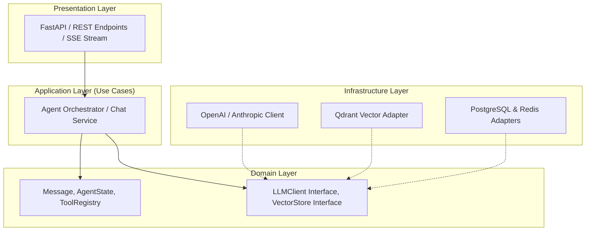

# ⚙️ Chuyên Đề 01: Nền Tảng Kỹ Thuật — Python Nâng Cao, Distributed Systems & Software Engineering

> [!abstract] **Mục Tiêu Chuyên Đề**
> Làm chủ các kỹ thuật lập trình Python hiện đại, tư duy thiết kế phần mềm sạch (Clean Architecture), thiết kế API chuẩn cho luồng streaming LLM, và kiến thức hệ thống phân tán phục vụ xây dựng hạ tầng AI quy mô lớn.

---

## 🐍 1. Python Nâng Cao Cho AI Engineering

Hệ thống AI hiện đại không còn viết bằng các script Jupyter Notebook rời rạc mà đòi hỏi mã nguồn chuẩn production:

- **Asyncio & Lập Trình Bất Đồng Bộ (Asynchronous Programming):**
  - Hiểu sâu về Event Loop, Coroutines (`async def`, `await`), `asyncio.Task`, `asyncio.gather`.
  - Kiểm soát tài nguyên bằng `asyncio.Semaphore` (ví dụ: giới hạn tối đa 10 request đồng thời gọi tới OpenAI/Anthropic để không bị dính rate limit `429 Too Many Requests`).
  - Xử lý timeout và graceful cancellation khi người dùng hủy request hoặc LLM sinh quá lâu.
- **Type Annotations & Kiểu Dữ Liệu Tĩnh (Static Typing):**
  - Ứng dụng `typing` (`Optional`, `Union`, `Literal`, `Annotated`, `Callable`, `Generic`, `TypeVar`).
  - Sử dụng `mypy` hoặc `pyright` để kiểm tra lỗi kiểu dữ liệu trước khi chạy code.
- **Pydantic V2 — Xương Sống Dữ Liệu:**
  - Định nghĩa dữ liệu chặt chẽ bằng `BaseModel`, `Field(description=..., ge=...)`.
  - Tận dụng `model_validate`, `model_dump_json`, `computed_field`.
  - Validation dữ liệu thời gian thực cho Tool Arguments và Structured Output từ LLM.

---

## 🏛️ 2. Clean Architecture & Software Engineering Cho Ứng Dụng AI

Xây dựng ứng dụng AI bền vững cần tách biệt logic nghiệp vụ khỏi các thư viện LLM (tránh bị vendor lock-in):

- **Dependency Inversion Principle (DIP):** Agent Orchestrator chỉ tương tác với Interface `LLMClient` và `VectorStore`, giúp dễ dàng chuyển đổi giữa OpenAI, DeepSeek, vLLM hoặc Ollama mà không phải sửa lại code nghiệp vụ.
- **Repository Pattern:** Quản lý truy xuất dữ liệu Agent (hội thoại, bộ nhớ, vector search) qua các lớp Repository độc lập.

---

## 🌐 3. API Design Chuẩn Cho AI & LLM Streaming

- **Server-Sent Events (SSE) cho Streaming Token:**
  - LLM sinh chữ theo thời gian thực (Time-to-First-Token - TTFT). API phải hỗ trợ streaming thông qua `StreamingResponse(stream_generator(), media_type="text/event-stream")`.
  - Định dạng chuẩn SSE: `data: {"delta": "xin chào", "finish_reason": null}\n\n`.
- **FastAPI Best Practices:**
  - Tách router rõ ràng (`/v1/chat/completions`, `/v1/agents/execute`).
  - Middleware ghi log request ID, đo latency, thống kê số token sử dụng.
  - Xử lý lỗi toàn cục (`Exception Handlers`) trả về định dạng JSON lỗi chuẩn hóa RFC 7807.

---

## 🛰️ 4. Kiến Thức Hệ Thống Phân Tán (Distributed Systems)

Các tác vụ AI Agent thường tốn nhiều thời gian (chạy qua nhiều bước, gọi tool bên ngoài). Không thể xử lý đồng bộ trên một thread:

- **Bất đồng bộ với Message Queue (Kafka / RabbitMQ / Celery / Redis Streams):**
  - Client gửi yêu cầu $\rightarrow$ API Gateway nhận request và đẩy Job vào Queue $\rightarrow$ Trả ngay `job_id` cho Client.
  - Worker Pool chuyên dụng kéo Job từ Queue, chạy Agent Workflow, lưu kết quả vào Database.
  - Client nhận kết quả qua WebSocket, SSE hoặc Polling.
- **Tính Bất Biến & Idempotency (Idempotency Key):**
  - Mọi request kích hoạt Agent (nhất là Agent có quyền thao tác gửi email, chuyển tiền, gọi API bên thứ ba) phải đi kèm `Idempotency-Key` lưu trong Redis để tránh việc người dùng click đúp dẫn đến gọi tool 2 lần.
- **Distributed Caching & Rate Limiting:**
  - Dùng Redis để cache kết quả Embeddings (Semantic Caching), tránh gọi lại embedding model với các câu query trùng lặp.
  - Thuật toán Token Bucket / Leaky Bucket kiểm soát lưu lượng người dùng và giới hạn gọi model ngoài.

---

## 🧪 5. Luồng Xử Lý (Flow) & Tiêu Chí Kiểm Thử (Test Cases)

### Luồng Xử Lý Chuẩn (End-to-End API Flow)
`Client` $\rightarrow$ `FastAPI SSE Endpoint` $\rightarrow$ `Auth & Rate Limiting Middleware` $\rightarrow$ `Agent Service` $\rightarrow$ `LLM Streaming Adapter` $\rightarrow$ `Yield Event Token` $\rightarrow$ `Client Render`

### Bộ Test Case Cần Thực Hiện
- **Happy Path:**
  - Gửi request hợp lệ, nhận stream token liên tục, mã phản hồi 200, đóng kết nối khi nhận token kết thúc `[DONE]`.
- **Edge Cases:**
  - Client ngắt kết nối giữa chừng (Client Disconnect) $\rightarrow$ Backend phải bắt được sự kiện `is_disconnected()` và lập tức hủy request gọi LLM để tiết kiệm chi phí token.
  - Request có chuỗi prompt cực dài chạm ngưỡng max token $\rightarrow$ Trả về lỗi validation rõ ràng kèm gợi ý rút gọn.
- **Error Handling:**
  - Model upstream trả về `429 Rate Limit` hoặc `503 Service Unavailable` $\rightarrow$ Áp dụng Exponential Backoff Retry (thử lại 3 lần) trước khi trả lỗi thân thiện cho người dùng.

---

## 🔗 Liên Kết Chuyên Đề
* [[00. Lộ Trình Nghiên Cứu & Bản Đồ Kiến Thức (Master Roadmap)|Quay lại Lộ Trình Tổng Quan]]
* [[02. RAG Chuyên Sâu, Embedding, Semantic Search & Vector DB|Xem tiếp Chuyên Đề 02: RAG & Vector DB]]
