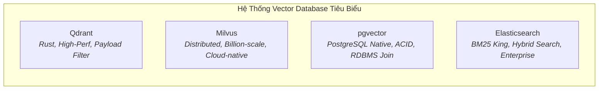
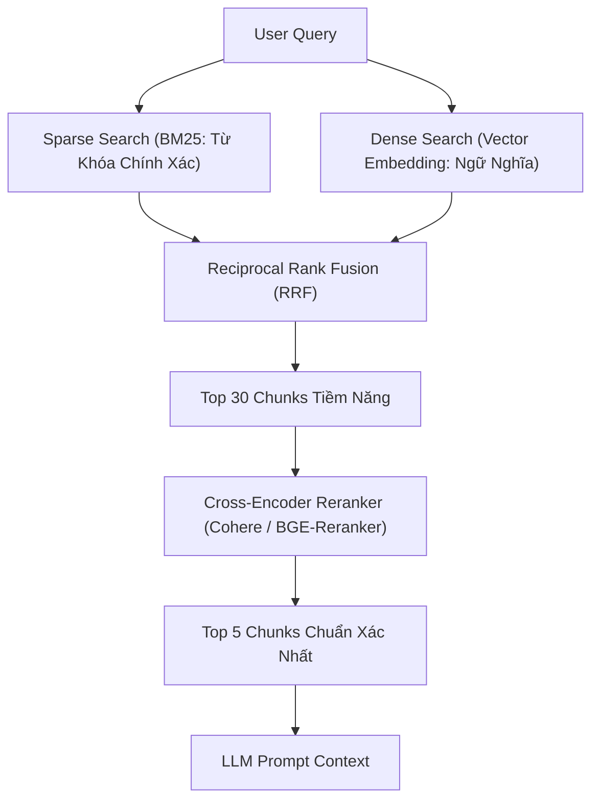

# 🔍 Chuyên Đề 02: RAG Toàn Diện — Embedding, Semantic Search, Hybrid Search & Vector DBs

> [!abstract] **Mục Tiêu Chuyên Đề**
> Nắm vững toàn bộ chu trình xây dựng hệ thống RAG (Retrieval-Augmented Generation) chuẩn sản phẩm: Từ chiến thuật cắt nhỏ văn bản (Chunking), mô hình nhúng (Embedding), tìm kiếm lai (Hybrid Search), so sánh các Vector Database chuyên dụng (Qdrant, Milvus, pgvector, Elasticsearch) đến tầng Reranking tăng độ chuẩn xác.

---

## 📑 1. Kỹ Thuật Phân Đoạn Văn Bản (Chunking Strategies)

Chất lượng câu trả lời của RAG phụ thuộc 80% vào bước chia nhỏ tài liệu:

- **Recursive Character Chunking:** Chia văn bản theo thứ tự phân tách tự nhiên (`\n\n` $\rightarrow$ `\n` $\rightarrow$ dấu cách), giữ độ dài cố định kèm `chunk_overlap` (ví dụ: chunk 512 tokens, overlap 50 tokens) để không đứt đoạn ngữ cảnh.
- **Document-Structure Chunking (Markdown/HTML/PDF):** Cắt theo cấu trúc tiêu đề (Header 1, Header 2) hoặc bảng biểu. Bảng biểu (Tables) phải được trích xuất thành Markdown hoặc HTML để LLM hiểu cấu trúc hàng/cột.
- **Parent-Document Retrieval (Small-to-Big Chunking):**
  - Cắt văn bản thành các đoạn rất nhỏ (Child Chunks: 100-200 tokens) để nhúng Vector (vì đoạn nhỏ giúp embedding thể hiện ngữ nghĩa chính xác hơn).
  - Nhưng khi gửi vào Prompt của LLM, ta trả về đoạn cha lớn hơn (Parent Chunk: 1000 tokens) để LLM có đầy đủ ngữ cảnh trả lời.
- **Semantic Chunking:** Đo độ tương đồng ngữ nghĩa giữa các câu liên tiếp; khi ngữ nghĩa thay đổi đột ngột qua một ngưỡng (threshold) thì tự động tạo điểm cắt chunk mới.

---

## 🧬 2. Mô Hình Nhúng (Embedding Models) & Độ Tương Đồng

- **Các mô hình nhúng hàng đầu:**
  - `text-embedding-3-small` & `text-embedding-3-large` (OpenAI): Tối ưu chi phí, hỗ trợ tính năng cắt giảm chiều (dimension reduction).
  - `bge-m3` (BAAI): Mô hình mã nguồn mở đa năng nhất, hỗ trợ đồng thời cả Dense Embedding, Sparse Embedding và Multi-vector.
  - `cohere-embed-multilingual-v3`: Tối ưu hóa cực tốt cho tiếng Việt và truy vấn tìm kiếm doanh nghiệp.
- **Phép đo khoảng cách không gian vector:**
  - *Cosine Similarity:* Đo góc giữa 2 vector, chuẩn hóa độ dài, phổ biến nhất trong tìm kiếm ngữ nghĩa.
  - *Dot Product (Tích vô hướng):* Nhanh hơn nếu các vector đã được chuẩn hóa về độ dài bằng 1.
  - *Euclidean Distance (L2):* Đo khoảng cách hình học thẳng giữa 2 điểm vector.

---

## ⚖️ 3. So Sánh Các Hệ Thống Tìm Kiếm & Vector Database

| Tiêu chí | Qdrant | Milvus | pgvector (PostgreSQL) | Elasticsearch |
| :--- | :--- | :--- | :--- | :--- |
| **Ngôn ngữ lõi** | Rust (Siêu nhẹ, cực nhanh) | Go / C++ | C (Extension Postgres) | Java |
| **Thế mạnh nhất** | Payload filtering (lọc metadata trước khi search) | Quy mô hàng tỷ vector, cụm phân tán lớn | Kết hợp dữ liệu quan hệ (SQL JOIN) + Vector | Tìm kiếm từ khóa chính xác (BM25) và Log search |
| **Thuật toán chỉ mục** | HNSW tối ưu cao | HNSW, IVF-Flat, SCaNN | HNSW, IVFFlat | HNSW kết hợp Lucene Inverted Index |
| **Trường hợp khuyên dùng** | Hệ thống AI Agent cần lọc theo tenant, user_id, tag | Doanh nghiệp lớn có dữ liệu vector khổng lồ | Dự án đã có sẵn PostgreSQL, tiết kiệm chi phí vận hành | Hệ thống tìm kiếm thương mại điện tử cần tìm từ khóa + ngữ nghĩa |

---

## 🚀 4. Tìm Kiếm Lai (Hybrid Search) & Reranking (Cross-Encoder)

Hệ thống RAG tốt nhất không bao giờ chỉ dùng Vector Search đơn thuần:

- **Tại sao cần Hybrid Search?**
  - Vector Search giỏi tìm nghĩa tương đồng (ví dụ: "cách tăng tốc truy vấn" $\approx$ "tối ưu hóa database").
  - Nhưng Vector Search rất dở khi tìm từ khóa cụ thể như mã lỗi (`ERR_404_TIMEOUT`), tên model (`RTX 4090`), tên riêng người dùng. BM25 giải quyết triệt để điểm yếu này.
- **Tại sao cần Reranker (Cross-Encoder)?**
  - Bi-Encoder (Embedding thông thường) nhúng Query và Document độc lập với nhau nên mất đi sự tương tác qua lại giữa các từ.
  - Cross-Encoder nhận cả cặp `(Query, Document)` cùng lúc vào mạng Transformer, chấm điểm tương quan trực tiếp từ 0.0 đến 1.0. Reranker giúp loại bỏ hoàn toàn các chunk nhiễu, giảm hiện tượng ảo giác (hallucination) của LLM.

---

## 🧪 5. Luồng Xử Lý (Flow) & Tiêu Chí Kiểm Thử (Test Cases)

### Luồng Nghiệp Vụ Chuẩn
`Truy vấn` $\rightarrow$ `Tạo Dense Vector & Sparse Vector` $\rightarrow$ `Truy vấn Qdrant / Milvus (Hybrid Search)` $\rightarrow$ `Áp dụng Metadata Filtering (Tenant ID, Role)` $\rightarrow$ `Hợp nhất RRF` $\rightarrow$ `Chấm điểm Reranker` $\rightarrow$ `Cắt Top 5 Chunks` $\rightarrow$ `Đưa vào System Prompt` $\rightarrow$ `LLM Trả Lời`

### Bộ Test Case Cần Kiểm Chứng
- **Happy Path:**
  - Truy vấn câu hỏi có nội dung trong tài liệu $\rightarrow$ Trích xuất chính xác chunk chứa câu trả lời, LLM trích dẫn đúng nguồn trang.
- **Edge Cases:**
  - Câu hỏi tìm mã số, SKU sản phẩm hoặc ký tự viết tắt $\rightarrow$ Nhánh BM25 phải bắt được đúng bản ghi dù nhánh Dense Vector cho điểm tương đồng thấp.
  - Câu hỏi hoàn toàn nằm ngoài tài liệu (Out of Scope) $\rightarrow$ Điểm Rerank thấp hơn ngưỡng (ví dụ < 0.3) $\rightarrow$ Hệ thống chủ động trả lời "Tài liệu không có thông tin này", không để LLM bịa đặt.
- **Error Handling:**
  - Vector DB bị timeout hoặc crash $\rightarrow$ Hệ thống fallback sang tìm kiếm Full-Text Search trong Postgres hoặc thông báo lỗi gracefully cho Agent.

---

## 🔗 Liên Kết Chuyên Đề
* [[00. Lộ Trình Nghiên Cứu & Bản Đồ Kiến Thức (Master Roadmap)|Quay lại Lộ Trình Tổng Quan]]
* [[01. Nền Tảng Kỹ Thuật (Python, Distributed Systems & Software Engineering)|Xem Chuyên Đề 01: Python & Distributed Systems]]
* [[03. Kiến Trúc AI Agent, State Management, Memory & Frameworks|Xem tiếp Chuyên Đề 03: Kiến Trúc AI Agent & Frameworks]]
