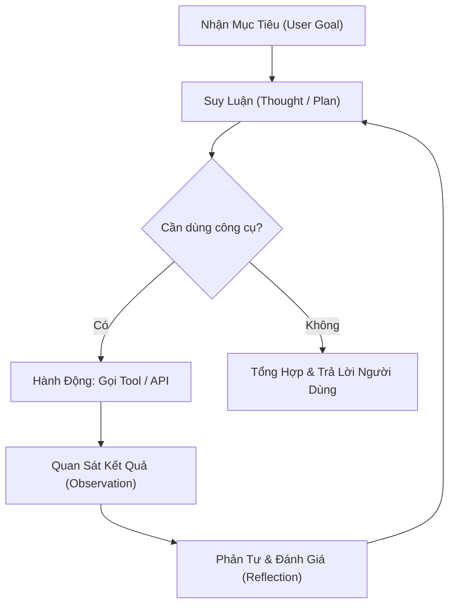
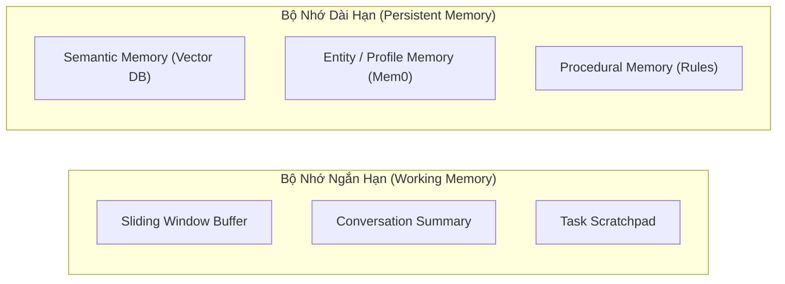

# 🤖 Chuyên Đề 03: Kiến Trúc AI Agent — State Management, Memory & Frameworks

> [!abstract] **Mục Tiêu Chuyên Đề**
> Hiểu rõ bản chất kiến trúc của hệ thống AI Agent tự trị (Autonomous Agents), cơ chế quản lý trạng thái (State Management), kỹ thuật quản lý ngữ cảnh & bộ nhớ (Memory Systems), và làm chủ các framework hàng đầu thị trường: LangGraph, AutoGen, CrewAI, OpenAI Agents SDK.

---

## 🏗️ 1. Các Mẫu Kiến Trúc Agent Cốt Lõi (Agent Patterns)

Một AI Agent khác với LLM thông thường ở chỗ nó có khả năng **Suy luận (Reason) $\rightarrow$ Hành động (Act) $\rightarrow$ Quan sát (Observe) $\rightarrow$ Tự sửa sai (Self-Correction)**:

- **ReAct (Reasoning + Acting):** Mô hình kinh điển nhất. Tại mỗi bước, Agent tự sinh ra suy nghĩ `Thought: ...`, sau đó kích hoạt hành động `Action: tool_name(params)`, nhận kết quả `Observation: ...` và tiếp tục vòng lặp cho đến khi hoàn thành mục tiêu.
- **Plan-and-Solve:** Agent lập ra một danh sách các bước cần làm trước (Execution Plan), sau đó lần lượt giải quyết từng bước và linh hoạt điều chỉnh kế hoạch nếu có bước gặp lỗi.
- **Reflection / Self-Correction:** Sau khi tạo kết quả sơ bộ, Agent tự đóng vai trò người phản biện để kiểm tra lại tính logic, format dữ liệu hoặc phát hiện lỗi cú pháp trước khi bàn giao kết quả cho người dùng.

---

## ⚖️ 2. So Sánh Các Framework Xây Dựng AI Agent Hàng Đầu

| Framework | Bản chất kiến trúc | Thế mạnh vượt trội | Điểm hạn chế | Khi nào nên dùng? |
| :--- | :--- | :--- | :--- | :--- |
| **LangGraph** *(Industry Standard)* | Đồ thị có chu trình (Cyclic Graphs), Node & Edge | • Quản lý State cực kỳ chặt chẽ • Hỗ trợ Checkpoint & Time-travel • Human-in-the-loop (dừng chờ người duyệt) | Đường cong học tập dốc, cấu hình nhiều boilerplate code | Hệ thống Agent phức tạp, đa bước, chạy trong môi trường Production đòi hỏi độ tin cậy tuyệt đối |
| **AutoGen** *(Microsoft)* | Hội thoại đa Agent (Conversational Multi-Agent) | • Giao tiếp giữa các Agent rất tự nhiên • GroupChat quản lý cuộc thảo luận thông minh | Khó kiểm soát luồng chạy chính xác 100%, dễ tốn token | Nghiên cứu, mô phỏng phản biện đa góc nhìn, phân tích ý tưởng phức tạp |
| **CrewAI** | Mô hình tổ chức nhân sự (Role-playing Crew) | • Cực kỳ trực quan: định nghĩa Role, Goal, Backstory • Phân công Task tuần tự hoặc phân cấp (Hierarchical) | Kém linh hoạt hơn LangGraph khi cần xử lý rẽ nhánh logic phức tạp | Dự án tự động hóa nghiệp vụ (VD: 1 Agent nghiên cứu + 1 Agent viết bài + 1 Agent biên tập) |
| **OpenAI Agents SDK / Swarm** | Nhẹ (Lightweight), Handoff-driven | • Cực kỳ nhanh, ít phụ thuộc thư viện nặng • Cơ chế Handoff chuyển giao ngữ cảnh tinh gọn | Thiếu các tính năng quản lý State lưu trữ lâu dài (State persistence) | Xây dựng chatbot chăm sóc khách hàng, phân luồng tổng đài viên |
| **Semantic Kernel** *(Microsoft)* | Enterprise-grade SDK (Python & C#) | • Chuẩn doanh nghiệp, tích hợp Azure cực tốt • Kiến trúc Plugin rõ ràng | Hệ sinh thái cộng đồng nhỏ hơn LangChain/LangGraph | Dự án tích hợp sâu vào hệ sinh thái Microsoft / Azure |

---

## 💾 3. Quản Trị Trạng Thái (State Management) & Checkpoint trong LangGraph

LangGraph là chuẩn mực cao nhất hiện nay nhờ biến Agent thành một **Máy Trạng Thái Hữu Hạn (State Machine)**:

- **State Schema:** Định nghĩa kiểu dữ liệu duy nhất luân chuyển qua toàn bộ các Node (dùng `TypedDict` hoặc `BaseModel`).
- **Reducers (Toán tử cập nhật State):** Xác định cách dữ liệu mới ghi đè hoặc cộng dồn vào dữ liệu cũ (ví dụ: `Annotated[list, operator.add]` để nối thêm message mới vào danh sách hội thoại thay vì ghi đè).
- **Checkpointers (PostgresSaver / RedisSaver):**
  - Sau mỗi Node chạy xong, toàn bộ State được chụp ảnh (Snapshot) và lưu ngay vào Database kèm theo `thread_id`.
  - Nếu server bị crash hoặc restart giữa chừng, Agent có thể khôi phục lại trạng thái cũ ngay lập tức từ Checkpoint gần nhất.
- **Human-in-the-loop (HITL):** Thiết lập `interrupt_before=["execute_payment"]` để Agent tự động tạm dừng quy trình, chờ con người phê duyệt trên giao diện Web rồi mới chạy tiếp.

---

## 🧠 4. Quản Trị Ngữ Cảnh & Hệ Thống Bộ Nhớ (Memory Systems)

- **Vấn đề "Lost in the Middle" trong Context Engineering:**
  - LLM thường ghi nhớ tốt nhất thông tin ở đầu và cuối prompt, nhưng rất hay bỏ quên thông tin nằm ở giữa context dài.
  - *Giải pháp:* Tự động nén (Compress) lịch sử hội thoại, chỉ giữ lại các message quan trọng nhất và các fact đã được trích xuất.
- **Bộ nhớ dài hạn (Long-term Memory với Mem0):**
  - Trích xuất thông tin người dùng từ hội thoại (sở thích, địa chỉ, lịch sử đơn hàng) và lưu dưới dạng các cặp Fact có đánh nhãn thời gian.
  - Khi bắt đầu phiên làm việc mới, Agent tự động truy vấn semantic memory để tái hiện ngữ cảnh người dùng mà không cần hỏi lại.

---

## 🧪 5. Luồng Xử Lý (Flow) & Tiêu Chí Kiểm Thử (Test Cases)

### Luồng Nghiệp Vụ Chuẩn (LangGraph Multi-step Workflow)
`Khởi tạo State` $\rightarrow$ `Router Node` $\rightarrow$ `Tool Execution Node` $\rightarrow$ `Conditional Edge (Kiểm tra điều kiện dừng)` $\rightarrow$ `Lưu Checkpoint vào DB` $\rightarrow$ `Trả về Output`

### Bộ Test Case Cần Kiểm Chứng
- **Happy Path:**
  - Agent thực hiện thành công bài toán gồm 4 bước (Tìm kiếm $\rightarrow$ Tính toán $\rightarrow$ Format kết quả $\rightarrow$ Gửi email).
- **Edge Cases:**
  - Vòng lặp vô tận (Infinite Loop): Tool trả về kết quả lỗi liên tục khiến Agent thử lại mãi $\rightarrow$ Phải có cơ chế `max_iterations = 10` để ngắt vòng lặp và thông báo thất bại gracefully.
  - Server restart đột ngột khi Agent đang chạy dở ở bước 2 $\rightarrow$ Gọi lại với cùng `thread_id`, Agent tiếp tục từ bước 3 mà không phải chạy lại bước 1 và 2.
- **Human-in-the-loop:**
  - Agent dừng lại ở bước xóa dữ liệu, gửi tín hiệu chờ duyệt $\rightarrow$ User gửi lệnh `Approve` $\rightarrow$ Agent chạy tiếp; User gửi lệnh `Reject` $\rightarrow$ Agent hủy bỏ tác vụ an toàn.

---

## 🔗 Liên Kết Chuyên Đề
* [[00. Lộ Trình Nghiên Cứu & Bản Đồ Kiến Thức (Master Roadmap)|Quay lại Lộ Trình Tổng Quan]]
* [[02. RAG Chuyên Sâu, Embedding, Semantic Search & Vector DB|Xem Chuyên Đề 02: RAG & Vector DB]]
* [[04. Tool Calling, Function Calling & Structured Output|Xem tiếp Chuyên Đề 04: Tool Calling & Structured Output]]
