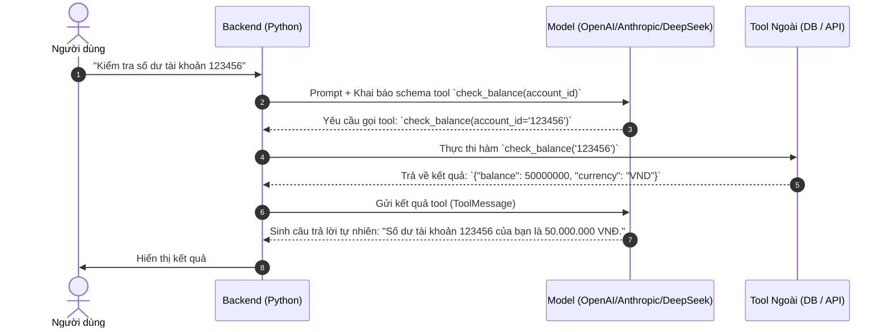

# 🛠️ Chuyên Đề 04: Tool Calling, Function Calling & Structured Output Chuẩn Hóa

> [!abstract] **Mục Tiêu Chuyên Đề**
> Nắm vững cơ chế gọi công cụ (Tool/Function Calling), kỹ thuật bắt buộc mô hình trả về dữ liệu có cấu trúc chính xác tuyệt đối (Structured Output / JSON Schema), cách xử lý lỗi khi mô hình sinh sai tham số và kiến trúc Tool Registry chuẩn doanh nghiệp.

---

## 🎯 1. Bản Chất Cơ Chế Tool Calling & Function Calling

Nhiều người lầm tưởng LLM tự thực thi code. Trên thực tế:
1. Bạn gửi cho LLM định dạng công cụ (JSON Schema mô tả tên hàm, chức năng, các tham số và kiểu dữ liệu).
2. LLM đọc hiểu câu hỏi của người dùng và quyết định xem có cần gọi công cụ nào hay không.
3. Nếu cần, **LLM không tự chạy hàm** mà nó chỉ sinh ra một chuỗi JSON chứa tên hàm và giá trị tham số cần truyền vào (`tool_calls`).
4. Hệ thống backend (Python code của bạn) nhận chuỗi JSON này, thực thi hàm thật (truy vấn DB, gọi REST API), lấy kết quả (`tool_result`) và gửi ngược lại cho LLM để nó tổng hợp câu trả lời.



---

## 📐 2. Bắt Buộc Chuẩn Dữ Liệu (Structured Output với Pydantic & JSON Schema)

Trước đây, lập trình viên thường dùng prompt "Hãy trả về định dạng JSON", nhưng LLM vẫn hay bị trả về thừa chữ dẫn dắt ("Dưới đây là JSON...") hoặc sai dấu ngoặc nhọn.

- **OpenAI Strict Mode (`response_format={"type": "json_schema", ...}`):**
  - Đảm bảo mô hình tuân thủ 100% ngữ pháp của JSON Schema bằng kỹ thuật Constrained Decoding (Grammar-guided generation) tại tầng inference.
- **Thư viện `Instructor` & `LangChain with_structured_output`:**
  - Ánh xạ trực tiếp giữa Pydantic model và LLM.
  ```python
  from pydantic import BaseModel, Field

  class UserExtraction(BaseModel):
      name: str = Field(description="Họ và tên khách hàng")
      age: int = Field(description="Tuổi khách hàng", ge=18)
      sentiment: Literal["positive", "neutral", "negative"]
  ```

---

## ⚡ 3. Gọi Nhiều Tool Đồng Thời (Parallel Tool Calling)

- Khi người dùng hỏi: *"So sánh thời tiết tại Hà Nội, Đà Nẵng và TP.HCM hôm nay?"*
- Thay vì gọi 3 lượt tuần tự mất 3 lần round-trip, mô hình hỗ trợ Parallel Tool Calling sẽ trả về 3 `tool_call_id` khác nhau trong cùng một lượt sinh token:
  - `call_1`: `get_weather(city="Hanoi")`
  - `call_2`: `get_weather(city="Danang")`
  - `call_3`: `get_weather(city="HCM")`
- Backend sử dụng `asyncio.gather()` để kích hoạt cả 3 API cùng lúc, tiết kiệm 70% thời gian chờ đợi.

---

## 🛡️ 4. Tự Sửa Sai Tham Số (Error Feedback Loop)

Khi LLM sinh tham số bị sai (ví dụ: truyền chuỗi `"năm mươi"` vào trường `age: int`):
- **Không văng lỗi crash ứng dụng:** Backend bắt lỗi `ValidationError` từ Pydantic.
- **Phản hồi lỗi lại cho LLM (Self-Correction):**
  - Gửi một `ToolMessage` mang nội dung: `"Lỗi Validation: Trường 'age' phải là số nguyên, bạn đã truyền 'năm mươi'. Hãy sửa lại."`
  - LLM đọc thông điệp lỗi này, nhận ra sai sót và tự động sinh lại lượt gọi tool mới với `age: 50` chính xác!

---

## 🧪 5. Luồng Xử Lý (Flow) & Tiêu Chí Kiểm Thử (Test Cases)

### Luồng Nghiệp Vụ Chuẩn (Tool Dispatcher)
`Nhận Tool Call từ LLM` $\rightarrow$ `Tra cứu trong Tool Registry` $\rightarrow$ `Pydantic Validate Arguments` $\rightarrow$ `Thực thi Async Function` $\rightarrow$ `Format kết quả chuẩn JSON` $\rightarrow$ `Gửi Tool Result cho LLM`

### Bộ Test Case Cần Kiểm Chứng
- **Happy Path:**
  - LLM nhận diện đúng tool cần dùng, trích xuất tham số đúng kiểu dữ liệu, thực thi thành công.
- **Edge Cases:**
  - LLM gọi một tool không có trong danh sách đăng ký (Hallucinated Tool Name) $\rightarrow$ Backend bắt lỗi và thông báo: `"Công cụ 'xyz' không tồn tại. Danh sách công cụ hợp lệ gồm: [a, b, c]"`.
  - Tham số thiếu trường bắt buộc $\rightarrow$ Kích hoạt vòng lặp Self-Correction tối đa 2 lần.
- **Security & Injection:**
  - Người dùng cố tình truyền mã độc SQL Injection vào tham số tìm kiếm $\rightarrow$ Hàm tool phải dùng parameterized query, không được nối chuỗi thô.

---

## 🔗 Liên Kết Chuyên Đề
* [[00. Lộ Trình Nghiên Cứu & Bản Đồ Kiến Thức (Master Roadmap)|Quay lại Lộ Trình Tổng Quan]]
* [[03. Kiến Trúc AI Agent, State Management, Memory & Frameworks|Xem Chuyên Đề 03: Kiến Trúc AI Agent]]
* [[05. Giao Thức MCP (Model Context Protocol) & Agent-to-Agent (A2A)|Xem tiếp Chuyên Đề 05: Giao Thức MCP & A2A]]
