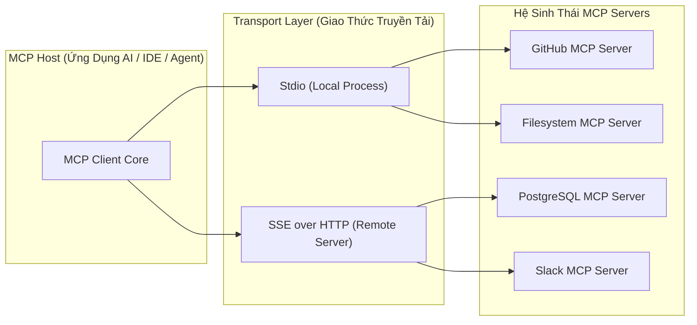
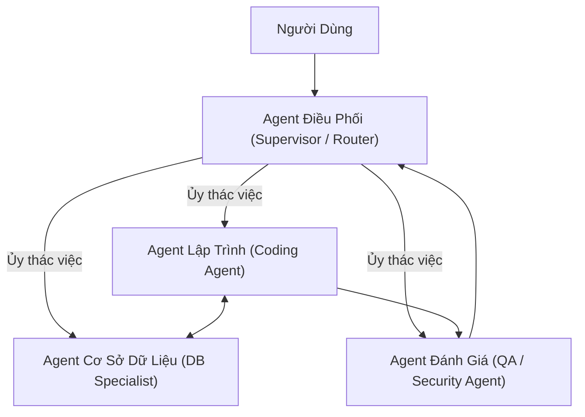

# 🔌 Chuyên Đề 05: Giao Thức MCP (Model Context Protocol) & Giao Tiếp Đa Agent (A2A)

> [!abstract] **Mục Tiêu Chuyên Đề**
> Nắm vững chuẩn mở MCP (Model Context Protocol) do Anthropic khởi xướng — được coi là "cổng USB-C của thế giới AI", cách xây dựng MCP Server / Client và thiết kế kiến trúc giao tiếp giữa nhiều Agent độc lập (Agent-to-Agent Communication).

---

## 🌐 1. MCP (Model Context Protocol) Là Gì? Tại Sao Cần Thiết?

Trước khi có MCP, mỗi ứng dụng AI phải tự viết mã tích hợp riêng lẻ với hàng trăm dịch vụ bên ngoài (Slack, GitHub, PostgreSQL, Jira). Điều này tạo ra bài toán $M \times N$ tích hợp cực kỳ tốn kém.

**MCP giải quyết bài toán này tương tự như chuẩn USB-C:**
- Bất kỳ dịch vụ nào (Database, File System, API) chỉ cần viết **1 lần duy nhất** thành một **MCP Server**.
- Bất kỳ AI Client nào (Claude Desktop, Antigravity IDE, Custom Python Agent) hỗ trợ **MCP Client** đều có thể kết nối ngay lập tức và sử dụng toàn bộ công cụ của Server đó mà không cần sửa code!



---

## 🧩 2. Ba Thành Phần Nguyên Bản Của MCP (MCP Primitives)

Một MCP Server cung cấp 3 loại tài nguyên chuẩn hóa:
- **Tools (Công cụ thực thi):** Các hàm mà Agent có thể gọi để thực hiện hành động (ví dụ: `create_github_issue`, `execute_sql_query`). Đi kèm JSON Schema chặt chẽ.
- **Resources (Tài nguyên đọc):** Dữ liệu ngữ cảnh tĩnh hoặc bán tĩnh mà Client có thể đính kèm vào hội thoại (ví dụ: nội dung file `file:///app.log`, schema của database `postgres://schema`).
- **Prompts (Khuôn mẫu gợi ý):** Các prompt được tạo sẵn trên Server giúp người dùng hoặc Agent kích hoạt quy trình làm việc chuẩn (ví dụ: prompt `review_pr` của GitHub MCP Server).

---

## 🤖 3. Giao Tiếp Giữa Các Agent (Agent-to-Agent - A2A Communication)

Khi hệ thống AI lớn lên, một Agent đơn lẻ sở hữu 50 tools sẽ bị "ngộ độc context", giảm độ chính xác và tốn kém chi phí. Giải pháp là **Chuyên Môn Hóa (Specialization) & Hợp Tác Đa Agent**:



- **Mô Hình Supervisor (Orchestrator Pattern):**
  - Một Agent đầu não phân tích bài toán, chia nhỏ thành các nhiệm vụ con và bàn giao (Handoff) cho các Agent chuyên môn.
- **Cấu Trúc Thông Điệp Chuẩn Giữa Các Agent (A2A Message Envelope):**
  ```json
  {
    "sender_id": "agent_coder",
    "recipient_id": "agent_database",
    "task_id": "task_create_user_schema",
    "intent": "REQUEST_SCHEMA_VERIFICATION",
    "payload": { "ddl": "CREATE TABLE users (...);" }
  }
  ```
- **Phân Tán & Bất Đồng Bộ (Decentralized Agents via Message Queue):**
  - Trong các hệ thống lớn, các Agent chạy trên các container độc lập và giao tiếp với nhau qua Kafka hoặc Redis Pub/Sub, giúp scale linh hoạt từng Agent theo tải công việc.

---

## 🧪 4. Luồng Xử Lý (Flow) & Tiêu Chí Kiểm Thử (Test Cases)

### Luồng Nghiệp Vụ Chuẩn (MCP Discovery & Call)
`Agent khởi động` $\rightarrow$ `MCP Client kết nối MCP Server qua Stdio/SSE` $\rightarrow$ `Handshake & Khám phá danh sách Tools (ListTools)` $\rightarrow$ `Agent kích hoạt Tool Call` $\rightarrow$ `MCP Server thực thi lệnh trên hệ thống thật` $\rightarrow$ `Trả dữ liệu Text/Image cho Agent`

### Bộ Test Case Cần Kiểm Chứng
- **Happy Path:**
  - Client kết nối thành công với MCP Server cục bộ qua `stdio`, thực hiện gọi lệnh `read_file` và nhận về nội dung văn bản chính xác.
- **Edge Cases:**
  - MCP Server từ xa (qua SSE) bị mất mạng giữa chừng $\rightarrow$ Client phải bắt được lỗi timeout, thử kết nối lại (reconnect) và không làm treo toàn bộ tiến trình của Agent.
  - Xung đột quyền hạn (Permission Boundary): Agent cố tình gọi tool xóa bảng `DROP TABLE` thông qua MCP Database Server $\rightarrow$ Server phải từ chối nếu user cấu hình ở chế độ Read-Only.

---

## 🔗 Liên Kết Chuyên Đề
* [[00. Lộ Trình Nghiên Cứu & Bản Đồ Kiến Thức (Master Roadmap)|Quay lại Lộ Trình Tổng Quan]]
* [[04. Tool Calling, Function Calling & Structured Output|Xem Chuyên Đề 04: Tool Calling]]
* [[06. Self-Host LLM, Inference Engine (vLLM, SGLang) & Open Source Models|Xem tiếp Chuyên Đề 06: Self-Host LLM & vLLM]]
