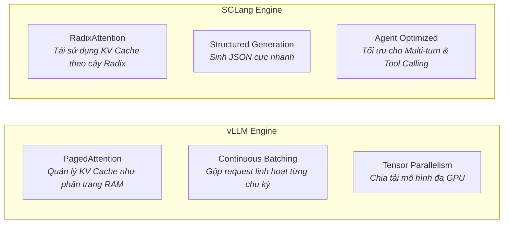

# ⚡ Chuyên Đề 06: Tự Host LLM — vLLM, SGLang & Mô Hình Mã Nguồn Mở

> [!abstract] **Mục Tiêu Chuyên Đề**
> Nắm vững cách triển khai hạ tầng tự host (Self-Hosted) mô hình ngôn ngữ lớn tại chỗ (On-Premise) hoặc trên Cloud riêng, làm chủ hai cỗ máy suy luận tốc độ cao nhất hiện nay: **vLLM** và **SGLang**, cùng chiến lược tối ưu phần cứng (vRAM, Quantization) cho các dòng mô hình hàng đầu (DeepSeek, Qwen, Llama).

---

## 🏢 1. Tại Sao Doanh Nghiệp Cần Self-Host LLM?

Dù OpenAI hay Anthropic rất mạnh, các doanh nghiệp bắt buộc phải tự host LLM vì 3 lý do sống còn:
- **Bảo Mật & Tuân Thủ (Data Privacy & Compliance):** Dữ liệu tài chính, y tế, bí mật kinh doanh không được phép gửi ra máy chủ nước ngoài.
- **Tiết Kiệm Chi Phí Quy Mô Lớn:** Khi hệ thống đạt hàng triệu request mỗi ngày, tiền token trả cho API thương mại đắt gấp 5-10 lần chi phí thuê/mua GPU riêng.
- **Không Bị Giới Hạn Tốc Độ (No Rate Limits):** Chủ động kiểm soát hoàn toàn thông lượng (Throughput) và độ trễ (Latency).

---

## 🏎️ 2. So Sánh Hai Cỗ Máy Suy Luận: vLLM vs SGLang

| Tiêu chí | vLLM | SGLang |
| :--- | :--- | :--- |
| **Công nghệ cốt lõi** | **PagedAttention:** Giải quyết triệt để phân mảnh bộ nhớ KV Cache, tăng kích thước batch lên 2-4 lần. | **RadixAttention:** Lưu trữ và tái sử dụng KV Cache của các đoạn prompt trùng lặp thông qua cấu trúc cây Radix. |
| **Thế mạnh đặc biệt** | Cực kỳ ổn định, chuẩn công nghiệp, tương thích 100% chuẩn OpenAI API (`/v1/chat/completions`). | Nhanh hơn vLLM 2-3 lần trong các bài toán **AI Agent đa bước** (vì system prompt và danh sách tools được tái sử dụng liên tục). |
| **Tối ưu suy luận** | Tích hợp vLLM FlashAttention-2, Chunked Prefill. | Tối ưu hóa suy luận có cấu trúc (Constrained JSON Decoding) không làm chậm tốc độ sinh chữ. |

---

## 🌟 3. Bản Đồ Mô Hình Mã Nguồn Mở Hàng Đầu (Open-Weights SOTA)

- **Qwen 2.5 (Alibaba):**
  - Dòng mô hình mã nguồn mở toàn diện nhất hiện nay (từ bản 7B, 14B, 32B đến 72B).
  - Bản `Qwen2.5-Coder` đạt trình độ lập trình và gọi tool (Tool Calling) ngang ngửa hoặc vượt Claude 3.5 Sonnet và GPT-4o.
- **DeepSeek (DeepSeek-V3 & DeepSeek-R1):**
  - Kiến trúc MoE (Mixture of Experts) đột phá: 671 tỷ tham số tổng cộng nhưng chỉ kích hoạt 37 tỷ tham số cho mỗi token, giúp tốc độ sinh chữ cực nhanh với chi phí phần cứng tối thiểu.
  - DeepSeek-R1 dẫn đầu thế giới mã nguồn mở về năng lực **Suy Luận Logic Sâu (Reasoning / Chain-of-Thought)** tương đương OpenAI o1.
- **Llama 3.1 & 3.3 (Meta):**
  - Bản 8B siêu nhẹ chạy tốt trên thiết bị cá nhân/laptop. Bản 70B là chuẩn mực cho đa số tác vụ doanh nghiệp. Hỗ trợ Context Window lên đến 128K tokens.

---

## 💾 4. Công Thức Tính vRAM & Tối Ưu Hóa Lượng Tử Hóa (Quantization)

### Công Thức Ước Tính Dung Lượng vRAM
$$\text{vRAM cần thiết} \approx \frac{\text{Số lượng tham số (tỷ)} \times \text{Số bytes mỗi tham số}}{1} + \text{Dung lượng KV Cache} + \text{Overhead (20\%)}$$

- **Mô hình gốc (FP16 / BF16):** Cần 2 bytes cho mỗi tham số.
  - *Ví dụ:* Model 70B ở bản FP16 cần: $70 \times 2 = 140\text{ GB vRAM} \rightarrow$ Bắt buộc dùng 2 card NVIDIA A100 (80GB) hoặc H100.
- **Kỹ thuật Lượng Tử Hóa (Quantization - AWQ / GPTQ / EXL2):**
  - **INT8 (8-bit):** Cần 1 byte/param $\rightarrow$ Model 70B giảm còn ~70 GB vRAM.
  - **INT4 (4-bit - AWQ):** Cần 0.5 byte/param $\rightarrow$ Model 70B chỉ còn ~35-40 GB vRAM $\rightarrow$ Có thể chạy mượt mà trên **1 card RTX 4090 / A6000 Ada hoặc 2 card 24GB thông thường!** Chất lượng suy luận gần như không suy giảm so với bản gốc.

---

## 🧪 5. Luồng Xử Lý (Flow) & Tiêu Chí Kiểm Thử (Test Cases)

### Luồng Triển Khai vLLM Phục Vụ API
`Cài đặt Docker / vLLM` $\rightarrow$ `Download weights từ HuggingFace` $\rightarrow$ `Chạy lệnh: vllm serve qwen2.5-coder-32b-awq --tensor-parallel-size 2` $\rightarrow$ `Expose Endpoint /v1/chat/completions` $\rightarrow$ `Client kết nối như OpenAI SDK`

### Bộ Test Case Cần Kiểm Chứng
- **Đo Lường Hiệu Năng (Benchmarking):**
  - Đo **TTFT (Time-to-First-Token):** Thời gian từ lúc gửi prompt đến khi nhận được chữ đầu tiên phải dưới 500ms.
  - Đo **Throughput (Tokens/second):** Khi có 20 người dùng gửi request đồng thời, server vẫn duy trì tốc độ trên 30 tokens/giây cho mỗi stream.
- **Xử Lý Lỗi Tràn Bộ Nhớ (Out of Memory - OOM):**
  - Gửi đồng thời 100 request có context 64K tokens $\rightarrow$ vLLM phải xếp hàng (Queue) và giải phóng KV Cache hợp lý, không được làm crash tiến trình GPU.

---

## 🔗 Liên Kết Chuyên Đề
* [[00. Lộ Trình Nghiên Cứu & Bản Đồ Kiến Thức (Master Roadmap)|Quay lại Lộ Trình Tổng Quan]]
* [[05. Giao Thức MCP (Model Context Protocol) & Agent-to-Agent (A2A)|Xem Chuyên Đề 05: Giao Thức MCP]]
* [[07. LLMOps, Observability & Đánh Giá AI (LLM-as-a-Judge, Golden Dataset)|Xem tiếp Chuyên Đề 07: LLMOps & Đánh Giá AI]]
