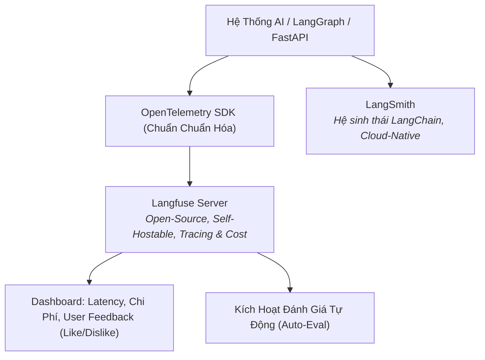

# 📊 Chuyên Đề 07: LLMOps, Observability & Đánh Giá AI (AI Evaluation)

> [!abstract] **Mục Tiêu Chuyên Đề**
> Nắm vững chu trình vận hành hệ thống AI trong thực tế (LLMOps): Từ việc giám sát chi tiết từng bước chạy của Agent (Tracing, Observability bằng Langfuse, OpenTelemetry) đến phương pháp kiểm thử hồi quy (Regression Testing), xây dựng bộ dữ liệu vàng (Golden Dataset) và kỹ thuật giám khảo AI (LLM-as-a-Judge).

---

## 👁️ 1. Tại Sao Giám Sát Truyền Thống Là Không Đủ Cho LLM?

Trong các ứng dụng web thông thường, nếu API trả về mã `200 OK`, hệ thống được coi là khỏe mạnh.
Nhưng với LLM: **API vẫn trả về `200 OK`, nhưng nội dung bên trong có thể là ảo giác (Hallucination), bịa đặt thông tin, hoặc Agent bị kẹt trong vòng lặp vô tận tốn hàng trăm USD tiền token!**

Đó là lý do ta bắt buộc phải có **LLM Observability**:
- Đo lường chi tiết: **Prompt Tokens, Completion Tokens, Tổng Chi Phí ($ USD)** cho từng cuộc hội thoại.
- Đo thời gian phản hồi: **Time-to-First-Token (TTFT)** và **Total Latency**.
- Lần vết chi tiết (Call Tracing): Xem từng bước trong Agent Workflow: LLM nghĩ gì $\rightarrow$ Gọi tool nào $\rightarrow$ Tool trả về gì $\rightarrow$ Bước tiếp theo ra sao.

---

## 🛠️ 2. Công Cụ Giám Sát: Langfuse vs LangSmith vs OpenTelemetry

- **Langfuse (Khuyên dùng cho mọi dự án):**
  - Mã nguồn mở 100%, có thể tự host bằng Docker/Postgres nội bộ.
  - Giao diện trực quan xem toàn bộ cây thực thi (Trace Tree) của Multi-Agent.
  - Lưu trữ và phân tích phản hồi người dùng (User Feedback: Thumbs up / Thumbs down).
- **LangSmith:** Cực mạnh nếu toàn bộ dự án viết bằng LangChain/LangGraph, nhưng chi phí cloud khá cao.
- **OpenTelemetry (OTel):** Tiêu chuẩn chung của ngành kỹ thuật phần mềm, tích hợp dữ liệu AI vào các dashboard chung của công ty (Datadog, Grafana).

---

## 📏 3. Phương Pháp Đánh Giá AI (AI Evaluation & LLM-as-a-Judge)

Làm sao để biết khi bạn thay đổi System Prompt hoặc đổi sang Model mới, hệ thống trả lời **tốt hơn hay tệ đi**? Bạn không thể ngồi đọc bằng tay hàng nghìn câu trả lời mỗi ngày.

### Kỹ Thuật LLM-as-a-Judge
Sử dụng một mô hình thông minh hơn (như GPT-4o hoặc Claude 3.5 Sonnet) đóng vai trò giám khảo chấm điểm câu trả lời của mô hình chạy sản phẩm theo thang điểm và tiêu chí nghiêm ngặt.

### Bộ Chỉ Số Đánh Giá Chuẩn (Ragas & DeepEval Metrics)
1. **Faithfulness (Độ trung thực - Chống ảo giác):**
   - Đo xem câu trả lời có được suy ra hoàn toàn từ tài liệu ngữ cảnh (Context) hay không? Nếu câu trả lời có thông tin ngoài tài liệu $\rightarrow$ Bị trừ điểm nặng.
2. **Answer Relevance (Độ phù hợp của câu trả lời):**
   - Đo xem câu trả lời có đi thẳng vào trọng tâm câu hỏi của người dùng hay trả lời lan man.
3. **Context Precision (Độ chính xác của việc tìm kiếm):**
   - Các đoạn văn bản liên quan nhất có được xếp ở vị trí đầu tiên (Top 1, Top 2) hay không?
4. **Context Recall (Độ đầy đủ của việc tìm kiếm):**
   - Hệ thống RAG có thu thập đủ toàn bộ các thông tin cần thiết để giải quyết câu hỏi không?
5. **Tool Selection Accuracy (Độ chính xác khi chọn Tool):**
   - Agent có chọn đúng công cụ và điền đúng tham số nghiệp vụ hay không?

---

## 🏆 4. Bộ Dữ Liệu Vàng (Golden Dataset) & Kiểm Thử Hồi Quy (CI/CD)

- **Golden Dataset Là Gì?**
  - Là tập hợp 100 - 500 câu hỏi mẫu đại diện cho tất cả các tình huống nghiệp vụ thực tế, gồm:
    - `Input Query`: Câu hỏi của người dùng.
    - `Ground Truth Context`: Đoạn tài liệu chuẩn bắt buộc phải tìm thấy.
    - `Ground Truth Answer`: Câu trả lời mẫu chuẩn do chuyên gia nghiệp vụ viết.
- **Tích hợp Kiểm Thử Hồi Quy vào CI/CD (GitHub Actions):**
  - Bất cứ khi nào lập trình viên tạo Pull Request sửa Prompt hoặc đổi cấu hình RAG:
  - Hệ thống tự động chạy Golden Dataset qua hệ thống mới.
  - Nếu điểm trung bình **Faithfulness** hoặc **Accuracy** tụt giảm (ví dụ từ 92% xuống 85%) $\rightarrow$ Tự động chặn (Block) không cho merge code vào nhánh Production!

---

## 🧪 5. Luồng Xử Lý (Flow) & Tiêu Chí Kiểm Thử (Test Cases)

### Luồng Đánh Giá Tự Động (Auto-Eval Pipeline)
`User tương tác` $\rightarrow$ `Ghi nhận Trace vào Langfuse` $\rightarrow$ `Lấy mẫu 5% dữ liệu thật` $\rightarrow$ `Chạy qua LLM-as-a-Judge chấm điểm 5 tiêu chí` $\rightarrow$ `Cảnh báo lên Slack nếu phát hiện câu trả lời điểm dưới 3/5`

### Bộ Test Case Cần Kiểm Chứng
- **Phát Hiện Ảo Giác (Hallucination Detection):**
  - Cố tình cấp tài liệu không có thông tin và ép trả lời $\rightarrow$ Metric Faithfulness phải bắt được nếu LLM tự ý bịa đặt thông tin.
- **Đo Lường Trôi Dạt Dữ Liệu (Data Drift):**
  - Theo dõi điểm hài lòng của người dùng qua thời gian; phát hiện kịp thời khi người dùng bắt đầu hỏi các chủ đề mới mà tài liệu chưa cập nhật.

---

## 🔗 Liên Kết Chuyên Đề
* [[00. Lộ Trình Nghiên Cứu & Bản Đồ Kiến Thức (Master Roadmap)|Quay lại Lộ Trình Tổng Quan]]
* [[06. Self-Host LLM, Inference Engine (vLLM, SGLang) & Open Source Models|Xem Chuyên Đề 06: Self-Host LLM]]
* [[08. Triển Khai Thực Tế, Kubernetes, Hạ Tầng Dữ Liệu & Production Readiness|Xem tiếp Chuyên Đề 08: Vận Hành Thực Chiến & Hạ Tầng]]
