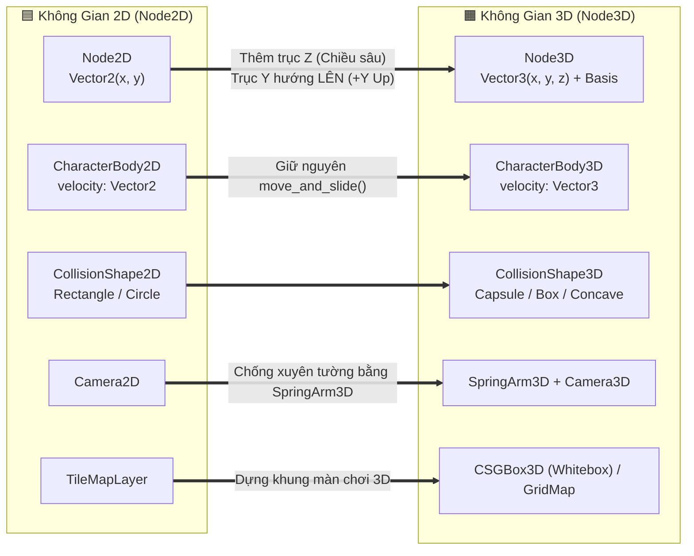

# 🧊 Giai Đoạn 3 (Phần 1) — Không Gian 3D, Node3D, Camera3D, Ánh Sáng & Môi Trường

> [!TIP] Điều Hướng Hồ Sơ
> - 🧭 **Về Trang Tổng Quan**: [[00. Tổng quan - Học & Phát Triển Game 2D & 3D (Godot 4)]]
> - 📂 **Cùng Chuyên Mục (Giai đoạn 3 — 3D Mastery)**: **01. Không gian 3D, Camera3D & Ánh sáng** | [[02. Nhập Mô Hình 3D (.glb), Rigging, AnimationTree & Âm Thanh Không Gian 3D]]
> - 🔗 **Kế thừa từ Giai đoạn 2**: [[01. Autoload (Singletons), EventBus, AudioManager & SceneTransition]] | [[02. Hệ thống Save-Load, Quản lý Resource & Đa ngôn ngữ]]

---

## 🗺️ Sơ Đồ Ánh Xạ Tư Duy: Từ 2D Sang 3D Trong Godot 4

> [!important] **Tin vui khi chuyển từ 2D sang 3D:**
> 80% kiến thức bạn đã học ở Giai đoạn 1 (State Machine, Signals, UI `CanvasLayer`, `Resource`) và 100% kiến trúc ở Giai đoạn 2 (`EventBus`, `AudioManager`, `SaveManager`, `SceneTransition`) **giữ nguyên hoàn toàn** khi sang 3D! Bạn chỉ thay đổi lớp Node hiển thị và toán học không gian từ 2 trục $(X, Y)$ sang 3 trục $(X, Y, Z)$.

### Bảng Đối Chiếu Hệ Tọa Độ & Toán Học 2D vs 3D

| Khái niệm | Trong Game 2D (`Node2D`) | Trong Game 3D (`Node3D`) | Lưu ý sống còn trong Godot 4 |
| :--- | :--- | :--- | :--- |
| **Đơn vị đo lường** | `Pixels` (Điểm ảnh) | `Meters` (Mét ngoài đời thực) | $1.0\text{ unit} = 1\text{ mét}$ (Nhân vật cao khoảng $1.7\text{m} - 1.8\text{m}$). |
| **Trục thẳng đứng (Up)** | `-Y` hướng lên, `+Y` hướng xuống | **`+Y` hướng lên**, `-Y` hướng xuống | Trọng lực 3D là `velocity.y -= gravity * delta` (ngược dấu với 2D!). |
| **Hướng nhìn về trước (Forward)** | `+X` (Bên phải màn hình) | **`-Z` (Hướng vào trong màn hình)** | Vector phía trước của `Node3D` luôn là `-global_transform.basis.z`. |
| **Phép xoay (Rotation)** | 1 góc duy nhất (`rotation` tính bằng Radian) | 3 trục (`Basis` / `Quaternion` / Euler `Vector3`) | Luôn dùng `rotate_y()`, `look_at()` hoặc `Quaternion` để tránh lỗi **Gimbal Lock**. |

---

## ✅ Checklist Công Việc Mốc 5: Dựng Thế Giới 3D, Camera Góc Nhìn Thứ 3 & Ánh Sáng

> [!note] **Quy ước phân vai trong Checklist:**
> - `[Code cùng AI]` — Viết GDScript cho `CharacterBody3D`, xoay `SpringArm3D` bằng chuột và tính toán hướng di chuyển theo góc nhìn Camera.
> - `[Thao tác trên Godot]` — Dựng màn chơi bằng `CSGBox3D` (Whiteboxing), cài đặt `WorldEnvironment`, ánh sáng, bóng đổ và sương mù.
> - `[Tự soạn nhạc]` — Thực hành nhạc lý **Modal Scales (Thang âm Dorian / Lydian)** & **Ambient Pad / Drone** tạo chiều sâu không gian 3D.
> - `[Tạo Asset]` — Tạo vật thể 3D tĩnh (Props) bằng AI (**Meshy / Tripo3D**), tối ưu lưới trong **Blender** và tạo Texture PBR.

### Hạng Mục A — Dựng Khung Màn Chơi 3D (Whiteboxing / Greyboxing) & Vật Lý 3D
- [ ] `[Thao tác trên Godot]` Tạo Scene `Level3D_Prototype.tscn` (gốc `Node3D`). Bật chế độ **Use Collision** trên các khối `CSGBox3D`, `CSGCylinder3D`, `CSGPolygon3D` để dựng nhanh sàn nhà, cầu thang, dốc nghiêng và cột trụ thử nghiệm (Whiteboxing) trước khi đưa mô hình 3D thật vào.
- [ ] `[Thao tác trên Godot]` Tạo Scene `Player3D.tscn` (gốc `CharacterBody3D`), gắn `CollisionShape3D` (`CapsuleShape3D` cao `1.8m`, bán kính `0.4m`) và một `MeshInstance3D` tạm thời để kiểm tra tỷ lệ.
- [ ] `[Code cùng AI]` Viết script `player_3d.gd` kết nối lại bộ khung **Finite State Machine (FSM)** từ Giai đoạn 1 nhưng chuyển sang toán học `Vector3`:
  - Áp dụng trọng lực theo chiều âm trục Y (`velocity.y -= gravity * delta`).
  - Xử lý leo dốc tự động bằng thuộc tính `floor_max_angle` và `floor_snap_length` của `CharacterBody3D`.
  - Ghi log `[DEBUG][Player3D]` kiểm tra tọa độ `global_position` và pháp tuyến mặt sàn `get_floor_normal()`.

### Hạng Mục B — Hệ Thống Camera 3D (Third-Person SpringArm3D & First-Person)
- [ ] `[Thao tác trên Godot]` Thiết lập cụm Camera góc nhìn thứ 3 (Third-Person) bên trong `Player3D`:
  - Tạo Node `CameraPivot` (`Node3D` đặt ở ngang vai/đầu nhân vật `y = 1.5m`) $\rightarrow$ gắn `SpringArm3D` (chiều dài `spring_length = 4.0m`, cấu hình `Collision Mask` chỉ va chạm với tường/địa hình để Camera tự thu ngắn lại khi bị khuất tường, không va chạm với chính Player) $\rightarrow$ gắn `Camera3D`.
- [ ] `[Code cùng AI]` Viết script `camera_controller_3d.gd` điều khiển góc nhìn bằng chuột (`InputEventMouseMotion`):
  - Bắt chuột vào giữa màn hình bằng `Input.set_mouse_mode(Input.MOUSE_MODE_CAPTURED)` (nhấn `ESC` để thả chuột mở Pause Menu của Giai đoạn 2).
  - Xoay ngang (Yaw) quanh trục Y và giới hạn góc ngẩng/cúi (Pitch) quanh trục X bằng `clamp(rotation.x, deg_to_rad(-60), deg_to_rad(45))`.
- [ ] `[Code cùng AI]` Viết công thức **Di chuyển tương đối theo hướng nhìn của Camera (Camera-Relative Movement)**:
  - Khi người chơi bấm `W`, nhân vật luôn chạy về phía mà `Camera3D` đang nhìn tới (chiếu xuống mặt phẳng ngang $XZ$), đồng thời thân nhân vật (`VisualRoot`) xoay mượt về hướng di chuyển bằng hàm nội suy góc `lerp_angle(visual_root.rotation.y, target_angle, rotation_speed * delta)`.

### Hạng Mục C — Ánh Sáng 3D, Bầu Trời & Môi Trường (`WorldEnvironment`)
- [ ] `[Thao tác trên Godot]` Thiết lập `WorldEnvironment` và `DirectionalLight3D` (Mặt trời):
  - Tạo `ProceduralSkyMaterial` hoặc nạp ảnh **HDRI Panorama** (từ PolyHaven) để tạo ánh sáng môi trường tự nhiên.
  - Bật `Shadow Enabled` trên `DirectionalLight3D`, tinh chỉnh `Directional Shadow Max Distance` để bóng đổ sắc nét mà không gây tụt FPS.
- [ ] `[Thao tác trên Godot]` Thiết lập các nguồn sáng cục bộ và hiệu ứng hậu kỳ (Post-Processing):
  - Đặt `OmniLight3D` (ngọn đuốc/đèn lồng) và `SpotLight3D` (đèn pha chiếu điểm).
  - Bật các hiệu ứng chiều sâu không gian trong `Environment`: **SSAO** (bóng tối ở các góc hẹp/khe tường), **Glow / Bloom** (phát sáng dịu), **Volumetric Fog** (sương mù có tia nắng xuyên qua - God Rays) và **Tonemap** (`Filmic` hoặc `ACES`).
- [ ] `[Code cùng AI]` Tích hợp lại `SceneTransition` và `SaveManager` từ Giai đoạn 2 vào màn chơi 3D: kiểm thử đi qua cổng dịch chuyển 3D (`Area3D`) tự động lưu vị trí `Vector3` và chuyển cảnh mượt mà.

### Hạng Mục D — Tạo Asset 3D Tĩnh Bằng AI & Blender (Static Props & PBR Materials)
- [ ] `[Tạo Asset]` Dùng công cụ AI tạo 3D (**Meshy.ai** hoặc **Tripo3D**) để sinh nhanh 3–5 vật thể tĩnh trang trí màn chơi (ví dụ: rương báu cổ, cột đá khắc phù điêu, thùng gỗ, tượng đá) và xuất ra định dạng `.glb` hoặc `.fbx`.
- [ ] `[Tạo Asset]` Đưa các mô hình AI sinh ra vào **Blender** để hậu kỳ trước khi đưa vào Godot:
  - Dùng **Decimate Modifier** hoặc **Remesh** để giảm số lượng đa giác (Low/Mid-Poly) giúp game chạy mượt.
  - Đưa tâm vật thể (Origin Point) về chính giữa đáy vật thể (`Z = 0` trong Blender $\rightarrow$ `Y = 0` trong Godot) để khi đặt xuống sàn không bị lún một nửa xuống đất.
  - Kiểm tra **UV Unwrap** và các kênh vật liệu **PBR** (`Albedo`, `Roughness`, `Metallic`, `Normal Map`).
- [ ] `[Thao tác trên Godot]` Nhập file `.glb` vào `res://assets/models/props/`, tạo `StaticBody3D` kèm `CollisionShape3D` (dùng tính năng *Create Trimesh/Convex Static Body* của Godot) và sắp xếp vào màn chơi 3D.

### Hạng Mục E — Thực Hành Nhạc Lý Mốc 5: Thang Âm Điệu Thức (Modes) & Nhạc Không Gian (Ambient 3D)
- [ ] `[Tự soạn nhạc]` **Lý thuyết nhạc lý áp dụng (Modal Scales — Điệu thức):**
  - Trong thế giới 3D rộng lớn, nhạc nền không nên dồn dập liên tục như game 2D Arcade mà cần tạo **không gian mở và màu sắc bí ẩn/kỳ vĩ**.
  - Thực hành 2 điệu thức kinh điển của nhạc Game 3D (Fantasy / Sci-Fi / Exploration):
    1. **Dorian Mode** (ví dụ: *D Dorian* gồm các nốt trắng từ `D` đến `D`: `D - E - F - G - A - B - C`): Mang màu sắc thứ (Minor) nhưng có **bậc 6 trưởng (`B`)** tạo cảm giác cổ kính, phiêu lưu, vừa trầm mặc vừa hy vọng (rất hay dùng trong *Halo*, *The Witcher*, *Zelda*).
    2. **Lydian Mode** (ví dụ: *F Lydian* gồm các nốt trắng từ `F` đến `F`: `F - G - A - B - C - D - E`): Mang màu sắc trưởng (Major) nhưng có **bậc 4 tăng (`#4` - nốt `B`)** tạo cảm giác bay bổng, kỳ ảo, thần tiên hoặc vũ trụ bao la (rất hay dùng trong *Skyrim*, *Minecraft*, *Starfield*).
- [ ] `[Tự soạn nhạc]` **Thực hành trên DAW (Reaper / LMMS):**
  - Thiết kế một lớp âm nền kéo dài (**Drone / Ambient Pad**) ở nốt chủ âm (`D`) kết hợp hiệu ứng **Reverb dài (Hall/Cathedral Reverb)** và **Stereo Delay**.
  - Điểm xuyết các câu giai điệu thưa (Sparse Melody) bằng nhạc cụ mộc (Piano, Flute, Cello hoặc Bell) đi trên thang âm *D Dorian* hoặc *F Lydian*, chừa nhiều khoảng lặng (Space/Silence) để người chơi nghe rõ âm thanh môi trường 3D.
  - Xuất file `bgm_3d_exploration.ogg` và phát qua `AudioManager` khi bước vào thế giới 3D.
- [ ] `[Tạo Asset]` Tạo 3 hiệu ứng âm thanh môi trường (Ambience SFX) bằng **ElevenLabs SFX**: tiếng gió thổi qua hẻm núi (`amb_wind_loop.ogg`), tiếng lửa trại nổ lách tách (`sfx_campfire_loop.ogg`), và tiếng nước chảy trong hang động (`sfx_cave_water_loop.ogg`).
