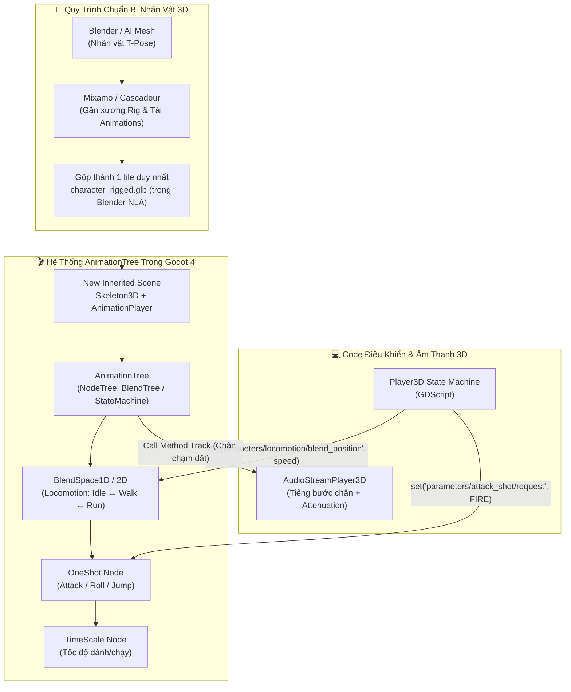

# 🕺 Giai Đoạn 3 (Phần 2) — Nhập Mô Hình 3D (`.glb`), Rigging, `AnimationTree` & Âm Thanh Không Gian 3D

> [!TIP] Điều Hướng Hồ Sơ
> - 🧭 **Về Trang Tổng Quan**: [[00. Tổng quan - Học & Phát Triển Game 2D & 3D (Godot 4)]]
> - 📂 **Cùng Chuyên Mục (Giai đoạn 3 — 3D Mastery)**: [[01. Không gian 3D, Node3D, Camera3D, Ánh sáng & Môi trường]] | **02. Nhập Mô Hình 3D (.glb), AnimationTree & Âm Thanh 3D**
> - 🧪 **Tiếp theo (Kiểm thử & Nghiệm thu)**: [[Hệ thống kiểm thử & Checklist hoàn thành từng mốc]]

---

## 🗺️ Sơ Đồ Luồng Xử Lý Hoạt Ảnh 3D (`AnimationTree`) & Âm Thanh Không Gian (`AudioStreamPlayer3D`)

Trong Game 2D, việc chuyển từ đứng yên (`Idle`) sang chạy (`Run`) chỉ đơn giản là đổi chuỗi ảnh Sprite. Nhưng trong Game 3D, nếu chuyển đột ngột giữa 2 tư thế xương (`Skeleton3D`), nhân vật sẽ bị giật cục rất mất tự nhiên. Do đó, Godot 4 sử dụng **`AnimationTree`** để **pha trộn mượt mà (Blending & Crossfading)** giữa các chuyển động.

---

## ✅ Checklist Công Việc Mốc 6: Nhân Vật 3D, `AnimationTree`, Vật Lý Nâng Cao & Âm Thanh 3D

> [!note] **Quy ước phân vai trong Checklist:**
> - `[Code cùng AI]` — Viết GDScript điều khiển các tham số (`parameters/...`) của `AnimationTree`, `RayCast3D` tương tác vật thể và AI kẻ địch `NavigationAgent3D`.
> - `[Thao tác trên Godot]` — Cấu hình Advanced Import cho `.glb`, dựng đồ thị `AnimationTree` (`BlendSpace2D`, `StateMachine`, `OneShot`), nướng bản đồ đường đi `NavigationRegion3D` và đặt `AudioStreamPlayer3D`.
> - `[Tự soạn nhạc]` — Thực hành nhạc lý **Leitmotif (Giai điệu chủ đề)**, soạn **Boss/Action Theme** và thử nghiệm hiệu ứng âm thanh không gian 3D.
> - `[Tạo Asset]` — Rig xương và lấy chuyển động nhân vật từ **Mixamo / Cascadeur**, gộp các track hoạt ảnh trong **Blender (NLA Editor)** xuất ra `.glb`.

### Hạng Mục A — Quy Trình Rigging & Gộp Animation 3D (Blender + Mixamo / Cascadeur)
- [ ] `[Tạo Asset]` Chuẩn bị mô hình nhân vật 3D (Character Mesh ở tư thế T-Pose) từ Kenney/KayKit, tự dựng trong Blender, hoặc tạo từ AI rồi chuẩn hóa lưới.
- [ ] `[Tạo Asset]` Đưa nhân vật lên **Mixamo** (hoặc dùng **Cascadeur**) để gắn bộ xương chuẩn (`Skeleton`) và tải về bộ chuyển động cơ bản: `Idle`, `Walk`, `Run`, `Jump`, `Attack_Slash`, `Hit_React`, `Death`.
- [ ] `[Tạo Asset]` Mở **Blender**, dùng cửa sổ **Nonlinear Animation (NLA Editor)** để gộp tất cả các chuyển động (`Actions`) vào chung **1 bộ xương duy nhất**, đặt tên rõ ràng từng Action (`idle`, `walk`, `run`, `jump`, `attack`) và xuất ra đúng 1 file `player_character.glb` duy nhất.

### Hạng Mục B — Nhập `.glb` Vào Godot 4 & Xây Dựng Đồ Thị `AnimationTree`
- [ ] `[Thao tác trên Godot]` Nhấp đúp vào file `player_character.glb` trong Godot để mở cửa sổ **Advanced Import Settings**:
  - Trong mục **Animation**: bật `Loop Mode = Linear` cho `idle`, `walk`, `run`; để `Loop Mode = None` cho `jump`, `attack`, `death`.
  - Trong mục **Skeleton3D**: có thể tạo `BoneAttachment3D` tại xương bàn tay phải (`RightHand`) để gắn vũ khí (kiếm/gậy phép).
- [ ] `[Thao tác trên Godot]` Tạo **New Inherited Scene** từ `player_character.glb`, thêm Node `AnimationTree` và trỏ `Anim Player` tới `AnimationPlayer` có sẵn của mô hình:
  - Tạo gốc `AnimationNodeBlendTree` hoặc `AnimationNodeStateMachine`.
  - Tạo **`BlendSpace1D` (hoặc `BlendSpace2D` cho Strafe 8 hướng)** tên là `Locomotion`: đặt `idle` tại vị trí `0.0`, `walk` tại `0.5`, và `run` tại `1.0`.
  - Nối thêm Node **`OneShot`** tên là `AttackShot` (kèm bộ lọc **Filter Bones** chỉ tác động lên phần thân trên từ thắt lưng trở lên để nhân vật vừa chạy vừa vung kiếm được!).
- [ ] `[Code cùng AI]` Viết script `character_anim_controller_3d.gd` đồng bộ hóa vận tốc thực tế của `CharacterBody3D` vào `AnimationTree`:
  - Cập nhật mượt tham số chạy: `anim_tree.set("parameters/Locomotion/blend_position", horizontal_speed / max_speed)`.
  - Kích hoạt đòn đánh khi bấm chuột trái: `anim_tree.set("parameters/AttackShot/request", AnimationNodeOneShot.ONE_SHOT_REQUEST_FIRE)`.
  - Ghi log `[DEBUG][Anim3D]` mỗi khi kích hoạt `OneShot` hoặc chuyển trạng thái lớn.

### Hạng Mục C — Tương Tác `RayCast3D` & Tìm Đường Thông Minh (`NavigationRegion3D`)
- [ ] `[Thao tác trên Godot]` Thêm `RayCast3D` gắn vào `Camera3D` (hoặc trước mặt nhân vật) hướng về phía `-Z` với tầm xa `3.0m` để phát hiện các vật thể có thể tương tác trong không gian 3D (Rương đồ, Cửa, NPC).
- [ ] `[Thao tác trên Godot]` Bọc địa hình màn chơi vào trong Node `NavigationRegion3D`, tạo `NavigationMesh` và nhấn **Bake NavigationMesh** để Godot tính toán vùng mặt đất mà NPC/Quái vật có thể bước đi.
- [ ] `[Code cùng AI]` Tạo kẻ địch 3D (`Enemy3D.tscn`) có gắn `NavigationAgent3D` và tái sử dụng bộ khung **State Machine** (`Patrol` $\rightarrow$ `Chase` $\rightarrow$ `Attack`):
  - Dùng `nav_agent.target_position = player.global_position` và `nav_agent.get_next_path_position()` để kẻ địch tự động tìm đường vòng qua chướng ngại vật 3D đuổi theo người chơi.

### Hạng Mục D — Âm Thanh Không Gian 3D (`AudioStreamPlayer3D`) & Thực Hành Nhạc Lý Mốc 6
- [ ] `[Thao tác trên Godot]` Thực hành hệ thống **Âm thanh định vị 3D (`AudioStreamPlayer3D`)**:
  - Khác với `AudioStreamPlayer` (phát đều 2 tai dùng cho BGM/UI), `AudioStreamPlayer3D` tự động tính toán **khoảng cách (Attenuation)** và **hướng trái/phải (Panning)** dựa trên vị trí của `Camera3D` (đóng vai trò là tai nghe `AudioListener3D`).
  - Gắn 1 `AudioStreamPlayer3D` vào đống lửa trại trong màn chơi: khi lại gần tiếng lửa nổ to dần, khi xoay Camera sang trái thì tiếng lửa chuyển sang tai phải.
  - Gắn `AudioStreamPlayer3D` vào dưới chân nhân vật và gọi hàm phát tiếng bước chân trực tiếp từ **Call Method Track** trong `AnimationPlayer` ngay tại khung hình (Keyframe) bàn chân chạm đất!
- [ ] `[Thao tác trên Godot]` Tạo các vùng âm vang (`Area3D` bật tính năng **Reverb Bus**): khi nhân vật bước từ ngoài trời vào trong hang động đá, tiếng bước chân và giọng nói tự động được gửi sang kênh `Reverb` trong `AudioBusLayout` tạo tiếng vang vọng thực tế.
- [ ] `[Tự soạn nhạc]` **Lý thuyết nhạc lý áp dụng (Leitmotif & Action/Boss Theme):**
  - **Leitmotif (Nét nhạc chủ đề đại diện):** Lấy lại đúng câu giai điệu chủ đề 4 nốt hoặc 8 nốt mà bạn đã sáng tác ở **Màn hình Menu (Mốc 2)**, nhưng biến tấu lại (Variation) cho trận chiến 3D:
    - Chuyển từ giọng Trưởng (Major) sang **Thứ Hòa Thanh (Harmonic Minor)** (nâng bậc 7 lên nửa cung, ví dụ trong *A Minor* nâng `G` thành `G#` tạo hợp âm `E7` căng thẳng kịch tính dẫn về `Am`).
    - Tăng Tempo lên `140–150 BPM`, thêm bộ trống dồn (Taiko / Orchestral Percussion) và dàn dây đánh ngắt tiếng (**Staccato Strings / Spiccato**).
  - Xuất thành 2 lớp (`bgm_3d_boss_intro.ogg` và `bgm_3d_boss_loop.ogg`) để phát qua `AudioManager` ngay khi bước vào vùng Boss (`Area3D`).
- [ ] `[Tạo Asset]` Dùng **ElevenLabs SFX** và **Chiptone** tạo bộ âm thanh chiến đấu 3D: tiếng vung kiếm xé gió (`sfx_sword_whoosh_3d.ogg`), tiếng vũ khí chạm khiên kim loại (`sfx_metal_clash_3d.ogg`), và tiếng gầm của quái vật 3D (`sfx_monster_roar_3d.ogg`).
