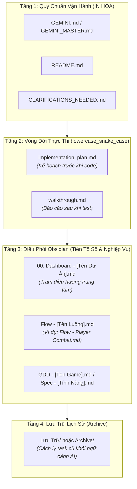

# 📐 Báo Cáo Phân Tích: Quy Chuẩn Master Blueprint, Hệ Thống Đặt Tên File .md & Đánh Giá Thiết Lập MCP

> [!abstract] **Mục Đích Tài Liệu**
> Tài liệu này phân tích chi tiết 3 nội dung trọng tâm theo yêu cầu của bạn trước khi chính thức tạo tệp Master Blueprint tại thư mục gốc `D:\Obsidian_Save\`:
> - Xác định rõ ràng các mong muốn và ý đồ vận hành dự án.
> - Phân tích và chuẩn hóa hệ thống đặt tên file `.md` để mọi phiên chat sau dễ dàng định vị và xử lý.
> - Đánh giá khách quan về việc tích hợp thêm các MCP (Model Context Protocol) hoặc công cụ bổ trợ.

---

## 🎯 1. Xác Định Rõ Ý Đồ & Mong Muốn Cốt Lõi Của Bạn

Dựa trên toàn bộ quá trình làm việc, ý đồ của bạn được xác định qua 4 trụ cột chính:

- **Một Điểm Tựa Duy Nhất (Single Root of Truth):**
  - Đặt một tệp kim chỉ nam (Master Blueprint) ngay tại thư mục gốc `D:\Obsidian_Save\` để mọi dự án con (từ `Game/`, `Mindy/` giảng dạy, `Outsource/` cho đến `Knownledge/`) đều thừa hưởng chung một bộ quy tắc.
  - Khi mở chat mới, bạn không cần giải thích lại từ đầu; AI chỉ cần đọc tệp gốc này là tự động kích hoạt chế độ làm việc chuẩn chỉ.
- **Mô Hình Vận Hành Song Hành 2 Không Gian Làm Việc (2 Workspaces):**
  - *Workspace 1 (Code/Project):* Nơi chứa mã nguồn, assets, cấu hình engine, build script.
  - *Workspace 2 (Obsidian Vault):* Nơi lưu trữ kiến trúc, sơ đồ luồng, kế hoạch triển khai, nhật ký và danh sách công việc.
- **Chiến Lược Tách Chat (Session Splitting & Context Hygiene):**
  - Tránh để một phiên chat kéo dài làm tràn cửa sổ ngữ cảnh (Context Window Saturation) dẫn đến việc AI "quên code cũ".
  - Mỗi phiên chat con đóng vai trò một "Công nhân chuyên biệt" (Ephemeral Worker) chỉ giải quyết trọn vẹn 1 Tính năng (Feature) hoặc 1 Luồng (Flow) với 100% ngữ cảnh sạch.
- **Kiểm Soát An Toàn Tuyệt Đối (Git Rollback & Debuggability):**
  - Bắt buộc Git cục bộ (`git init`) và atomic commits để có thể quay về phiên bản an toàn bất kỳ lúc nào.
  - Code phải đặt log đúng chỗ (`INFO`, `DEBUG`, `WARN`, `ERROR`) để dễ dàng truy vết và sửa lỗi.
  - Khi có điểm chưa chắc chắn: Tạo file `clarifications_needed.md` để xác nhận một lần thay vì đoán mò.

---

## 🏷️ 2. Phân Tích Hệ Thống Đặt Tên File .md (Naming Taxonomy)

Một trong những lý do lớn nhất khiến AI ở các chat sau bị "lạc lối" hoặc đọc nhầm file là do **tên file mơ hồ, thiếu tiền tố vai trò, hoặc đặt tên lộn xộn giữa tiếng Anh và tiếng Việt**. 

Dưới đây là hệ thống phân loại tên file `.md` được chuẩn hóa thành 4 tầng rõ ràng:

### Chi Tiết Quy Ước Cho Từng Loại File:

- **Tầng 1: Tệp Quy Chuẩn Hệ Thống (System Protocol Files — Đặt tên IN HOA):**
  - `GEMINI.md`: Luôn nằm ở thư mục gốc của repo code. AI đọc vào là biết ngay quy tắc làm việc.
  - `README.md`: Tổng quan dự án, hướng dẫn cài đặt môi trường và cách chạy ứng dụng/game.
  - `CLARIFICATIONS_NEEDED.md`: Tạo ra khi AI gặp yêu cầu mơ hồ hoặc có nhiều phương án cần người dùng chốt.
- **Tầng 2: Tệp Vòng Đời Thực Thi Kỹ Thuật (Execution Lifecycle — lowercase_snake_case):**
  - `implementation_plan.md`: Lập kế hoạch chi tiết từng bước trước khi bắt tay vào code tác vụ lớn.
  - `walkthrough.md`: Báo cáo kết quả chạy thử, bằng chứng log/test sau khi hoàn thành.
  - *Lý do dùng tiếng Anh chuẩn:* Các công cụ AI (Antigravity/Cursor/Claude) đều nhận diện ngay lập tức 2 file này theo thói quen mặc định của ngành kỹ thuật phần mềm.
- **Tầng 3: Tệp Quản Lý & Thiết Kế Trong Obsidian (Obsidian Hub & Flow Notes):**
  - *Tệp Điều Phối Cấp Cao (Dùng tiền tố số):*
    - `00. Dashboard - [Tên Dự Án].md`: File quan trọng nhất trong Vault, liên kết đến tất cả các tài liệu khác.
    - `01. Hộp thư đến (Inbox).md`: Nơi ghi nhanh ý tưởng chưa phân loại.
    - `02. Việc hôm nay (Today).md`: Tiêu điểm công việc trong ngày.
  - *Tệp Luồng Nghiệp Vụ / Gameplay (Dùng tiền tố `Flow - `):*
    - Ví dụ: `Flow - Player Movement & State Machine.md`, `Flow - Combat & Damage Calculation.md`.
    - *Quy chuẩn nội dung:* Phải mô tả từ đâu tới đâu (Input $\rightarrow$ Controller $\rightarrow$ State $\rightarrow$ Animation/Sound) và liệt kê đầy đủ Test Cases.
  - *Tệp Thiết Kế Trò Chơi / Hệ Thống (Dùng tiền tố `GDD - ` hoặc `Spec - `):*
    - Ví dụ: `GDD - Core Mechanics.md`, `Spec - Database Schema.md`.
- **Tầng 4: Tệp Đã Hoàn Thành (Archive / Lưu Trữ):**
  - Đặt trong thư mục con `Lưu Trữ/` hoặc `Archive/`.
  - Giúp AI trong các chat sau không bị đọc nhầm các task cũ đã xong, tránh gây nhiễu context.

---

## 🔌 3. Đánh Giá Khách Quan Về Việc Nhét Thêm MCP (Model Context Protocol)

Khi làm việc với Antigravity, câu hỏi đặt ra là: **Có nên cài thêm MCP Server không, hay dùng công cụ có sẵn là đủ?**

### Phân Tích Công Cụ Tích Hợp Sẵn Của Antigravity:
Antigravity hiện đã được trang bị bộ công cụ nội tại (Native Tools) cực kỳ mạnh mẽ:
- Đọc/ghi/chỉnh sửa file: `view_file`, `write_to_file`, `replace_file_content` (tốc độ nano-giây, hỗ trợ slice line, linting trực tiếp).
- Thực thi dòng lệnh: `run_command` (chạy PowerShell trực tiếp, quản lý background task).
- Giao tiếp và kiểm soát: `ask_question`, `search_web`, `manage_task`.

### So Sánh Việc Cài Thêm MCP vs Dùng Công Cụ Có Sẵn:

| Loại MCP | Đánh Giá Khả Thi | Lợi Ích Thực Tế | Khuyến Nghị |
| :--- | :--- | :--- | :--- |
| **Filesystem MCP** | ❌ **Không cần thiết** | Thừa thãi vì Antigravity đã truy cập trực tiếp toàn bộ ổ cứng máy tính với tốc độ cao hơn nhiều. | **KHÔNG DÙNG** |
| **Git MCP** | ❌ **Không cần thiết** | Antigravity chạy lệnh `git status`, `git commit`, `git restore` qua terminal PowerShell cực kỳ linh hoạt và chuẩn xác. | **KHÔNG DÙNG** |
| **Obsidian Local REST API MCP** | 🟡 **Cân nhắc khi Vault rất lớn** | Cho phép tìm kiếm ngữ nghĩa (Semantic search) trong Obsidian. Tuy nhiên với quy mô hàng chục đến hàng trăm file, công cụ đọc file và grep của Antigravity nhanh và ít lỗi hơn. | **CHƯA CẦN THIẾT** |
| **Game Engine MCP (Godot / Unity MCP)** | 🟢 **Đáng giá cho dự án Game** | Nếu làm game (ví dụ Godot): Một MCP Server kết nối trực tiếp với Godot Editor qua socket có thể giúp AI inspect Scene Tree, đọc thông số Node hoặc xem debug output runtime. | **NÊN XEM XÉT NẾU LÀM GAME PHỨC TẠP** |
| **Memory / Context MCP (SQLite / Mem0)** | 🟡 **Tiềm năng** | Giúp lưu trữ kiến thức dài hạn tự động giữa các phiên chat mà không cần phụ thuộc vào việc copy-paste prompt. Tuy nhiên, việc lưu vào file `.md` trong Obsidian hiện tại đã đáp ứng hoàn hảo vai trò này. | **TẬN DỤNG OBSIDIAN LÀ ĐỦ TỐT** |

> [!tip] **Kết luận về MCP:**
> Giữ cấu hình theo triết lý **Lean Setup (Tinh Gọn)**. Bộ công cụ native của Antigravity kết hợp với hệ thống `.md` trong Obsidian là giải pháp ổn định, nhanh nhất và không bao giờ bị lỗi đứt gãy kết nối (Connection Crash). Chỉ nên xem xét thêm MCP chuyên biệt cho Game Engine (như Godot Editor integration) khi bước vào giai đoạn debug runtime sâu.

---

## 📄 4. Đề Xuất Dự Thảo File Master Đặt Tại Root `D:\Obsidian_Save\`

Tôi đề xuất đặt tệp này ngay tại thư mục gốc:
`D:\Obsidian_Save\MASTER_AGENT_BLUEPRINT.md`

### Bố Cục Dự Kiến Của Tệp:
1. **Lời Dẫn & Nguyên Tắc Tối Thượng:** Định nghĩa vai trò Senior AI Agent & Project Manager.
2. **Quy Chuẩn Không Gian Làm Việc:** Hướng dẫn phân định rạch ròi giữa Thư Mục Dự Án (Code) và Thư Mục Obsidian (Tài liệu).
3. **Quy Chuẩn Đặt Tên File:** Bảng tra cứu nhanh 4 tầng đặt tên file `.md` để AI tự động tuân thủ.
4. **Quy Chuẩn Kỹ Thuật:** Git cục bộ, Atomic commit, Quy chuẩn ghi log truy vết (`INFO`, `DEBUG`, `WARN`, `ERROR`).
5. **Bộ 3 Prompt Mẫu Chuẩn Hóa:**
   - *Prompt 1:* Khởi động dự án mới (Quét Turn 1, đánh giá hiện trạng).
   - *Prompt 2:* Tách chat theo tính năng con (Feature/Flow).
   - *Prompt 3:* Bàn giao và đóng gói phiên làm việc.

---

## 🔗 Liên Kết Điều Hướng
* [[00. Tổng quan - Dashboard]] | [[05. Nghiên Cứu - Quy Chuẩn GEMINI.md & Quản Lý Git Cho Dự Án Khác]]
