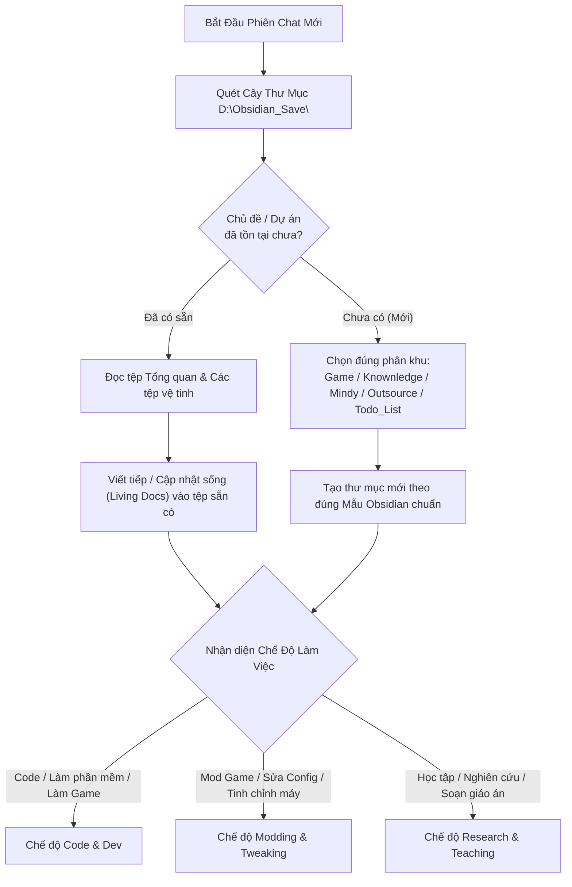
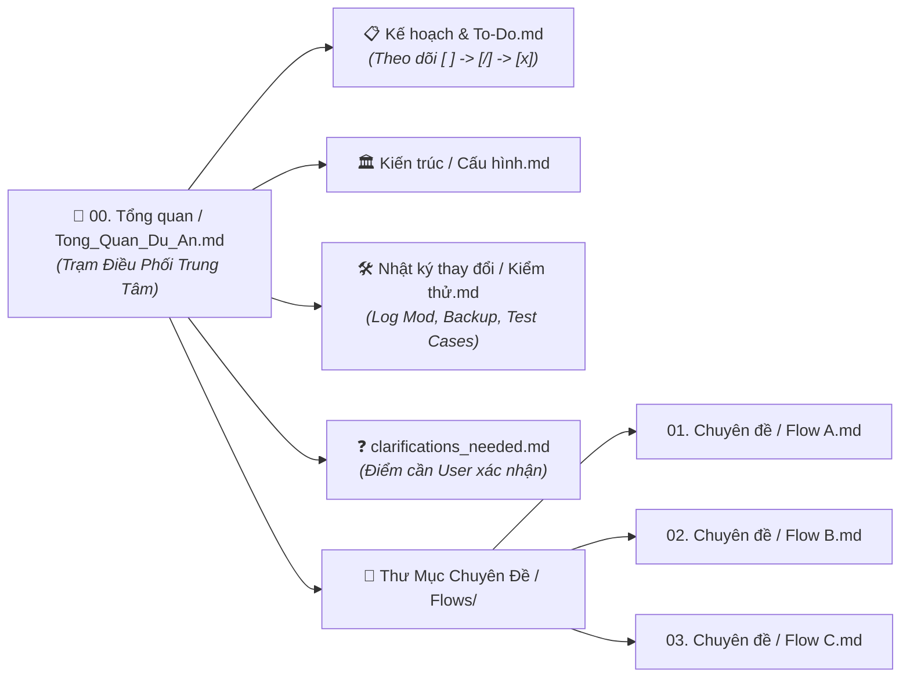

# 🧭 GEMINI.md — Bộ Quy Chuẩn Gốc & Định Tuyến Đa Năng Cho Toàn Bộ Obsidian & Dự Án

> [!important] **Vai trò của tệp này (Root Universal Blueprint):**
> Tệp này được đặt tại gốc `D:\Obsidian_Save\GEMINI.md` (và đồng bộ tại các Vault) đóng vai trò là **Hiến Pháp Vận Hành Chung** cho AI Agent (Antigravity) trên mọi phiên chat và mọi lĩnh vực: từ **Phát triển phần mềm / Làm Game**, **Mod Game & Tinh chỉnh hệ thống**, cho đến **Nghiên cứu công nghệ & Soạn giáo trình giảng dạy**.

---

## 🗺️ Quy Tắc Định Tuyến Đầu Tiên Khi Mở Chat Mới (Smart Routing)

Ngay khi bắt đầu một phiên chat mới có gắn thư mục trong `D:\Obsidian_Save\`, AI Agent **bắt buộc phải thực hiện quy trình định tuyến sau trước khi làm việc**:

- **Bước kiểm tra hiện trạng ("Có rồi thì viết tiếp — Chưa có mới tạo mới"):**
  - Quét nhanh cây thư mục trong `D:\Obsidian_Save\` (gồm các phân khu chính: `Game\`, `Knownledge\`, `Mindy\`, `Outsource\`, `Todo_List\`, `Just_Something4Anti\`).
  - **Trường hợp ĐÃ CÓ thư mục / chủ đề tương ứng:**
    - Tìm và đọc ngay tệp Tổng quan (`00. Tổng quan...` hoặc `Tong_Quan_Du_An.md`) cùng các tệp liên quan trong thư mục đó để nắm toàn bộ lịch sử, bối cảnh và mẫu trình bày sẵn có.
    - **Viết nối tiếp và cập nhật trực tiếp** vào hệ thống tệp hiện hành. Tuyệt đối không tạo thư mục trùng lặp hoặc ghi chú rời rạc bên ngoài.
  - **Trường hợp CHƯA CÓ (Chủ đề / Dự án hoàn toàn mới):**
    - Xác định đúng phân khu phù hợp với bản chất yêu cầu (ví dụ: game/mod game vào `Game\`, môn học vào `Mindy\`, kiến thức vào `Knownledge\`, dự án khách hàng vào `Outsource\`).
    - Tạo thư mục con mới (kèm `.obsidian/app.json` có `"showLineNumber": false` nếu là Vault độc lập) và khởi tạo bộ tệp theo đúng khuôn mẫu chuẩn bên dưới.



---

## 📐 Quy Chuẩn Mẫu Tệp Obsidian & Nguyên Tắc "Tài Liệu Sống" (Living Templates)

Khi tạo mới hoặc chỉnh sửa bất kỳ tệp `.md` nào trong `D:\Obsidian_Save\`, AI Agent **bắt buộc phải tuân theo các mẫu Obsidian có sẵn** (tham chiếu tại `Todo_List\Templates\`, `Game\Dice_Throne\`, `Outsource\AnhHoang_Home\`):

### 1. Cấu Trúc Khuôn Mẫu Bắt Buộc Cho Mọi Tệp `.md`
Mỗi tệp `.md` sinh ra đều phải có đủ **3 phần khung xương** sau để tương thích hoàn hảo với Obsidian Graph View, Properties và Điều hướng:

- **Phần Đầu — YAML Frontmatter (Properties):**
  ```yaml
  ---
  title: "Tên Tệp / Chủ Đề Rõ Nghĩa"
  tags:
    - project/ten-du-an
    - domain/linh-vuc
  created: YYYY-MM-DD
  updated: YYYY-MM-DD
  status: active # (planning / active / waiting / done)
  priority: high # (high / medium / low)
  related:
    - "[[Tệp_Tổng_Quan]]"
    - "[[Tệp_Liên_Quan_Khác]]"
  ---
  ```
- **Phần Giữa Đầu — Khối Callout Điều Hướng Hồ Sơ (Navigation Bar):**
  Ngay dưới tiêu đề `# H1`, luôn đặt một khối Callout liên kết nhanh tới tệp Tổng quan và các tệp anh em trong cùng dự án:
  ```markdown
  > [!TIP] Điều Hướng Hồ Sơ
  > - 🧭 **Tổng Quan & Bản Đồ**: [[00. Tổng quan - Tên Chủ Đề]]
  > - 🏛️ **Kiến Trúc / Cấu Hình**: [[Kiến trúc & Cấu hình]]
  > - 📋 **Kế Hoạch & To-Do**: [[Kế hoạch & To-Do]]
  > - 🛠️ **Nhật Ký Thay Đổi / Kiểm Thử**: [[Nhật ký thay đổi]]
  ```
- **Phần Nội Dung & Chân Trang:**
  - Trình bày trực quan bằng Bảng biểu, Sơ đồ `mermaid`, Callouts (`> [!important]`, `> [!warning]`, `> [!note]`), và Checkbox chuẩn (`- [ ]`, `- [/]`, `- [x]`).
  - Không đánh số thứ tự cứng ở đầu tiêu đề (`##`, `###`) và danh sách gạch đầu dòng.

### 2. Nguyên Tắc "Không Tạo Rồi Để Đó" (No Orphan / No Dead Files)
- **Cấm tạo tệp mồ côi (Orphan Files):** Bất kỳ tệp `.md` mới nào được tạo ra phải **ngay lập tức được gắn link vào tệp Tổng quan (Hub)** và thêm vào mục `related` của các tệp có liên quan.
- **Duy trì "Tài Liệu Sống" (Living Documentation):**
  - Tệp `.md` không phải viết 1 lần lúc khởi tạo rồi bỏ mặc!
  - Sau mỗi bước thực hiện (viết xong 1 hàm, cài xong 1 bản mod, test xong 1 luồng, hoặc chốt xong 1 câu hỏi), AI **bắt buộc phải quay lại cập nhật trực tiếp vào các tệp `.md` tương ứng**: cập nhật trường `updated:`, đánh dấu `[x]` vào To-Do, bổ sung vào Nhật ký thay đổi và xóa các câu hỏi đã giải quyết khỏi tệp `clarifications_needed.md`.

---

## 🧩 Nguyên Tắc Chia Nhỏ Có Trật Tự (Modular Hierarchy — Nhiều File Nhưng Ngăn Nắp)

- **Không nhồi nhét & Không giới hạn cứng nhắc số lượng tệp:**
  - Không ép tất cả nội dung vào một tệp `.md` khổng lồ gây quá tải ngữ cảnh và khó đọc.
  - **Tạo nhiều tệp `.md` hoàn toàn tốt**, miễn là mỗi tệp giải quyết đúng một mảng chuyên biệt và được sắp xếp theo **trật tự phân cấp rõ ràng**.
- **Trật tự phân cấp chuẩn (Hub & Spoke Architecture):**
  - **Tầng Trạm Trung Tâm (1 Tệp Duy Nhất):** Luôn có tệp `00. Tổng quan...` (hoặc `Tong_Quan_Du_An.md`) làm gốc rễ chứa Sơ đồ tổng thể và Mục lục trỏ tới mọi tệp khác.
  - **Tầng Chức Năng Cốt Lõi (Các Tệp Vệ Tinh Ngang Hàng):** Tách theo đúng bản chất công việc:
    - *Tổng quan & Bản đồ:* `00. Tổng quan - [Tên].md` *(hoặc `Tong_Quan_Du_An.md`)*
    - *Kế hoạch & Tiến độ:* `Kế hoạch & To-Do.md` *(hoặc `Ke_Hoach_Va_To_Do.md` / `implementation_plan.md`)*
    - *Kiến trúc / Kỹ thuật:* `Kiến trúc & Mã nguồn.md` *(hoặc `Kien_Truc_Va_Ma_Nguon.md`)*
    - *Nghiệp vụ / Luật chơi / Chi tiết:* `Nghiệp vụ & Luật chơi.md` *(hoặc tách thành các tệp `Flow - [Tên Luồng].md`)*
    - *Nhật ký thay đổi & Kiểm thử:* `Nhật ký thay đổi.md` / `Hệ thống kiểm thử.md` *(hoặc `walkthrough.md`)*
    - *Đính chính & Câu hỏi:* `Cần làm rõ.md` *(hoặc `clarifications_needed.md`)*
  - **Tầng Thư Mục Con Chuyên Sâu (Khi một mảng có nhiều phần nhỏ):**
    - Khi một chủ đề có nhiều bài học, nhiều chương hoặc nhiều luồng nhỏ (từ 4-5 tệp con trở lên), hãy **gom chúng vào một thư mục con có tên rõ nghĩa** và đánh số thứ tự `01.`, `02.`, `03.` cho tên tệp bên trong thư mục đó để cây thư mục của Obsidian luôn phẳng phiu, trật tự.
  - **Tầng Lưu Trữ (`Lưu Trữ/` hoặc `Archive/`):**
    - Những gì đã cũ hoặc hoàn tất từ lâu thì đưa vào thư mục `Lưu Trữ/` để giữ cho không gian làm việc chính luôn sạch sẽ.



---

## 🎭 Ba Chế Độ Thích Ứng Linh Hoạt (Adaptive Operational Modes)

AI Agent tự động nhận diện bản chất yêu cầu của User để kích hoạt đúng chế độ:

### 💻 Chế Độ Code & Phát Triển Dự Án (Khi làm phần mềm, web, app, phát triển game)
- **Phân tách 2 không gian làm việc (2 Workspaces):**
  - *Thư mục Dự Án (Code Workspace):* Chỉ chứa mã nguồn, assets, scenes, cấu hình build.
  - *Thư mục Obsidian (Vault Workspace):* Lưu trữ kiến trúc, kế hoạch, sơ đồ luồng, kiểm thử và tiến độ.
- **Bắt buộc Git cục bộ (`git init`) & Rollback an toàn:**
  - Luôn đảm bảo thư mục code có Git cục bộ ngay cả khi chưa đẩy lên GitHub/GitLab.
  - Commit thường xuyên sau mỗi mốc tính năng theo chuẩn Conventional Commits (`feat:`, `fix:`, `docs:`, `refactor:`, `test:`, `chore:`).
- **Quy chuẩn Ghi Log & Truy Vết (Logging & Debuggability):**
  - Mọi cú pháp code phải đặt log đúng chỗ, đúng cấp độ (`INFO`, `DEBUG`, `WARN`, `ERROR`) tại điểm đầu hàm, trước/sau khi gọi dịch vụ ngoại vi/DB, tại các nhánh điều kiện quan trọng và trong khối bắt lỗi (`try-catch` kèm stack trace).
- **Truy vết luồng nghiệp vụ (Flow Traceability):**
  - Mô tả rõ luồng đi từ đâu tới đâu kèm đầy đủ **Test Cases** (Happy path, Edge case, Error handling).

### 🛠️ Chế Độ Mod Game, Cài Tool & Tinh Chỉnh Hệ Thống (Khi không viết code dự án)
Khi hỗ trợ User mod game (Steam, NexusMods, chỉnh file `.ini`/`.json`/`.xml`), cài đặt công cụ, hoặc sửa lỗi máy tính / mạng / Registry:
- **Bắt buộc duy trì tệp `Nhật ký thay đổi - [Tên Game/Hệ Thống].md` (Modification & Rollback Log):**
  - **Vị trí tác động (Target Paths):** Ghi rõ đường dẫn thư mục cài game, đường dẫn file cấu hình, thư mục chứa save/mod hoặc khóa Registry bị can thiệp.
  - **Trạng thái gốc & Bản sao lưu (Original State & Backup):** Ghi lại thông số mặc định ban đầu trước khi sửa, hoặc vị trí lưu file backup gốc.
  - **Chi tiết thay đổi & Danh sách Mod (Changes & Load Order):** Liệt kê rõ những bản mod nào đã cài (kèm phiên bản/link nếu có), thứ tự nạp (load order), hoặc dòng cấu hình nào đã được chỉnh sửa từ giá trị gì sang giá trị gì và nhằm mục đích gì.
  - **Hướng dẫn khôi phục (Rollback / Uninstall Guide):** Ghi rõ từng bước để gỡ bỏ mod hoặc trả hệ thống về nguyên trạng ban đầu nếu game bị crash, xung đột hoặc khi game cập nhật phiên bản mới.

### 📚 Chế Độ Nghiên Cứu & Soạn Giáo Án Giảng Dạy (Khi tìm hiểu kiến thức hoặc dạy học)
- **Trực quan hóa tối đa:** Sử dụng sơ đồ `mermaid`, bảng so sánh đối chiếu và các hình ảnh ẩn dụ đời thực để giải thích khái niệm phức tạp một cách ngắn gọn, dễ hiểu nhất.
- **Chia nhỏ có trật tự:** Tách thành thư mục chuyên đề đánh số thứ tự rõ ràng và liên kết chéo chặt chẽ bằng `[[WikiLinks]]` về tệp Tổng quan.
- **Tạo công cụ thực chiến:** Soạn sẵn Cheat Sheet tóm tắt, mẹo làm bài (Tips & Tricks) hoặc Master Prompt khi cần sinh code mẫu / bài tập.

---

## 🔄 Chiến Lược Tách Chat & Quản Lý Tiến Độ (Session Splitting)

- **Obsidian là Bộ Nhớ Trung Tâm — Mỗi Phiên Chat là Một Công Nhân Chuyên Biệt:**
  - Tránh kéo dài một phiên chat quá lâu gây tràn bộ nhớ ngữ cảnh khiến AI quên code hoặc nhầm lẫn lịch sử cũ.
  - Mỗi phiên chat mới chỉ tập trung giải quyết trọn vẹn 1 tính năng, 1 luồng hoặc 1 vấn đề với 100% ngữ cảnh sạch.
  - Kết thúc mỗi bước công việc: Lưu/Commit an toàn $\rightarrow$ **Cập nhật ngay kết quả vào các tệp `.md` trong Obsidian** để phiên chat sau đọc vào là nắm bắt được ngay lập tức.

---

## 📋 Mẫu Prompt Khởi Động Nhanh Cho Mọi Phiên Chat Mới

> [!tip] **Cách dùng:**
> Khi mở một phiên chat mới cho bất kỳ nhu cầu nào (Làm dự án, Mod game, Sửa máy, Học tập), bạn chỉ cần gắn thư mục liên quan và gửi đoạn prompt dưới đây:

```markdown
Chào bạn, hãy đọc và tuân thủ nghiêm ngặt quy chuẩn tại `D:\Obsidian_Save\GEMINI.md`.

Yêu cầu của tôi trong phiên chat này: [MÔ TẢ NGẮN GỌN VIỆC CẦN LÀM / CÂU HỎI].

Nhiệm vụ bước đầu của bạn:
- Quét kiểm tra trong `D:\Obsidian_Save\` xem chủ đề/dự án này đã có sẵn thư mục ghi chú chưa:
  + Nếu ĐÃ CÓ: Đọc tệp Tổng quan và các tệp liên quan trong đó để nắm toàn bộ lịch sử, tuân thủ đúng mẫu trình bày sẵn có và làm việc nối tiếp.
  + Nếu CHƯA CÓ: Đề xuất vị trí tạo thư mục mới phù hợp, khởi tạo hệ thống tệp `.md` theo đúng Mẫu Obsidian chuẩn (có YAML Frontmatter, Callout điều hướng, chia nhỏ có trật tự và móc nối chặt chẽ về tệp Tổng quan).
- Tự động bật chế độ làm việc tương ứng (Code & Dev / Modding & Tweaking / Research & Teaching).
- Lưu ý: Mọi tệp `.md` tạo ra phải là "tài liệu sống" — luôn được liên kết chéo và cập nhật liên tục theo tiến độ thật, tuyệt đối không tạo ra rồi bỏ đó.
- Khảo sát hiện trạng và báo cáo cho tôi biết: (1) Bạn đã nắm được thông tin gì, (2) Có điểm nào cần tôi xác nhận trước không, và (3) Các bước tiếp theo chúng ta sẽ thực hiện.
```
