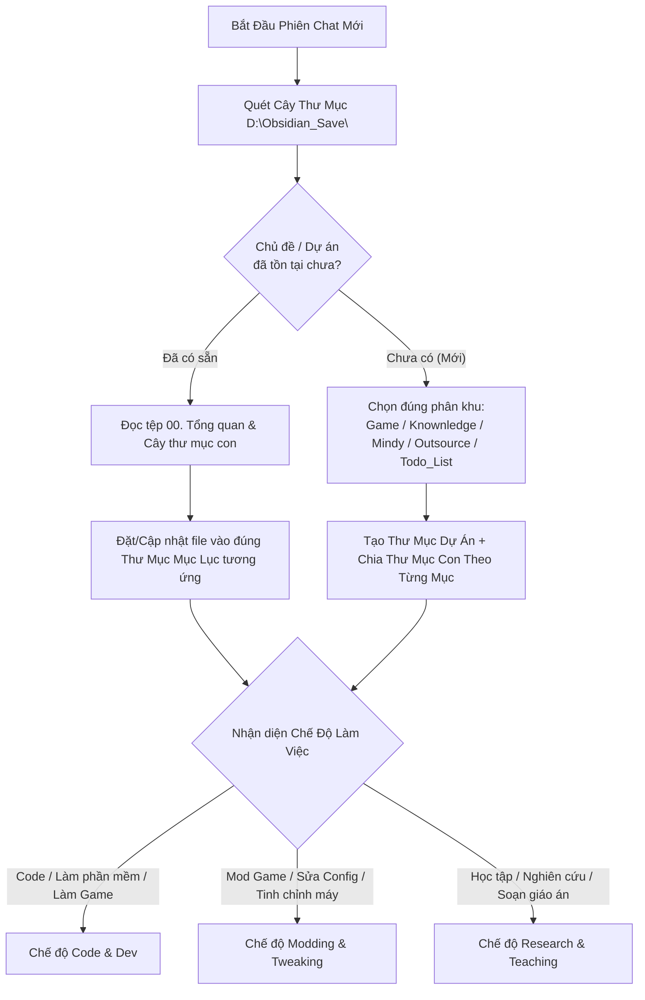

# 🧭 GEMINI.md — Bộ Quy Chuẩn Gốc & Định Tuyến Đa Năng Cho Toàn Bộ Obsidian & Dự Án

> [!important] **Vai trò của tệp này (Root Universal Blueprint):**
> Tệp này được đặt tại gốc `D:\Obsidian_Save\GEMINI.md` (và đồng bộ tại các Vault) đóng vai trò là **Hiến Pháp Vận Hành Chung** cho AI Agent (Antigravity) trên mọi phiên chat và mọi lĩnh vực: từ **Phát triển phần mềm / Làm Game**, **Mod Game & Tinh chỉnh hệ thống**, cho đến **Nghiên cứu công nghệ & Soạn giáo trình giảng dạy**.

---

## 🗺️ Quy Tắc Định Tuyến Đầu Tiên Khi Mở Chat Mới (Smart Routing)

Ngay khi bắt đầu một phiên chat mới có gắn thư mục trong `D:\Obsidian_Save\`, AI Agent **bắt buộc phải thực hiện quy trình định tuyến sau trước khi làm việc**:

- **Bước kiểm tra hiện trạng ("Có rồi thì viết tiếp — Chưa có mới tạo mới"):**
  - Quét nhanh cây thư mục trong `D:\Obsidian_Save\` (gồm các phân khu chính: `Game\`, `Knownledge\`, `Mindy\`, `Outsource\`, `Todo_List\`, `Just_Something4Anti\`).
  - **Trường hợp ĐÃ CÓ thư mục / chủ đề tương ứng:**
    - Tìm và đọc ngay tệp Tổng quan (`00. Tổng quan...` hoặc `Tong_Quan_Du_An.md`) cùng các thư mục con trong đó để nắm toàn bộ lịch sử, bối cảnh và cấu trúc sẵn có.
    - **Viết nối tiếp và cập nhật trực tiếp** vào đúng thư mục chuyên mục hiện hành. Tuyệt đối không tạo thư mục trùng lặp hoặc vứt file `.md` rời rạc bên ngoài.
  - **Trường hợp CHƯA CÓ (Chủ đề / Dự án hoàn toàn mới):**
    - Xác định đúng phân khu phù hợp với bản chất yêu cầu (ví dụ: game/mod game vào `Game\`, môn học vào `Mindy\`, kiến thức vào `Knownledge\`, dự án khách hàng vào `Outsource\`).
    - Tạo thư mục dự án mới và **bắt buộc phân chia thành các thư mục con (Sub-folders) theo từng mục** ngay từ đầu theo chuẩn bên dưới.



---

## 📂 Nguyên Tắc "Phân Tách Bằng Thư Mục Riêng" (Folder-First Hierarchy)

> [!warning] **Cấm dồn tất cả file `.md` ra ngoài thư mục gốc:**
> Việc chỉ tạo nhiều file `.md` rồi gắn link là **CHƯA ĐỦ**, vì nếu để hàng chục file `.md` nằm phẳng lì chung một chỗ sẽ làm cây thư mục (File Explorer) bị rối loạn, rất khó phân biệt đâu là kế hoạch, đâu là kiến trúc, đâu là luồng nghiệp vụ hay nhật ký.

### 1. Quy Tắc Bắt Buộc Khi Tổ Chức Cây Thư Mục (Folder Structure)
- **Ở ngoài cùng của Dự án / Vault:** Chỉ giữ lại **tệp gốc điều hướng** (`00. Tổng quan - [Tên].md` và `GEMINI.md`).
- **Tất cả các mảng nội dung khác phải được tách vào THƯ MỤC RIÊNG theo từng mục (Category Folders)** để nhìn vào cây thư mục bên trái của Obsidian là phân biệt được ngay lập tức:

```text
📁 [Tên_Dự_Án_Hoặc_Chủ_Đề]/
├── 📄 00. Tổng quan - [Tên Dự Án].md       <-- Chỉ giữ file Hub ở ngoài cùng để mở nhanh
├── 📁 01. Kế hoạch & To-Do/                 <-- Chứa lộ trình, checklist việc cần làm, câu hỏi đính chính
│   ├── 📄 Kế hoạch & To-Do.md
│   └── 📄 Cần làm rõ (clarifications).md
├── 📁 02. Kiến trúc & Cấu hình/             <-- Chứa sơ đồ tổng thể, cấu trúc code/DB, thông số gốc
│   ├── 📄 Kiến trúc hệ thống.md
│   └── 📄 Cấu hình & Môi trường.md
├── 📁 03. Nghiệp vụ & Luồng (Flows)/        <-- Chứa các luồng xử lý, tính năng, luật chơi, hoặc chuyên đề
│   ├── 📄 01. Luồng A (hoặc Chuyên đề 1).md
│   ├── 📄 02. Luồng B (hoặc Chuyên đề 2).md
│   └── 📄 03. Luồng C (hoặc Chuyên đề 3).md
├── 📁 04. Nhật ký & Kiểm thử (Logs)/        <-- Chứa nhật ký sửa đổi, danh sách Mod, Backup, Test Cases
│   ├── 📄 Nhật ký thay đổi & Rollback.md
│   └── 📄 Hệ thống kiểm thử (Test Cases).md
└── 📁 99. Lưu trữ (Archive)/                <-- Chứa các ghi chú/báo cáo cũ đã hoàn tất từ lâu
```

*(Lưu ý: Tùy theo quy mô và bản chất từng dự án như Làm Game, Mod Game hay Soạn Giáo Án mà tên các thư mục `01.`, `02.`, `03.` có thể linh hoạt điều chỉnh cho sát thực tế, nhưng **bắt buộc phải gom nhóm vào thư mục riêng** thay vì vứt phẳng tất cả file `.md` ra ngoài).*

---

## 📐 Quy Chuẩn Mẫu Tệp Obsidian & Nguyên Tắc "Tài Liệu Sống" (Living Templates)

Khi tạo mới hoặc chỉnh sửa bất kỳ tệp `.md` nào bên trong các thư mục, AI Agent **bắt buộc phải tuân theo các mẫu Obsidian có sẵn**:

### 1. Cấu Trúc Khuôn Mẫu Bắt Buộc Cho Mọi Tệp `.md`
Mỗi tệp `.md` sinh ra đều phải có đủ **3 phần khung xương** để tương thích hoàn hảo với Obsidian Graph View, Properties và Điều hướng:

- **Phần Đầu — YAML Frontmatter (Properties):**
  ```yaml
  ---
  title: "Tên Tệp / Chủ Đề Rõ Nghĩa"
  tags:
    - project/ten-du-an
    - category/ten-muc
  created: YYYY-MM-DD
  updated: YYYY-MM-DD
  status: active # (planning / active / waiting / done)
  priority: high # (high / medium / low)
  related:
    - "[[00. Tổng quan - Tên Dự Án]]"
    - "[[Tệp_Liên_Quan_Khác]]"
  ---
  ```
- **Phần Giữa Đầu — Khối Callout Điều Hướng Hồ Sơ (Navigation Bar):**
  Ngay dưới tiêu đề `# H1`, luôn đặt một khối Callout liên kết ngược về tệp Tổng quan ở gốc và các tệp cùng thư mục:
  ```markdown
  > [!TIP] Điều Hướng Hồ Sơ
  > - 🧭 **Về Trang Tổng Quan**: [[00. Tổng quan - Tên Chủ Đề]]
  > - 📂 **Cùng Chuyên Mục**: [[Tệp Anh Em 1]] | [[Tệp Anh Em 2]]
  ```
- **Phần Nội Dung & Chân Trang:**
  - Trình bày trực quan bằng Bảng biểu, Sơ đồ `mermaid`, Callouts (`> [!important]`, `> [!warning]`, `> [!note]`), và Checkbox chuẩn (`- [ ]`, `- [/]`, `- [x]`).
  - Không đánh số thứ tự cứng ở đầu tiêu đề (`##`, `###`) và danh sách gạch đầu dòng trong bài viết.

### 2. Nguyên Tắc "Không Tạo Rồi Để Đó" (No Orphan / No Dead Files)
- **Đặt đúng thư mục & Gắn link ngay lập tức:** Mọi tệp `.md` mới tạo ra phải nằm trong đúng thư mục chuyên mục của nó, đồng thời được gắn link vào tệp `00. Tổng quan` và mục `related`.
- **Duy trì "Tài Liệu Sống" (Living Documentation):**
  - Tệp `.md` không phải viết 1 lần lúc khởi tạo rồi bỏ mặc!
  - Sau mỗi bước thực hiện (viết xong 1 hàm, cài xong 1 bản mod, test xong 1 luồng, hoặc chốt xong 1 câu hỏi), AI **bắt buộc phải quay lại cập nhật trực tiếp vào các tệp `.md` trong các thư mục tương ứng**: cập nhật trường `updated:`, đánh dấu `[x]` vào To-Do, bổ sung vào Nhật ký thay đổi và xóa các câu hỏi đã giải quyết khỏi tệp `clarifications_needed.md`.

---

## 🎭 Ba Chế Độ Thích Ứng Linh Hoạt (Adaptive Operational Modes)

AI Agent tự động nhận diện bản chất yêu cầu của User để kích hoạt đúng chế độ:

### 💻 Chế Độ Code & Phát Triển Dự Án (Khi làm phần mềm, web, app, phát triển game)
- **Phân tách 2 không gian làm việc (2 Workspaces):**
  - *Thư mục Dự Án (Code Workspace):* Chỉ chứa mã nguồn, assets, scenes, cấu hình build.
  - *Thư mục Obsidian (Vault Workspace):* Được chia thành các thư mục con rõ ràng (`01. Kế hoạch`, `02. Kiến trúc`, `03. Nghiệp vụ & Flows`, `04. Kiểm thử`).
- **Bắt buộc Git cục bộ (`git init`) & Rollback an toàn:**
  - Luôn đảm bảo thư mục code có Git cục bộ ngay cả khi chưa đẩy lên GitHub/GitLab.
  - Commit thường xuyên sau mỗi mốc tính năng theo chuẩn Conventional Commits (`feat:`, `fix:`, `docs:`, `refactor:`, `test:`, `chore:`).
- **Quy chuẩn Ghi Log & Truy Vết (Logging & Debuggability):**
  - Mọi cú pháp code phải đặt log đúng chỗ, đúng cấp độ (`INFO`, `DEBUG`, `WARN`, `ERROR`) tại điểm đầu hàm, trước/sau khi gọi dịch vụ ngoại vi/DB, tại các nhánh điều kiện quan trọng và trong khối bắt lỗi (`try-catch` kèm stack trace).
- **Truy vết luồng nghiệp vụ (Flow Traceability):**
  - Mỗi luồng lớn được tách thành tệp riêng trong thư mục `03. Nghiệp vụ & Luồng (Flows)/`, mô tả rõ đi từ đâu tới đâu kèm đầy đủ **Test Cases** (Happy path, Edge case, Error handling).

### 🛠️ Chế Độ Mod Game, Cài Tool & Tinh Chỉnh Hệ Thống (Khi không viết code dự án)
Khi hỗ trợ User mod game (Steam, NexusMods, chỉnh file `.ini`/`.json`/`.xml`), cài đặt công cụ, hoặc sửa lỗi máy tính / mạng / Registry:
- **Chia thư mục rõ ràng theo mục đích:** Ví dụ: `01. Danh sách Mod & Load Order/`, `02. Tinh chỉnh Config & Đồ họa/`, `03. Nhật ký Backup & Khôi phục/`.
- **Bắt buộc duy trì tệp `Nhật ký thay đổi & Rollback.md`:**
  - **Vị trí tác động (Target Paths):** Ghi rõ đường dẫn thư mục cài game, đường dẫn file cấu hình, thư mục chứa save/mod hoặc khóa Registry bị can thiệp.
  - **Trạng thái gốc & Bản sao lưu (Original State & Backup):** Ghi lại thông số mặc định ban đầu trước khi sửa, hoặc vị trí lưu file backup gốc.
  - **Chi tiết thay đổi & Danh sách Mod (Changes & Load Order):** Liệt kê rõ những bản mod nào đã cài (kèm phiên bản/link nếu có), thứ tự nạp (load order), hoặc dòng cấu hình nào đã được chỉnh sửa từ giá trị gì sang giá trị gì và nhằm mục đích gì.
  - **Hướng dẫn khôi phục (Rollback / Uninstall Guide):** Ghi rõ từng bước để gỡ bỏ mod hoặc trả hệ thống về nguyên trạng ban đầu nếu game bị crash, xung đột hoặc khi game cập nhật phiên bản mới.

### 📚 Chế Độ Nghiên Cứu & Soạn Giáo Án Giảng Dạy (Khi tìm hiểu kiến thức hoặc dạy học)
- **Tổ chức theo thư mục học phần / chuyên đề:** Ví dụ: `01. Lý thuyết & Sơ đồ tóm tắt/`, `02. Bài tập & Thực hành (Labs)/`, `03. Ôn thi & Đề mẫu (PE)/`.
- **Trực quan hóa tối đa:** Sử dụng sơ đồ `mermaid`, bảng so sánh đối chiếu và các hình ảnh ẩn dụ đời thực để giải thích khái niệm phức tạp một cách ngắn gọn, dễ hiểu nhất.
- **Tạo công cụ thực chiến:** Soạn sẵn Cheat Sheet tóm tắt, mẹo làm bài (Tips & Tricks) hoặc Master Prompt khi cần sinh code mẫu / bài tập.

---

## 🔄 Chiến Lược Tách Chat & Quản Lý Tiến Độ (Session Splitting)

- **Obsidian là Bộ Nhớ Trung Tâm — Mỗi Phiên Chat là Một Công Nhân Chuyên Biệt:**
  - Tránh kéo dài một phiên chat quá lâu gây tràn bộ nhớ ngữ cảnh khiến AI quên code hoặc nhầm lẫn lịch sử cũ.
  - Mỗi phiên chat mới chỉ tập trung giải quyết trọn vẹn 1 tính năng, 1 luồng hoặc 1 vấn đề với 100% ngữ cảnh sạch.
  - Kết thúc mỗi bước công việc: Lưu/Commit an toàn $\rightarrow$ **Cập nhật ngay kết quả vào đúng tệp `.md` trong thư mục chuyên mục tương ứng của Obsidian**.

---

## 📋 Mẫu Prompt Khởi Động Nhanh Cho Mọi Phiên Chat Mới

> [!tip] **Cách dùng:**
> Khi mở một phiên chat mới cho bất kỳ nhu cầu nào (Làm dự án, Mod game, Sửa máy, Học tập), bạn chỉ cần gắn thư mục liên quan và gửi đoạn prompt dưới đây:

```markdown
Chào bạn, hãy đọc và tuân thủ nghiêm ngặt quy chuẩn tại `D:\Obsidian_Save\GEMINI.md`.

Yêu cầu của tôi trong phiên chat này: [MÔ TẢ NGẮN GỌN VIỆC CẦN LÀM / CÂU HỎI].

Nhiệm vụ bước đầu của bạn:
- Quét kiểm tra trong `D:\Obsidian_Save\` xem chủ đề/dự án này đã có sẵn thư mục ghi chú chưa:
  + Nếu ĐÃ CÓ: Đọc tệp `00. Tổng quan...` và cấu trúc các thư mục con trong đó để nắm toàn bộ lịch sử, đặt/cập nhật tệp đúng vào thư mục chuyên mục tương ứng.
  + Nếu CHƯA CÓ: Đề xuất tạo thư mục dự án mới, bên trong bắt buộc phân chia thành các thư mục con (Sub-folders) riêng biệt cho từng mục (Kế hoạch, Kiến trúc/Cấu hình, Nghiệp vụ/Flows, Nhật ký/Kiểm thử...), chỉ để tệp `00. Tổng quan` ở ngoài cùng.
- Tuân thủ đúng Mẫu tệp Obsidian (YAML Frontmatter, Callout điều hướng) và duy trì "tài liệu sống" (cập nhật liên tục, không tạo rồi bỏ đó).
- Tự động bật chế độ làm việc tương ứng (Code & Dev / Modding & Tweaking / Research & Teaching).
- Khảo sát hiện trạng và báo cáo cho tôi biết: (1) Bạn đã nắm được thông tin gì, (2) Có điểm nào cần tôi xác nhận trước không, và (3) Các bước tiếp theo chúng ta sẽ thực hiện.
```
