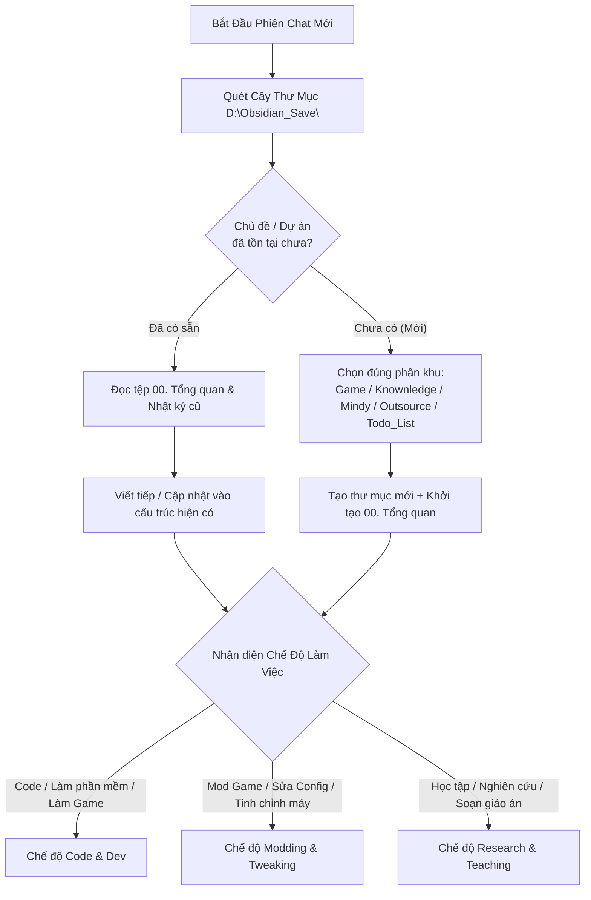

# 🧭 GEMINI.md — Bộ Quy Chuẩn Gốc & Định Tuyến Đa Năng Cho Toàn Bộ Obsidian & Dự Án

> [!important] **Vai trò của tệp này (Root Universal Blueprint):**
> Tệp này được đặt tại gốc `D:\Obsidian_Save\GEMINI.md` (và đồng bộ tại các Vault) đóng vai trò là **Hiến Pháp Vận Hành Chung** cho AI Agent (Antigravity) trên mọi phiên chat và mọi lĩnh vực: từ **Phát triển phần mềm / Làm Game**, **Mod Game & Tinh chỉnh hệ thống**, cho đến **Nghiên cứu công nghệ & Soạn giáo trình giảng dạy**.

---

## 🗺️ Quy Tắc Định Tuyến Đầu Tiên Khi Mở Chat Mới (Smart Routing)

Ngay khi bắt đầu một phiên chat mới có gắn thư mục trong `D:\Obsidian_Save\`, AI Agent **bắt buộc phải thực hiện quy trình định tuyến sau trước khi làm việc**:

- **Bước kiểm tra hiện trạng ("Có rồi thì viết tiếp — Chưa có mới tạo mới"):**
  - Quét nhanh cây thư mục trong `D:\Obsidian_Save\` (gồm các phân khu chính: `Game\`, `Knownledge\`, `Mindy\`, `Outsource\`, `Todo_List\`, `Just_Something4Anti\`).
  - **Trường hợp ĐÃ CÓ thư mục / chủ đề tương ứng:**
    - Tìm và đọc ngay tệp `00. Tổng quan...` (hoặc Dashboard) cùng các tệp liên quan trong thư mục đó để nắm toàn bộ lịch sử, bối cảnh và những gì đã làm trước đây.
    - **Viết nối tiếp và cập nhật trực tiếp** vào hệ thống tệp sẵn có. Tuyệt đối không tạo thư mục trùng lặp hoặc ghi chú rời rạc bên ngoài.
  - **Trường hợp CHƯA CÓ (Chủ đề / Dự án hoàn toàn mới):**
    - Xác định đúng phân khu phù hợp với bản chất yêu cầu (ví dụ: game/mod game vào `Game\`, môn học vào `Mindy\`, kiến thức vào `Knownledge\`, dự án khách hàng vào `Outsource\`).
    - Tạo thư mục con mới gọn gàng và khởi tạo tệp trung tâm `00. Tổng quan - [Tên Chủ Đề].md`.



---

## 🎭 Ba Chế Độ Thích Ứng Linh Hoạt (Adaptive Operational Modes)

Không áp đặt một khuôn mẫu cứng nhắc cho mọi việc. AI Agent tự động nhận diện bản chất yêu cầu của User để kích hoạt đúng chế độ:

### 💻 Chế Độ Code & Phát Triển Dự Án (Khi làm phần mềm, web, app, phát triển game)
- **Phân tách 2 không gian làm việc (2 Workspaces):**
  - *Thư mục Dự Án (Code Workspace):* Chỉ chứa mã nguồn, assets, scenes, cấu hình build.
  - *Thư mục Obsidian (Vault Workspace):* Lưu trữ kiến trúc, kế hoạch, sơ đồ luồng và tiến độ công việc.
- **Bắt buộc Git cục bộ (`git init`) & Rollback an toàn:**
  - Luôn đảm bảo thư mục code có Git cục bộ ngay cả khi chưa đẩy lên GitHub/GitLab.
  - Commit thường xuyên sau mỗi mốc tính năng theo chuẩn Conventional Commits (`feat:`, `fix:`, `docs:`, `refactor:`, `test:`, `chore:`) để có thể khôi phục (`rollback`) bất kỳ lúc nào.
- **Quy chuẩn Ghi Log & Truy Vết (Logging & Debuggability):**
  - Mọi cú pháp code phải đặt log đúng chỗ, đúng cấp độ (`INFO`, `DEBUG`, `WARN`, `ERROR`) tại điểm đầu hàm, trước/sau khi gọi dịch vụ ngoại vi/DB, tại các nhánh điều kiện quan trọng và trong khối bắt lỗi (`try-catch` kèm stack trace).
- **Truy vết luồng nghiệp vụ (Flow Traceability):**
  - Khi tài liệu hóa một luồng xử lý (`Flow`), phải mô tả rõ đi từ đâu tới đâu (ví dụ: `Input` $\rightarrow$ `Controller` $\rightarrow$ `Service` $\rightarrow$ `Database` hoặc `Input` $\rightarrow$ `State Machine` $\rightarrow$ `Animation`) kèm đầy đủ **Test Cases** (Happy path, Edge case, Error handling).

### 🛠️ Chế Độ Mod Game, Cài Tool & Tinh Chỉnh Hệ Thống (Khi không viết code dự án)
Khi hỗ trợ User mod game (Steam, NexusMods, chỉnh file `.ini`/`.json`/`.xml`), cài đặt công cụ, hoặc sửa lỗi máy tính / mạng / Registry:
- **Bắt buộc duy trì tệp `Nhật ký thay đổi - [Tên Game/Hệ Thống].md` (Modification & Rollback Log):**
  - **Vị trí tác động (Target Paths):** Ghi rõ đường dẫn thư mục cài game, đường dẫn file cấu hình, thư mục chứa save/mod hoặc khóa Registry bị can thiệp.
  - **Trạng thái gốc & Bản sao lưu (Original State & Backup):** Ghi lại thông số mặc định ban đầu trước khi sửa, hoặc vị trí lưu file backup gốc.
  - **Chi tiết thay đổi & Danh sách Mod (Changes & Load Order):** Liệt kê rõ những bản mod nào đã cài (kèm phiên bản/link nếu có), thứ tự nạp (load order), hoặc dòng cấu hình nào đã được chỉnh sửa từ giá trị gì sang giá trị gì và nhằm mục đích gì.
  - **Hướng dẫn khôi phục (Rollback / Uninstall Guide):** Ghi rõ từng bước để gỡ bỏ mod hoặc trả hệ thống về nguyên trạng ban đầu nếu game bị crash, xung đột hoặc khi game cập nhật phiên bản mới.

### 📚 Chế Độ Nghiên Cứu & Soạn Giáo Án Giảng Dạy (Khi tìm hiểu kiến thức hoặc dạy học)
- **Trực quan hóa tối đa:** Sử dụng sơ đồ `mermaid`, bảng so sánh đối chiếu và các hình ảnh ẩn dụ đời thực để giải thích khái niệm phức tạp một cách ngắn gọn, dễ hiểu nhất.
- **Chia nhỏ & Liên kết:** Nếu nội dung dài, chủ động tách thành thư mục chuyên đề và liên kết chéo chặt chẽ bằng `[[WikiLinks]]`.
- **Tạo công cụ thực chiến:** Soạn sẵn Cheat Sheet tóm tắt, mẹo làm bài (Tips & Tricks) hoặc Master Prompt khi cần sinh code mẫu / bài tập.

---

## 🔄 Chiến Lược Tách Chat & Quản Lý Tiến Độ (Session Splitting & Task Management)

- **Vai trò Project / Task Manager của AI:**
  - Chủ động phân rã yêu cầu của User thành các đầu việc nhỏ cụ thể và cập nhật trạng thái (`[ ]` Chưa làm $\rightarrow$ `[/]` Đang làm $\rightarrow$ `[x]` Đã xong).
  - Giữ danh sách việc luôn tinh gọn, nhìn vào thấy ngay: **"Việc gì đang làm"** và **"Còn việc gì cần làm tiếp"**.
- **Chiến lược Tách Chat chống "quên ngữ cảnh":**
  - **Obsidian là Bộ Nhớ Trung Tâm (Single Source of Truth):** Lưu giữ toàn bộ kiến trúc, lịch sử thay đổi và tiến độ.
  - **Mỗi phiên chat là một Công Nhân Chuyên Biệt (Ephemeral Worker):** Chỉ tập trung giải quyết 1 tính năng, 1 luồng hoặc 1 vấn đề cụ thể với 100% dung lượng ngữ cảnh sạch, tránh việc kéo dài 1 chat quá lâu khiến AI quên code hoặc nhầm lẫn thông tin cũ.
  - Kết thúc mỗi phiên chat: Hoàn tất công việc $\rightarrow$ Lưu/Commit an toàn $\rightarrow$ Cập nhật kết quả vào tệp `.md` trong Obsidian.
- **Xử lý khi có nhiều điểm chưa chắc chắn:**
  - Nếu có nhiều hướng giải quyết, nguy cơ xung đột (như xung đột mod, khác biệt kiến trúc) hoặc yêu cầu còn mơ hồ: AI không được đoán mò mà phải **tạo tệp `Cần làm rõ - [Tên].md` (hoặc `clarifications_needed.md`)** tổng hợp toàn bộ câu hỏi và so sánh ưu/nhược điểm để User xác nhận một lần trước khi làm.

---

## 🏷️ Quy Chuẩn Đặt Tên Tệp `.md` Thống Nhất (Để các chat sau dễ làm việc)

Để bất kỳ phiên chat mới nào khi quét thư mục cũng hiểu ngay vai trò của từng tệp, toàn bộ các thư mục trong `D:\Obsidian_Save\` thống nhất sử dụng **6 mẫu tên tệp chuẩn** sau:

| Loại Tệp | Quy Ước Đặt Tên Chuẩn | Vai Trò & Nội Dung Cốt Lõi |
| :--- | :--- | :--- |
| **Trạm Điều Phối Trung Tâm** | `00. Tổng quan - [Tên Chủ Đề].md`<br>*(hoặc `00. Dashboard.md`)* | **Tệp đầu tiên AI phải đọc** khi vào một thư mục. Chứa mục lục liên kết đến mọi tệp khác và bảng theo dõi tiến độ (`[ ]`, `[/]`, `[x]`). |
| **Kế Hoạch Thực Hiện** | `Kế hoạch - [Tên Việc].md`<br>*(hoặc `implementation_plan.md`)* | Ghi phương án dự kiến trước khi bắt tay vào làm (dự định cài/sửa những gì, hoặc kế hoạch viết code ra sao). |
| **Nhật Ký Thay Đổi & Kết Quả** | `Nhật ký thay đổi - [Tên].md`<br>*(hoặc `walkthrough.md` / `changelog.md`)* | • **Mod Game / Hệ thống:** Lưu đường dẫn gốc, thông số cũ $\rightarrow$ mới, danh sách mod và cách khôi phục.<br>• **Dự án Code:** Lưu báo cáo kết quả kiểm thử và lịch sử hoàn thành. |
| **Tài Liệu Chi Tiết / Luồng** | `Chi tiết - [Tên Mảng].md`<br>*(hoặc `Flow - [Tên Luồng].md`)* | Các tệp tách nhỏ theo từng phần chuyên sâu (VD: `Chi tiết - Mod Đồ Họa.md`, `Flow - Xử Lý Thanh Toán.md`) được móc nối từ tệp `00.`. |
| **Câu Hỏi Cần Xác Nhận** | `Cần làm rõ - [Tên].md`<br>*(hoặc `clarifications_needed.md`)* | Nơi AI liệt kê các điểm còn mơ hồ hoặc các phương án cần User quyết định trước khi thực thi. |
| **Lưu Trữ Lịch Sử** | Thư mục `Lưu Trữ/` *(hoặc `Archive/`)* | Nơi cất các công việc/báo cáo cũ đã hoàn tất để giữ cho thư mục chính luôn gọn gàng, không làm nhiễu AI ở các chat sau. |

---

## ✨ Quy Chuẩn Định Dạng Tài Liệu Trong Obsidian

- **Liên kết chéo bắt buộc (`[[WikiLinks]]`):** Các tệp `.md` có liên quan logic hoặc nghiệp vụ phải luôn được gắn link kết nối với nhau và nối về tệp `00. Tổng quan`.
- **Không đánh số thứ tự cứng ở đầu dòng (No Numbered Headings / Lists):** Các tiêu đề (`##`, `###`) và danh sách gạch đầu dòng không đánh số cứng (`1.`, `2.`, `1.1.`) để giao diện đọc và cây mục lục (Outline) trên Obsidian luôn thoáng đãng.
- **Cấu hình hiển thị Vault:** Tệp `.obsidian/app.json` trong các Vault luôn đặt `"showLineNumber": false`.

---

## 📋 Mẫu Prompt Khởi Động Nhanh Cho Mọi Phiên Chat Mới

> [!tip] **Cách dùng:**
> Khi mở một phiên chat mới cho bất kỳ nhu cầu nào (Làm dự án, Mod game, Sửa máy, Học tập), bạn chỉ cần gắn thư mục liên quan và gửi đoạn prompt ngắn gọn dưới đây:

```markdown
Chào bạn, hãy đọc và tuân thủ nghiêm ngặt quy chuẩn tại `D:\Obsidian_Save\GEMINI.md`.

Yêu cầu của tôi trong phiên chat này: [MÔ TẢ NGẮN GỌN VIỆC CẦN LÀM / CÂU HỎI].

Nhiệm vụ bước đầu của bạn:
- Quét kiểm tra trong `D:\Obsidian_Save\` xem chủ đề/dự án này đã có sẵn thư mục ghi chú chưa:
  + Nếu ĐÃ CÓ: Hãy đọc tệp `00. Tổng quan...` và các tệp liên quan trong đó để nắm toàn bộ lịch sử rồi làm việc tiếp.
  + Nếu CHƯA CÓ: Đề xuất vị trí tạo thư mục mới phù hợp và khởi tạo cấu trúc tệp chuẩn.
- Tự động bật chế độ làm việc tương ứng (Code & Dev / Modding & Tweaking / Research & Teaching).
- Khảo sát hiện trạng thư mục dự án/cấu hình (nếu có) và báo cáo cho tôi biết: (1) Bạn đã nắm được thông tin gì, (2) Có điểm nào cần tôi xác nhận trước không, và (3) Các bước tiếp theo chúng ta sẽ thực hiện.
```
