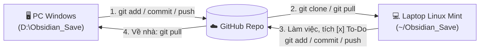

# 💻 Tóm Tắt Bàn Giao & Hướng Dẫn Làm Việc Trên Laptop (Linux Mint)

> [!TIP] Điều Hướng Nhanh
> - 🧭 **Bảng Điều Khiển Chung**: [[00. Tổng quan - Dashboard]]
> - 🎮 **Dự Án Trọng Tâm Hiện Tại**: [[00. Tổng quan - Học & Phát Triển Game 2D & 3D (Godot 4)]]
> - ⚖️ **Quy Chuẩn Vận Hành AI Agent**: [[GEMINI]]

---

## 📌 Tóm Tắt Hiện Trạng Trước Khi Ra Ngoài (Handover Summary)

> [!important] **Dành cho AI Agent trên Laptop Linux Mint:**
> Khi người dùng mở kho lưu trữ (Repository) này trên **Linux Mint**, hãy lưu ý:
> 1. **Chưa có mã nguồn (Source Code) của dự án Game:** Hiện tại kho lưu trữ này chứa **100% hệ thống Hồ sơ Kế hoạch, Kiến trúc, Lộ trình & Checklist trên Obsidian** (bao gồm cả cấu hình `.obsidian/`).
> 2. **Tự động ánh xạ đường dẫn Đa Nền Tảng (Windows $\leftrightarrow$ Linux Mint):**
>    - Trong các tệp `.md` và `GEMINI.md` viết trên PC Windows, đường dẫn gốc đang được ghi là `D:\Obsidian_Save\...`.
>    - Khi chạy trên **Linux Mint**, AI Agent **tự động hiểu đường dẫn gốc tương ứng là thư mục Workspace hiện tại** (ví dụ: `~/Obsidian_Save/...` hoặc `~/Todo_List/...`), tuyệt đối không báo lỗi tìm ổ đĩa `D:\` và luôn dùng dấu gạch chéo `/` chuẩn POSIX.

### Các Hạng Mục Đã Hoàn Tất 100% Trong Obsidian
- [x] **Quy chuẩn gốc `GEMINI.md`**: Thiết lập nguyên tắc **Folder-First Hierarchy** (tách thư mục con cho từng chuyên mục, chỉ để tệp `00. Tổng quan...` ở ngoài cùng) và **Obsidian Living Templates** (YAML Frontmatter, Callout điều hướng, Mermaid, cập nhật liên tục).
- [x] **Cấu hình giao diện `.obsidian/`**: Đã lưu sẵn `app.json` (tắt số dòng), `appearance.json`, `core-plugins.json`, `graph.json` để khi mở trên Linux Mint giữ nguyên trải nghiệm như trên máy bàn.
- [x] **Bộ Hồ Sơ Dự Án `05. Học & Phát Triển Game 2D & 3D (Godot 4)`**:
  - Đã chia thành **5 thư mục chuyên mục** và **8 tệp lộ trình chi tiết**.
  - Đã phân tách rõ 4 nhãn vai trò trong từng checklist: `[Code cùng AI]`, `[Thao tác trên Godot]`, `[Tự soạn nhạc]`, và `[Tạo Asset]`.
  - Đã lồng ghép lộ trình thực hành **Nhạc lý (Music Theory)** gắn liền với 6 mốc làm game (từ nhịp 4/4, vòng hòa âm cơ bản, Pentatonic Loop $\rightarrow$ Adaptive Crossfade, Hợp âm 7 $\rightarrow$ Điệu thức Dorian/Lydian & Leitmotif 3D).

---

## 🐧 Hướng Dẫn Clone & Thiết Lập Nhanh Trên Laptop Linux Mint

### Bước 1 — Clone Kho Lưu Trữ Obsidian Về Máy Linux Mint
Mở Terminal trên Linux Mint và chạy:

```bash
# 1. Cài đặt Git và Git LFS (nếu máy chưa có)
sudo apt update && sudo apt install -y git git-lfs
git lfs install

# 2. Clone kho lưu trữ Obsidian về thư mục cá nhân (qua SSH)
git clone git@github.com:LordV4D3R/Game.git ~/Obsidian_Save
cd ~/Obsidian_Save
```

> [!note] **Mở trong Obsidian trên Linux Mint:**
> Mở ứng dụng **Obsidian** $\rightarrow$ chọn **Open folder as vault** $\rightarrow$ trỏ tới thư mục vừa clone (`~/Obsidian_Save` hoặc thư mục con bên trong). Toàn bộ cấu hình `.obsidian/` sẽ tự động kích hoạt.

### Bước 2 — Cài Đặt Công Cụ Làm Game & Soạn Nhạc Trên Linux Mint (Khi Cần)
Khi bắt đầu bước vào **Giai đoạn 0 (Setup & Pipeline)** trên laptop Linux Mint:

| Nhóm công cụ | Cách cài đặt nhanh trên Linux Mint | Ghi chú cấu hình |
| :--- | :--- | :--- |
| **Godot Engine 4.x** | Tải bản `Godot_v4.x_linux.x86_64` từ trang chủ hoặc qua Flatpak | Nên dùng bản `.x86_64` thực thi trực tiếp để kết nối LSP cổng `6005` mượt nhất (tránh bị sandbox của Flatpak chặn cổng). |
| **Antigravity IDE** | Mở thư mục Code + thư mục Obsidian trong Workspace | Cài 4 extensions: `godot-tools` (`geequlim`), `Error Lens`, `GitLens`, `Markdown All in One`. |
| **DAW Soạn Nhạc** | **REAPER** (có bản Linux native `.tar.xz` cực nhẹ) hoặc **LMMS** / **MuseScore 4** (AppImage/Flatpak) | Cấu hình đầu ra âm thanh trên Linux Mint qua **PipeWire / PulseAudio** hoặc **ALSA** để độ trễ (latency) thấp nhất. |
| **Đồ Họa 2D & 3D** | **Krita**, **Aseprite**, **Blender** (`sudo apt install krita blender` hoặc bản tải trực tiếp) | Phục vụ hậu kỳ Sprite 2D và kiểm tra/gộp Animation `.glb` 3D. |

---

## 🔄 Quy Trình Đồng Bộ 2 Chiều Giữa Laptop (Linux Mint) & PC (Windows)



- **Trước khi đóng máy trên Laptop Linux Mint để về nhà:**
  ```bash
  git add -A
  git commit -m "docs(progress): update checklist and notes from Linux Mint"
  git push
  ```
- **Khi về lại PC Windows:**
  ```powershell
  git pull
  ```

---

## 📋 Prompt Khởi Động Nhanh Khi Mở Antigravity Trên Laptop Linux Mint

Sau khi clone repo về máy Linux Mint, bạn chỉ cần mở Antigravity IDE, gắn thư mục vừa clone vào và gửi đoạn prompt sau:

```markdown
Chào bạn, tôi đang làm việc trên laptop chạy Linux Mint. Tôi vừa clone kho lưu trữ Obsidian này về từ GitHub.

Hãy đọc tệp `GEMINI.md`, `README.md` và tệp tổng quan dự án tại `05. Học & Phát Triển Game 2D & 3D (Godot 4)/00. Tổng quan - Học & Phát Triển Game 2D & 3D (Godot 4).md`.

Lưu ý:
- Tự động ánh xạ mọi đường dẫn Windows (`D:\Obsidian_Save\...`) sang đường dẫn Linux Mint hiện tại của Workspace.
- Hiện tại tôi chưa tạo thư mục code dự án Godot. Hãy kiểm tra hiện trạng hồ sơ và hướng dẫn tôi bắt đầu bước tiếp theo trên Linux Mint.
```
